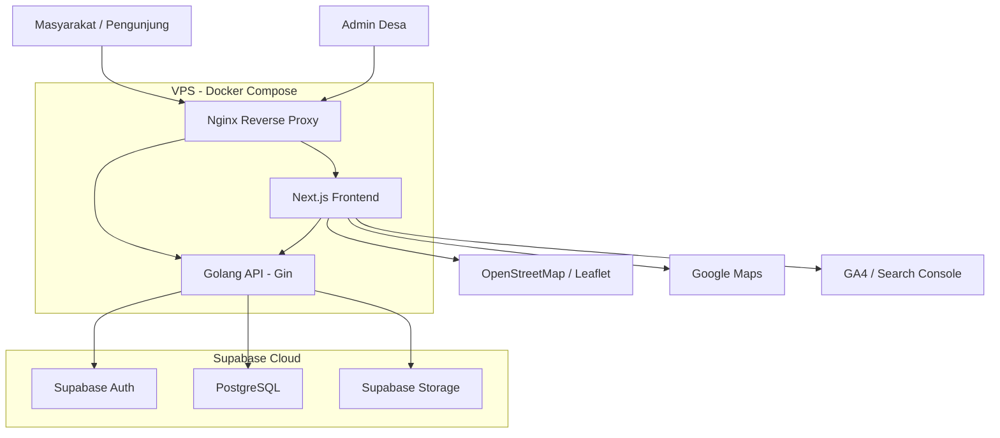
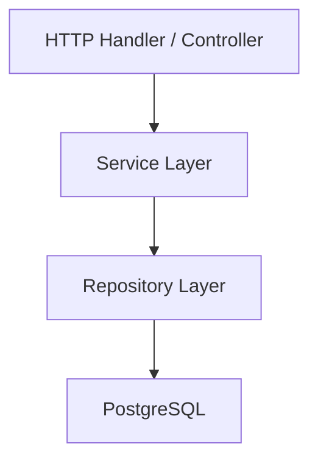
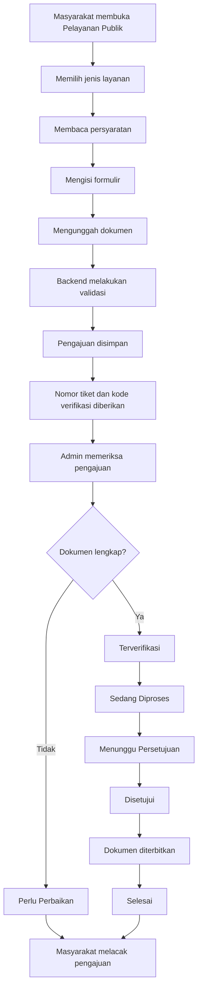

# ARCHITECTURE.md

# WEBSITE DESA LEREP

**Lokasi:** Desa Lerep, Kecamatan Ungaran Barat, Kabupaten Semarang, Jawa Tengah  
**Versi:** 1.2 — Final (Penutupan Celah Data Lapangan)  
**Tanggal:** 8 November 2026 (revisi sinkronisasi 10 November 2026; ADR AR-21–AR-27 11 November 2026)  
**Status:** FINAL — LOCKED  
**Acuan:** PRD v1.1 Final + 70 Keputusan Arsitektur (Q1–Q70) + AR-01–AR-27 + Sinkronisasi PRD–Architecture–Schema  
**Strategi:** Evaluation-First, Production-Ready Later  
**Target Deployment Evaluasi:** 22 November 2026

---

# 1. Architecture Overview

## 1.1 Tujuan

Dokumen ini menjelaskan rancangan teknis dan arsitektur sistem Website Desa Lerep sebagai acuan implementasi frontend, backend, database, infrastruktur, keamanan, integrasi, dan pengujian.

Website dikembangkan dengan dua tujuan:

1. Memenuhi kebutuhan penilaian dan evaluasi berdasarkan kriteria A–H.
2. Menjadi fondasi website resmi Desa Lerep yang dapat dikembangkan untuk kebutuhan jangka panjang.

Arsitektur dirancang agar realistis untuk tim beranggotakan tiga orang dan tetap memungkinkan pengembangan lanjutan tanpa membangun ulang keseluruhan sistem.

## 1.2 Prinsip Arsitektur

- Evaluation-First, Production-Ready Later.
- Modular Monolith pada backend.
- Feature-Based Architecture pada frontend.
- Seluruh akses database melalui Golang API.
- PostgreSQL sebagai sumber data utama.
- Relational Database sebagai fondasi dengan JSONB secara selektif.
- Keamanan dan privasi diterapkan sejak awal.
- Mengutamakan teknologi yang sudah disepakati.
- Memisahkan kebutuhan evaluasi dan pengembangan jangka panjang.
- Tidak menambahkan teknologi atau layanan yang tidak diperlukan.

## 1.3 Technology Stack

| Lapisan             | Teknologi                     |
| ------------------- | ----------------------------- |
| Frontend            | Next.js App Router            |
| Bahasa frontend     | TypeScript                    |
| Styling             | Tailwind CSS                  |
| UI Components       | shadcn/ui + Custom Components |
| Frontend State      | React State + Context API     |
| Form Validation     | React Hook Form + Zod         |
| Backend             | Golang                        |
| HTTP Framework      | Gin                           |
| Database Driver     | pgx / pgxpool                 |
| Database            | Supabase PostgreSQL           |
| Authentication      | Supabase Auth                 |
| File Storage        | Supabase Storage              |
| Database Migration  | golang-migrate                |
| API Documentation   | Swagger/OpenAPI               |
| Map                 | Leaflet + OpenStreetMap       |
| External Navigation | Google Maps                   |
| Reverse Proxy       | Nginx                         |
| Containerization    | Docker                        |
| Orchestration       | Docker Compose                |
| Infrastructure      | VPS                           |
| Testing             | Hybrid Testing                |
| Analytics           | Google Analytics 4            |
| SEO Monitoring      | Google Search Console         |

---

# 2. System Architecture

## 2.1 High-Level Architecture

Sistem menggunakan pendekatan frontend-backend terpisah dengan Supabase Cloud sebagai layanan database, autentikasi, dan penyimpanan file.



## 2.2 Alur Komunikasi

1. Pengunjung mengakses website melalui browser.
2. Nginx menerima request dan meneruskannya ke Next.js atau Golang API.
3. Next.js menampilkan halaman berdasarkan kebutuhan rendering.
4. Frontend mengambil data aplikasi melalui Golang API.
5. Golang memproses logika bisnis dan mengakses PostgreSQL menggunakan pgx.
6. Golang memverifikasi token autentikasi Supabase dan memeriksa hak akses.
7. File dikelola melalui Supabase Storage.
8. Data peta ditampilkan menggunakan Leaflet dan OpenStreetMap.

## 2.3 Prinsip Akses Database

Seluruh akses database aplikasi wajib melewati Golang API.

Frontend tidak diperbolehkan mengakses PostgreSQL secara langsung.

Pengecualian hanya untuk komunikasi autentikasi melalui Supabase Auth SDK sesuai mekanisme autentikasi yang disepakati.

Secret database dan service role key tidak boleh dikirim ke browser.

---

# 3. Application Modules

## 3.1 Modul Utama

Website memiliki delapan modul utama sesuai PRD.

| Modul              | Tanggung Jawab                                                                      |
| ------------------ | ----------------------------------------------------------------------------------- |
| Profil Desa        | Identitas, sejarah, visi misi, struktur pemerintahan, perangkat, dan informasi desa |
| Statistik Desa     | Data kependudukan dan statistik desa                                                |
| Transparansi Desa  | Informasi publik, dokumen, transparansi, dan informasi pembangunan                  |
| Pelayanan Publik   | Katalog layanan, pengajuan, verifikasi, dan pelacakan                               |
| Berita & Informasi | Berita, pengumuman, artikel, dan informasi desa                                     |
| Potensi Desa       | Potensi wilayah, UMKM, dan informasi ekonomi desa                                   |
| Agenda & Kegiatan  | Agenda, kegiatan, acara, dan informasi pelaksanaan                                  |
| Fitur Inovasi      | Fitur pendukung sesuai ruang lingkup inovasi dalam PRD                              |

## 3.2 Fitur Pendukung Lintas Modul

Fitur berikut dipetakan ke modul terkait dan tidak menjadi modul backend terpisah apabila tidak diperlukan:

- Pusat dokumen publik.
- Galeri media.
- Banner pengumuman.
- FAQ.
- Polling.
- Direktori fasilitas publik.
- Direktori lembaga desa.
- Monitoring pembangunan.
- Halaman kontak.
- Ensiklopedia sejarah desa.
- Katalog UMKM sederhana.
- Daftar dusun.
- Pencarian global.
- Berbagi konten melalui media sosial.

## 3.3 Hubungan Antar Modul

Hubungan antarfitur menggunakan relasi langsung, foreign key, dan junction table sesuai kebutuhan.

Contoh:

- Berita dapat terhubung dengan agenda.
- Potensi desa dapat terhubung dengan lokasi.
- Informasi fasilitas dapat terhubung dengan peta.
- Agenda dapat terhubung dengan lokasi kegiatan.
- Konten dapat menggunakan kategori dan tag.
- Halaman pelayanan publik terhubung dengan katalog layanan dan pengajuan.

Tidak menggunakan relasi polymorphic untuk kebutuhan evaluasi.

---

# 4. Frontend Architecture

## 4.1 Framework

Frontend menggunakan Next.js App Router dengan TypeScript dan Feature-Based Architecture.

Struktur folder:

```text
frontend/
├── public/
├── src/
│   ├── app/
│   │   ├── (public)/
│   │   ├── admin/
│   │   ├── login/
│   │   ├── tracking/
│   │   ├── layout.tsx
│   │   └── page.tsx
│   │
│   ├── features/
│   │   ├── village/
│   │   ├── statistics/
│   │   ├── transparency/
│   │   ├── services/
│   │   ├── news/
│   │   ├── potential/
│   │   ├── events/
│   │   └── innovation/
│   │
│   ├── components/
│   │   ├── ui/
│   │   ├── layout/
│   │   ├── navigation/
│   │   └── shared/
│   │
│   ├── lib/
│   │   ├── api/
│   │   ├── auth/
│   │   ├── utils/
│   │   └── validations/
│   │
│   ├── hooks/
│   ├── contexts/
│   ├── types/
│   └── config/
│
├── .env.example
├── package.json
└── next.config.ts
```

## 4.2 Component Architecture

- shadcn/ui menjadi fondasi komponen.
- Tailwind CSS untuk styling.
- Komponen khusus dikembangkan sesuai kebutuhan.
- Komponen umum ditempatkan dalam shared components.
- Komponen yang hanya digunakan satu fitur tetap berada dalam folder fitur tersebut.

## 4.3 Rendering Strategy

Menggunakan Hybrid Rendering.

| Halaman              | Rendering                            |
| -------------------- | ------------------------------------ |
| Homepage             | SSG / ISR                            |
| Profil Desa          | SSG / ISR                            |
| Statistik            | SSG / ISR sesuai kebutuhan pembaruan |
| Berita               | SSG / ISR                            |
| Potensi Desa         | SSG / ISR                            |
| Agenda               | ISR atau dynamic sesuai kebutuhan    |
| Detail konten publik | SSG / ISR                            |
| Login                | Dynamic                              |
| Dashboard Admin      | Dynamic / No Store                   |
| Pengajuan layanan    | Dynamic                              |
| Pelacakan pengajuan  | Dynamic / No Store                   |

Data privat dan halaman admin tidak boleh masuk ke public cache.

## 4.4 Data Fetching

Menggunakan Native Fetch dengan API Client terpusat.

- Server Components mengambil data dari Golang API.
- Client Components menggunakan API Client.
- Next.js built-in cache digunakan untuk data publik.
- Revalidation digunakan untuk memperbarui konten.
- Data admin dan privat tidak menggunakan cache publik.
- Tidak menggunakan TanStack Query.

## 4.5 State Management

Menggunakan React State dan Context API.

State lokal tetap menjadi pilihan utama. Context API hanya digunakan untuk kebutuhan state lintas komponen.

Tidak menggunakan global state management library tambahan.

## 4.6 Form Validation

Pendekatan Hybrid:

- Form sederhana: native HTML dan React.
- Form kompleks: React Hook Form + Zod.
- Backend Golang tetap melakukan validasi ulang.
- Validasi frontend tidak dianggap sebagai pengamanan utama.

## 4.7 Responsive Design

Seluruh halaman publik dan dashboard admin harus mendukung:

- Mobile.
- Tablet.
- Desktop.

Pengujian utama difokuskan pada mobile dan desktop, dengan tablet tetap divalidasi.

Tidak membuat aplikasi mobile terpisah.

## 4.8 UI/UX Standards

- Bahasa utama: Indonesia.
- Tema: Light, Dark, dan System.
- Layout responsif.
- Navigasi konsisten.
- Loading state.
- Error state.
- Empty state.
- Accessibility dasar.
- Kontras dan keterbacaan yang memadai.
- Komponen interaktif yang memiliki feedback jelas.

Tidak membuat accessibility panel khusus pada tahap evaluasi.

Fitur cetak halaman (P1) menggunakan print stylesheet CSS tanpa library tambahan.

## 4.9 Image Handling

Menggunakan Next.js Image.

- File asli disimpan di Supabase Storage.
- Tidak menggunakan CDN atau layanan image transformation eksternal pada tahap evaluasi.
- Optimasi gambar dilakukan sesuai kemampuan Next.js.
- Ukuran dan format gambar disesuaikan dengan kebutuhan halaman.

## 4.10 SEO

Menggunakan Next.js Metadata API.

Mencakup:

- Metadata halaman.
- Dynamic metadata.
- Open Graph.
- Sitemap.
- Robots.
- Canonical URL.
- Structured data (Schema Markup JSON-LD) untuk profil pemerintah desa, artikel berita, dan agenda kegiatan.
- Struktur halaman yang mendukung indeksasi.

Tidak menggunakan library SEO tambahan kecuali memang diperlukan.

## 4.11 Social Sharing

Mendukung:

- WhatsApp.
- Facebook.
- X.
- Copy Link.
- Open Graph metadata.

Tidak menggunakan API untuk mempublikasikan konten secara otomatis ke media sosial.

## 4.12 PWA

PWA dasar berstatus P1 sesuai PRD v1.1 §13.2 dan tidak memblokir deployment evaluasi.

Batasan:

- Tidak ada offline synchronization.
- Tidak ada push notification.
- Tidak ada sinkronisasi data saat offline.

---

# 5. Backend Architecture

## 5.1 Architecture Pattern

Backend menggunakan Modular Monolith dengan Layered Architecture.

Tujuan:

- Struktur kode modular.
- Pemisahan tanggung jawab.
- Mudah diuji dan dipelihara.
- Tidak membutuhkan kompleksitas microservices.
- Memungkinkan pengembangan modul baru.

## 5.2 Framework

- Bahasa: Golang.
- Framework: Gin.
- Database driver: pgx.
- Connection pool: pgxpool.
- API: REST.
- Versioning: `/api/v1`.
- Dokumentasi: Swagger/OpenAPI.

## 5.3 Layer Architecture



Tanggung jawab:

| Layer      | Tanggung Jawab                                   |
| ---------- | ------------------------------------------------ |
| Handler    | HTTP request, response, binding                  |
| Service    | Business logic dan validasi bisnis               |
| Repository | Query dan akses database                         |
| Model      | Struktur data                                    |
| Middleware | Authentication, authorization, logging, security |

## 5.4 Backend Folder Structure

```text
backend/
├── cmd/
│   └── api/
│       └── main.go
│
├── internal/
│   ├── config/
│   ├── database/
│   ├── middleware/
│   ├── platform/
│   │
│   ├── modules/
│   │   ├── village/
│   │   ├── statistics/
│   │   ├── transparency/
│   │   ├── services/
│   │   ├── news/
│   │   ├── potential/
│   │   ├── events/
│   │   └── innovation/
│   │
│   ├── shared/
│   │   ├── response/
│   │   ├── errors/
│   │   ├── pagination/
│   │   ├── validation/
│   │   └── utils/
│   │
│   └── router/
│
├── migrations/
├── docs/
├── scripts/
├── .env.example
├── go.mod
└── go.sum
```

Setiap modul dapat memiliki handler, service, repository, model, dan DTO sesuai kebutuhan.

## 5.5 Database Connection

Menggunakan PostgreSQL melalui pgx dan pgxpool.

- Pool diinisialisasi saat aplikasi berjalan.
- Melakukan ping database saat startup.
- Menggunakan context dan timeout.
- Graceful close ketika aplikasi berhenti.
- Melakukan bounded retry hanya untuk operasi aman.
- Tidak melakukan retry sembarangan pada transaksi.
- Endpoint koneksi dan kebutuhan Supabase Pooler diverifikasi ketika konfigurasi VPS dilakukan.

## 5.6 Query Strategy

Menggunakan raw SQL dengan pgx.

- Query menggunakan parameterized statement.
- Tidak menggabungkan input pengguna langsung ke SQL.
- Tidak menggunakan GORM.
- Tidak menggunakan sqlc.
- Query kompleks ditempatkan pada repository.

## 5.7 Error Handling

Menggunakan centralized error handling.

Alur:

1. Repository mengenali error database.
2. Service menerjemahkan error menjadi business error.
3. Handler mengubah error menjadi HTTP response.
4. Internal error dicatat dalam log yang aman.
5. Detail internal tidak diberikan kepada pengguna.

## 5.8 Transaction Management

Menggunakan manual pgx transaction.

- Transaksi dikelola pada service sesuai kebutuhan.
- Query terkait dilakukan dalam satu transaksi.
- Status pengajuan dan riwayat status harus disimpan dalam transaksi yang sama.
- Operasi database dan Storage tidak dianggap sebagai satu transaksi atomik.
- Kegagalan Storage ditangani dengan cleanup atau compensation.

---

# 6. API Architecture

## 6.1 API Standard

Seluruh endpoint aplikasi menggunakan Golang API.

Base path:

```text
/api/v1
```

Tidak membuat backend data terpisah menggunakan Next.js API Routes.

## 6.2 API Response

Menggunakan Envelope Response.

Contoh sukses:

```json
{
  "success": true,
  "message": "Data berhasil diambil",
  "data": {}
}
```

Contoh error:

```json
{
  "success": false,
  "message": "Terjadi kesalahan",
  "errors": {}
}
```

Pagination menggunakan metadata:

```json
{
  "success": true,
  "message": "Data berhasil diambil",
  "data": [],
  "meta": {
    "page": 1,
    "limit": 10,
    "total": 100,
    "total_pages": 10
  }
}
```

## 6.3 API Documentation

Menggunakan Swagger/OpenAPI dengan `swaggo/swag`.

Dokumentasi mencakup:

- Endpoint.
- HTTP method.
- Request body.
- Response.
- Authentication.
- Error response.
- Pagination.
- Parameter dan validasi.

## 6.4 API Versioning

Menggunakan URL Path Versioning.

Contoh:

```text
/api/v1/news
/api/v1/services
/api/v1/events
```

Perubahan yang tidak kompatibel di masa depan dapat menggunakan `/api/v2`.

## 6.5 API Pagination

Menggunakan server-side pagination dan filtering.

Parameter dapat meliputi:

- page.
- limit.
- search.
- category.
- status.
- date range.
- sort.

Parameter diterapkan sesuai kebutuhan setiap endpoint.

## 6.6 API Timeout and Retry

- Semua request memiliki timeout.
- Retry hanya untuk operasi yang aman atau idempotent.
- Pengajuan layanan tidak boleh otomatis diulang tanpa mekanisme idempotency yang sesuai.
- Tidak melakukan retry tanpa batas.

## 6.7 API Revalidation

Revalidation cache Next.js dilakukan melalui mekanisme server-side yang aman.

Endpoint revalidation tidak boleh dapat dipanggil tanpa autentikasi atau secret yang sesuai.

---

# 7. Authentication and Authorization

## 7.1 Authentication

Menggunakan Supabase Auth.

- Akun admin dibuat manual melalui Supabase Dashboard.
- Tidak ada pendaftaran admin publik.
- Supabase Auth mengelola identitas.
- Golang memverifikasi token sebelum mengizinkan akses endpoint terlindungi.

Verifikasi JWT dilakukan dengan memeriksa signature menggunakan signing key/JWKS Supabase yang tepercaya dan memvalidasi claim yang diperlukan, termasuk issuer, audience, dan expiration.

Verifikasi dilakukan secara lokal menggunakan konfigurasi key yang sesuai, bukan dengan menganggap setiap request harus memanggil endpoint Auth Supabase.

## 7.2 Session Management

Frontend menggunakan Supabase Auth SDK dengan session management Next.js.

Pengelolaan session menggunakan mekanisme cookie yang sesuai dengan pola SSR Supabase dan Next.js.

Token tidak dikelola melalui localStorage sebagai mekanisme utama session.

Access token diteruskan ke Golang API untuk verifikasi.

## 7.3 Authorization

Golang menjadi sumber keputusan otorisasi.

Role awal:

```text
admin
```

Arsitektur disiapkan agar dapat dikembangkan menjadi RBAC.

Frontend tidak boleh menjadi sumber kebenaran role atau hak akses.

Wewenang menyetujui permohonan layanan tidak berasal dari role, melainkan dari mandat persetujuan yang berlaku (lihat §9.7 dan AR-11).

## 7.4 Resident Account

Informasi publik tidak memerlukan login.

Akun masyarakat bersifat opsional dan hanya diperlukan jika layanan tertentu memang mensyaratkannya.

Pelacakan pengajuan dapat dilakukan tanpa akun melalui nomor tiket dan kode verifikasi.

Tidak memaksakan akun masyarakat untuk seluruh layanan.

---

# 8. Database Architecture

## 8.1 Database Platform

Menggunakan Supabase Cloud dengan PostgreSQL managed.

Seluruh akses database aplikasi dilakukan melalui Golang API.

## 8.2 Primary Key

Menggunakan UUID.

Default PostgreSQL:

```sql
gen_random_uuid()
```

User ID mengikuti identitas Supabase Auth.

Nomor tiket pengajuan dibuat terpisah dari UUID internal.

## 8.3 Database Schema Strategy

Menggunakan Hybrid Relational + JSONB.

Relational digunakan untuk:

- Identitas data.
- Primary key dan foreign key.
- Relasi antarentitas.
- Status.
- Kategori.
- Data yang sering dicari dan difilter.
- Audit dan riwayat.

JSONB digunakan secara selektif untuk:

- Konfigurasi form dinamis.
- Atribut yang bervariasi.
- Konfigurasi fitur tertentu.
- Struktur data yang memang fleksibel.

JSONB tidak menggantikan relasi utama.

## 8.4 Naming Convention

Menggunakan Snake Case.

| Elemen      | Standar               |
| ----------- | --------------------- |
| Table       | Plural snake_case     |
| Column      | snake_case            |
| Primary key | id                    |
| Foreign key | `{table_singular}_id` |
| Index       | Prefix konsisten      |
| Constraint  | Prefix konsisten      |

## 8.5 Relationship Strategy

Menggunakan:

- Foreign Key.
- Junction Table.
- Relasi langsung.
- Constraint database.
- Validasi bisnis pada Golang.

Tidak menggunakan polymorphic relation untuk tahap evaluasi.

## 8.6 Index Strategy

Menggunakan Targeted Indexing.

Index diberikan pada:

- Primary key.
- Foreign key.
- Kolom yang sering dicari.
- Kolom yang sering difilter.
- Kolom yang sering diurutkan.

GIN, JSONB index, dan Full Text Search diterapkan hanya jika dibutuhkan.

## 8.7 Migration

Menggunakan `golang-migrate`.

Migration menjadi sumber utama perubahan struktur database.

Perubahan manual melalui SQL Editor hanya untuk inspeksi atau debugging. Perubahan permanen harus disinkronkan ke migration.

## 8.8 Seeding

Menggunakan Hybrid SQL + Golang.

- SQL untuk data referensi dan konfigurasi awal.
- Golang untuk kebutuhan seeding yang memerlukan business logic.
- Admin dibuat manual.
- Seed harus idempotent.

## 8.9 Deletion Strategy

Menggunakan Hybrid Soft Delete dan Hard Delete terkontrol.

- Konten yang dapat dipulihkan menggunakan soft delete.
- `deleted_at` digunakan jika diperlukan.
- Hard delete hanya melalui proses terkontrol.
- Audit log tidak dihapus melalui alur operasional biasa.
- File Storage dikelola sesuai kebijakan penghapusan data.
- Retensi disesuaikan dengan kebutuhan dan ketentuan yang berlaku.

## 8.10 Audit Logging

Menggunakan Application-Level Audit Logging.

Informasi utama:

```text
user_id
action
entity
entity_id
created_at
metadata
```

Audit log mencatat aktivitas penting, terutama:

- Perubahan konten.
- Perubahan konfigurasi.
- Pengajuan layanan.
- Perubahan status.
- Persetujuan dan penyelesaian layanan.
- Penghapusan terkontrol.
- Pemberian, pencabutan, dan penggunaan mandat persetujuan.
- Penerapan gambar tanda tangan scan.
- Pengunggahan, penggantian, dan penghapusan file gambar tanda tangan scan (AR-23).
- Pembuatan akses (signed URL) ke file privat, tanpa menyimpan URL-nya.

Login dan logout admin tidak ditulis ulang oleh aplikasi; jejaknya diambil dari audit log Supabase Auth, yang dapat ditinjau melalui Supabase Dashboard atau dibaca backend untuk tampilan audit di dashboard admin (AR-18).

Audit log tidak boleh menyimpan password, token, kode verifikasi, NIK, signed URL, atau isi dokumen privat.

## 8.11 Data Protection

- Pemisahan data publik dan privat.
- Foreign key dan constraint.
- Validasi aplikasi.
- Pembatasan akses.
- Retensi data.
- Enkripsi selektif pada tingkat aplikasi. NIK yang dikumpulkan wajib dienkripsi (AES-256-GCM) dengan kunci yang hanya berada di environment server dan ditampilkan tersamar kepada admin (AR-16).
- Tidak mengumpulkan NIK kecuali benar-benar diperlukan oleh layanan.

## 8.12 Date and Time

- Timestamp disimpan menggunakan `TIMESTAMPTZ`.
- Tanggal tanpa waktu menggunakan PostgreSQL `DATE`.
- Penyimpanan waktu menggunakan UTC.
- Tampilan menggunakan zona waktu `Asia/Jakarta`.
- Jadwal kegiatan dengan waktu pasti menggunakan `TIMESTAMPTZ`.

## 8.13 Pembaruan `updated_at`

Kolom `updated_at` diperbarui oleh repository Golang pada setiap query UPDATE (`SET updated_at = now()`). Tidak menggunakan trigger database pada tahap evaluasi (AR-15).

---

# 9. Public Service Architecture

## 9.1 Service Request Flow

Alur pengajuan:



## 9.2 Service Catalog

Katalog layanan bersifat dinamis.

Konfigurasi dapat mencakup:

- Nama layanan.
- Deskripsi.
- Persyaratan.
- Status aktif.
- Form fields.
- Jenis dokumen.
- Ketentuan pengajuan.

Perubahan konfigurasi layanan tidak boleh mengubah secara diam-diam persyaratan pengajuan lama. Data pengajuan harus mempertahankan informasi persyaratan atau konfigurasi yang digunakan saat pengajuan dibuat.

## 9.3 Service Request Status

Status yang digunakan:

1. Menunggu Verifikasi.
2. Perlu Perbaikan.
3. Terverifikasi.
4. Sedang Diproses.
5. Menunggu Persetujuan.
6. Disetujui.
7. Selesai.
8. Ditolak.
9. Dibatalkan.

Status Ditolak dan Dibatalkan harus disertai alasan. Alasan tersebut disimpan sebagai catatan publik pada riwayat status sehingga dapat dilihat pemohon melalui pelacakan, dan ditegakkan dengan CHECK constraint database (AR-17).

Status terkini disimpan pada tabel pengajuan.

Setiap perubahan status disimpan dalam tabel riwayat terpisah.

## 9.4 Status History

Tabel konseptual:

`service_request_status_histories`

| Field              | Keterangan                     |
| ------------------ | ------------------------------ |
| id                 | UUID                           |
| service_request_id | Relasi pengajuan               |
| old_status         | Status sebelumnya              |
| new_status         | Status baru                    |
| changed_by         | Admin yang melakukan perubahan |
| notes              | Catatan atau alasan            |
| is_public          | Catatan boleh dilihat pemohon  |
| created_at         | Waktu perubahan                |

Perubahan status dan pencatatan riwayat wajib dilakukan dalam satu transaksi database.

Riwayat tidak boleh dihapus atau dimanipulasi melalui alur operasional biasa.

## 9.5 Tracking Security

Pelacakan menggunakan:

```http
POST /api/v1/services/requests/track
```

Request body berisi nomor tiket dan kode verifikasi.

Ketentuan:

- Kode verifikasi disimpan dalam bentuk hash.
- Kode asli tidak disimpan sebagai plaintext.
- Kode asli diberikan kepada masyarakat ketika pengajuan berhasil.
- Backend membandingkan kode yang dikirim dengan hash tersimpan.
- Percobaan verifikasi dibatasi.
- Kode tidak dimasukkan ke URL.
- Kode tidak dicatat dalam log.
- Nomor tiket saja tidak cukup untuk membuka informasi pengajuan.
- Dokumen privat tidak dapat diakses melalui endpoint tracking publik.
- Kode verifikasi dibuat secara acak kriptografis (minimal 10 karakter alfanumerik tanpa karakter ambigu) dan disimpan sebagai HMAC-SHA256 dengan secret server (pepper) dari environment variable. Perbandingan dilakukan constant-time (AR-14).
- Kolom hash bernama seragam `verification_code_hash` pada pengajuan, pengaduan, dan aspirasi.
- Mekanisme yang sama berlaku untuk pengaduan (`POST /api/v1/complaints/track`) dan aspirasi (`POST /api/v1/aspirations/track`).
- Respons untuk kombinasi tiket/kode yang salah bersifat generik.

## 9.6 Complaint Privacy

Pengaduan tidak boleh anonim.

Pengadu wajib memberikan identitas dan kontak sesuai kebutuhan layanan.

Data pengaduan hanya dapat diakses oleh:

- Pelapor yang berhak.
- Admin yang memiliki otorisasi.

Informasi pengaduan tidak ditampilkan secara publik.

Statistik pengaduan dapat ditampilkan dalam bentuk agregat yang tidak mengungkap identitas atau isi pengaduan pribadi.

## 9.7 Document Generation and Signature

Dokumen PDF dapat dibuat setelah proses dan persetujuan yang berwenang.

**Model persetujuan berbasis penunjukan langsung (AR-11).** Kepala Desa atau Carik menunjuk admin secara langsung, boleh lisan; surat mandat tidak wajib. Admin mencatat penunjukan itu satu kali di dashboard (tabel `service_approval_delegations`): pemberi penunjukan, tanggal mulai, cakupan layanan, izin tanda tangan scan, serta tanggal berakhir dan nomor surat bila ada. Tanggal berakhir kosong berarti berlaku sampai dicabut. Selama penunjukan berlaku dan belum dicabut, admin menyetujui atau menolak permohonan secara langsung tanpa keterlibatan pejabat per permohonan. Pejabat pemberi mandat tidak wajib memiliki akun.

Saat admin mengambil keputusan, Golang memverifikasi dalam satu transaksi bahwa:

- Akun admin adalah penerima mandat yang dirujuk.
- Penunjukan sudah berlaku, belum berakhir (jika ada tanggal berakhir), dan belum dicabut.
- Cakupan mandat mencakup layanan pada permohonan.
- Tidak ada dua mandat aktif yang tumpang tindih untuk admin dan layanan yang sama.

Keputusan, perubahan status, riwayat status, dan audit log ditulis dalam transaksi yang sama.

Gambar hasil scan tanda tangan hanya boleh diterapkan setelah persetujuan tercatat dan hanya jika penunjukan yang menjadi dasar keputusan mencatat izin penggunaan tanda tangan scan.

Gambar scan tanda tangan bukan Tanda Tangan Elektronik tersertifikasi.

**Template dokumen hasil (AR-22).** Tahap evaluasi memakai satu template surat keterangan umum untuk semua layanan yang dibuka secara online: kop surat desa, nomor surat, judul dokumen dari `public_services.output_document_name`, data pemohon, isi yang dibentuk dari `form_data` sesuai layanan, nama dan jabatan pejabat pemberi mandat, serta gambar tanda tangan scan bila diizinkan. Template disimpan sebagai aset kode backend, bukan data database. Dari desa cukup dibutuhkan kop surat, format nomor surat, dan satu contoh surat keterangan yang sudah disamarkan.

**Penyimpanan tanda tangan scan (AR-23).** File gambar tanda tangan disimpan di bucket `private-service-documents` dan dirujuk oleh `village_officials.signature_image_path`. Hanya backend yang membacanya, saat membuat dokumen hasil; path dan file tidak pernah dikirim ke browser.

Integrasi TTE tersertifikasi melalui BSrE atau PSrE merupakan pengembangan lanjutan, bukan implementasi evaluasi.

---

# 10. File Storage Architecture

## 10.1 Storage Platform

Menggunakan Supabase Storage.

Bucket konseptual:

```text
public-media
public-documents
private-service-documents
```

## 10.2 Access Policy

| Bucket                    | Akses                                                                            |
| ------------------------- | -------------------------------------------------------------------------------- |
| public-media              | Publik sesuai kebijakan konten                                                   |
| public-documents          | Publik untuk dokumen yang memang ditetapkan terbuka                              |
| private-service-documents | Privat, hanya melalui otorisasi; juga menyimpan gambar tanda tangan scan (AR-23) |

## 10.3 Upload Flow

Upload dilakukan melalui Golang backend.

1. Frontend mengirim file.
2. Golang memvalidasi ukuran, format, dan jenis file.
3. Golang memeriksa hak akses.
4. File dikirim ke Supabase Storage.
5. Metadata file disimpan di PostgreSQL.
6. Sistem melakukan cleanup apabila proses gagal.

## 10.4 Private File Access

Menggunakan Private Bucket dan Signed URL.

- Backend memverifikasi otorisasi.
- Signed URL memiliki masa berlaku terbatas.
- Masa berlaku awal yang direncanakan sekitar lima menit.
- URL tidak boleh masuk ke log atau respons publik.
- Signed URL tidak boleh dibagikan sebagai pengganti kontrol akses.
- Setiap pembuatan signed URL untuk file privat dicatat di audit log (pengguna, entitas, waktu) tanpa menyimpan URL-nya.

## 10.5 File Validation

Validasi mencakup:

- Ukuran file.
- MIME type.
- Ekstensi.
- Jenis file yang diperbolehkan.
- Nama file yang aman.
- Hak akses.
- Batas ukuran request.

---

# 11. Authentication and Security Architecture

## 11.1 Security Layers

Menggunakan layered security:

1. HTTPS.
2. Nginx reverse proxy.
3. CORS allowlist.
4. Authentication.
5. Authorization.
6. Rate limiting.
7. CAPTCHA dan honeypot pada form publik.
8. Input validation.
9. Request size limits.
10. Security headers.
11. Secure file upload.
12. Safe logging.

## 11.2 CORS

Hanya domain yang diizinkan yang dapat mengakses API dari browser.

Tidak menggunakan wildcard pada production untuk endpoint yang menggunakan credentials.

## 11.3 Rate Limiting

Rate limiting diterapkan terutama pada:

- Login.
- Pelacakan pengajuan, pengaduan, dan aspirasi.
- Pengajuan layanan.
- Form pengaduan dan aspirasi.
- Endpoint publik yang berisiko disalahgunakan.

## 11.4 CAPTCHA

CAPTCHA digunakan pada form publik yang rentan spam atau penyalahgunaan.

Seluruh form publik juga memakai field honeypot tersembunyi; submission yang mengisi honeypot ditolak tanpa pesan error yang menjelaskan alasannya (AR-19).

## 11.5 Authentication Protection

- Login attempt limits.
- Token expiration validation.
- Authorization middleware.
- Tidak ada pendaftaran admin publik.
- Tidak ada kebocoran service role key.

## 11.6 Sensitive Data

- Tidak mengumpulkan NIK tanpa kebutuhan; NIK yang dikumpulkan disimpan terenkripsi (AR-16).
- Tidak menyimpan password secara manual.
- Tidak menyimpan token dalam log.
- Tidak menyimpan kode verifikasi dalam plaintext.
- Dokumen privat tidak boleh diakses publik.
- Data pengaduan tidak boleh muncul pada halaman publik.

## 11.7 Database Access Control (RLS) — Baseline Tahap Evaluasi

Keputusan AR-12:

- RLS diaktifkan pada seluruh tabel aplikasi di schema `public`.
- Privilege tabel aplikasi dicabut dari role `anon` dan `authenticated`, dan tidak ada policy untuk kedua role tersebut. Dengan begitu Supabase Data API tidak dapat membaca atau menulis data aplikasi.
- Golang API terhubung menggunakan role runtime khusus (nama kerja `app_runtime`) yang bukan owner tabel, tidak memiliki `BYPASSRLS`, dan hanya diberi privilege yang diperlukan. Tabel append-only (riwayat status dan `audit_logs`) hanya diberi `SELECT` dan `INSERT`.
- Setiap tabel memiliki satu policy permisif khusus untuk `app_runtime`. Otorisasi per pengguna sepenuhnya ditegakkan di Golang API.
- Kredensial migration/owner terpisah dari kredensial runtime.
- Kompatibilitas role runtime dengan Supabase connection pooler diverifikasi saat konfigurasi VPS (§5.5).
- RLS berbasis identitas pengguna (penerusan klaim JWT per transaksi) ditunda ke pasca-evaluasi.

---

# 12. Maps and Geospatial Architecture

## 12.1 Map Platform

- Leaflet sebagai library peta.
- OpenStreetMap sebagai sumber peta utama.
- Google Maps untuk navigasi eksternal.

Tidak menggunakan Google Maps JavaScript API pada tahap evaluasi.

## 12.2 Geospatial Data

Menggunakan kolom:

```text
latitude
longitude
```

PostGIS tidak digunakan pada tahap evaluasi.

## 12.3 Map Features

Peta dapat menampilkan:

- Lokasi fasilitas desa.
- Lokasi potensi desa.
- Lokasi kegiatan.
- Lokasi informasi publik yang relevan.
- Batas administrasi desa jika data resmi tersedia.

## 12.4 Official Boundary Dependency

Data batas wilayah resmi Desa Lerep menjadi dependensi data.

Data harus berasal dari sumber resmi atau dapat diverifikasi.

Jika data batas resmi belum tersedia, implementasi batas administrasi tidak boleh menggunakan garis hasil perkiraan dan mengklaimnya sebagai batas resmi.

Batas wilayah resmi disimpan sebagai berkas GeoJSON statis di frontend, bukan tabel database. Perubahan data batas memerlukan deployment ulang frontend.

Peta resmi yang hanya tersedia sebagai gambar (misalnya Peta Dasar Desa Lerep program KOTAKU) boleh ditampilkan sebagai gambar di halaman profil, lengkap dengan keterangan sumber, tetapi tidak digambar ulang atau dijiplak menjadi garis batas di Leaflet (AR-27).

Koordinat kantor desa disimpan pada `village_profiles.latitude`/`longitude` dan dipakai untuk peta kontak serta tautan petunjuk arah Google Maps (AR-21).

---

# 13. Search Architecture

## 13.1 Search Engine

Menggunakan PostgreSQL.

Strategi awal:

- ILIKE untuk pencarian sederhana.
- PostgreSQL Full Text Search jika kebutuhan meningkat.
- Filtering.
- Sorting.
- Server-side pagination.

## 13.2 Search Scope

Pencarian dapat diterapkan pada:

- Berita.
- Informasi desa.
- Potensi desa.
- Agenda.
- Pelayanan publik.
- Konten publik lainnya sesuai kebutuhan.

Pencarian global mengarahkan pengguna ke konten yang relevan berdasarkan modul.

---

# 14. Content Management Architecture

## 14.1 Content Status

Menggunakan status:

- Draft.
- Review.
- Published.
- Archived.

Single Admin dapat langsung memublikasikan konten.

Status Review disiapkan untuk kebutuhan multi-admin di masa depan.

Status ini berlaku seragam untuk seluruh konten dengan workflow publikasi: dokumen publik, berita, pengumuman, banner, galeri, potensi, UMKM, agenda, fasilitas, dan proyek pembangunan. Preview adalah tampilan pratinjau, bukan status tersimpan. Pengaturan section beranda tidak memiliki status draft; preview dilakukan di dashboard dari isian formulir sebelum disimpan (AR-20).

## 14.2 Rich Text Editor

Menggunakan Tiptap.

- Structured JSON menjadi format utama.
- Backend melakukan validasi.
- Konten disanitasi.
- Arbitrary HTML dan script tidak diperbolehkan.

## 14.3 Media Management

Admin mengunggah media melalui form.

Media Library khusus tidak menjadi kebutuhan tahap evaluasi.

## 14.4 Content Versioning

Versioning dilakukan secara selektif.

Prioritas:

- Profil desa.
- Dokumen transparansi penting.
- Konten penting lainnya sesuai kebutuhan.

Berita dan agenda menggunakan audit log serta workflow status.

Pemulihan versi hanya diterapkan pada konten prioritas.

## 14.5 Archiving

Menggunakan status Archived dan `deleted_at` sesuai kebutuhan.

Tidak membuat modul arsip terpisah.

---

# 15. Admin Dashboard Architecture

## 15.1 Access

Dashboard hanya dapat diakses oleh admin terautentikasi.

Role awal adalah `admin`.

## 15.2 Dashboard Responsibilities

Dashboard mengelola:

- Profil desa.
- Statistik.
- Transparansi.
- Pelayanan publik.
- Berita.
- Potensi desa.
- Agenda.
- Fitur inovasi.
- Dokumen.
- Media.
- Pengaduan dan aspirasi (aspirasi P1).
- Mandat persetujuan pelayanan.
- Konfigurasi konten.
- Audit log.
- Analitik.

## 15.3 Analytics

GA4 dan Google Search Console digunakan untuk analitik dan pemantauan SEO.

Akses laporan melalui dashboard admin sesuai integrasi yang tersedia.

Tidak membuat sistem analitik internal yang kompleks pada tahap evaluasi.

---

# 16. Notification Architecture

Pada tahap evaluasi, notifikasi menggunakan website saja.

Mencakup informasi status pengajuan melalui halaman pelacakan.

Batasan:

- Tidak ada notifikasi WhatsApp otomatis.
- Tidak ada notifikasi email otomatis.
- Tidak ada push notification.
- Tombol WhatsApp hanya sebagai kontak.
- Email hanya sebagai tautan `mailto` untuk kontak.

---

# 17. Infrastructure Architecture

## 17.1 Deployment Platform

Menggunakan satu VPS dengan Docker Compose.

Container utama:

```text
nginx
frontend
backend
```

Supabase Cloud berada di luar VPS.

## 17.2 Docker Compose

Docker Compose digunakan untuk menjalankan layanan aplikasi.

Nginx bertugas sebagai reverse proxy.

Frontend dan backend berjalan dalam container terpisah.

## 17.3 Deployment Workflow

Deployment dilakukan secara manual melalui SSH.

Urutan:

1. Persiapan perubahan.
2. Build image.
3. Backup sesuai kebutuhan.
4. Jalankan migration secara terkontrol.
5. Deploy container.
6. Periksa health check.
7. Validasi fungsi utama.
8. Rollback jika deployment gagal.

CI/CD belum menjadi kebutuhan tahap evaluasi.

## 17.4 Environment

Menggunakan dua environment:

- Development.
- Production.

Masing-masing memiliki konfigurasi dan Supabase project terpisah.

Tidak melakukan penyalinan data production secara sembarangan ke development.

## 17.5 Environment Variables

Menggunakan:

- `.env.example`.
- `.env.local`.
- `.env`.
- Environment variables production pada VPS.

`NEXT_PUBLIC_` hanya digunakan untuk variabel yang memang aman diakses browser.

Secret database dan service role key hanya berada di server.

## 17.6 Reverse Proxy

Nginx mengatur routing antara frontend dan backend.

HTTPS wajib digunakan pada production.

---

# 18. Caching Architecture

Menggunakan Hybrid Caching.

| Data             | Strategi                       |
| ---------------- | ------------------------------ |
| Konten publik    | Next.js cache / ISR            |
| Profil desa      | ISR                            |
| Berita           | ISR                            |
| Statistik publik | ISR sesuai pembaruan           |
| Dashboard admin  | No Store                       |
| Pengajuan privat | No Store                       |
| Pelacakan        | No Store                       |
| Dokumen privat   | Tidak menggunakan public cache |

Cache publik harus diperbarui setelah perubahan konten yang dipublikasikan.

---

# 19. Background Jobs

Menggunakan pendekatan Hybrid.

Tahap evaluasi:

- Proses dilakukan secara synchronous melalui Golang.
- Tidak menggunakan Redis.
- Tidak menggunakan message queue.
- Tidak membuat worker terpisah.

Background worker dapat dipertimbangkan pada tahap pengembangan selanjutnya jika kebutuhan meningkat.

---

# 20. Logging and Monitoring

## 20.1 Initial Monitoring

Tahap evaluasi menggunakan:

- Basic application logging.
- Health check.
- Error logging.
- Database connection check.

## 20.2 Centralized Monitoring

Centralized monitoring ditunda untuk pengembangan lanjutan.

## 20.3 Logging Security

Log tidak boleh menyimpan:

- Password.
- Access token.
- Service role key.
- Kode verifikasi.
- Signed URL privat.
- Isi dokumen sensitif.
- Informasi pribadi yang tidak diperlukan.

---

# 21. Backup and Recovery

Menggunakan Hybrid Backup Strategy.

Komponen:

1. Backup Supabase Cloud.
2. Independent PostgreSQL `pg_dump`.
3. Backup objek Storage secara terpisah.
4. Salinan backup di luar VPS.
5. Retention policy.
6. Restore test.

Jadwal, retensi, dan prosedur pemulihan ditentukan dalam konfigurasi operasional sebelum penggunaan production jangka panjang.

---

# 22. Testing Architecture

Menggunakan Hybrid Testing.

## 22.1 Backend

- Unit test untuk business logic penting.
- Integration test untuk alur kritis.
- Validasi API.
- Database testing sesuai kebutuhan.

## 22.2 Frontend

- TypeScript.
- Manual testing.
- Vitest.
- React Testing Library untuk logic penting.

## 22.3 Evaluation Testing

Seluruh fitur P0 wajib melalui pengujian fungsional dan validasi sebelum deployment evaluasi.

Fitur P1 dan P2 dapat ditunda jika berisiko menghambat penyelesaian P0.

## 22.4 Quality Standards

Menggunakan:

- ESLint.
- Prettier.
- TypeScript.
- Validasi backend.
- API testing.
- Responsive testing.

Husky dan lint-staged bersifat opsional apabila tidak menghambat alur kerja.

---

# 23. API and Database Reliability

## 23.1 Connection Recovery

Menggunakan Hybrid Recovery Strategy:

- pgxpool.
- Connection timeout.
- Context cancellation.
- Bounded retry.
- Health check.
- Tidak mengulang transaksi secara sembarangan.

## 23.2 Database Constraints

Menggunakan kombinasi:

- NOT NULL.
- UNIQUE.
- CHECK.
- FOREIGN KEY.
- Validasi bisnis pada Golang.

## 23.3 Database Error Strategy

Error diterjemahkan pada service layer dan disampaikan melalui response yang konsisten.

Tidak menampilkan query atau detail internal database kepada pengguna.

---

# 24. Data Synchronization

Development dan production menggunakan:

- Migration yang sama.
- Seed yang sesuai.
- Environment variables terpisah.
- Data development dummy.
- Data production terlindungi.

Perubahan schema harus tercatat pada migration.

Tidak melakukan sinkronisasi data production ke development tanpa prosedur yang aman.

---

# 25. External Integrations

| Integrasi           | Penggunaan          | Status                |
| ------------------- | ------------------- | --------------------- |
| Supabase Auth       | Autentikasi         | Tahap evaluasi        |
| Supabase PostgreSQL | Database            | Tahap evaluasi        |
| Supabase Storage    | File storage        | Tahap evaluasi        |
| OpenStreetMap       | Peta                | Tahap evaluasi        |
| Leaflet             | Rendering peta      | Tahap evaluasi        |
| Google Maps         | Navigasi eksternal  | Tahap evaluasi        |
| GA4                 | Analitik pengunjung | Tahap evaluasi        |
| Search Console      | Pemantauan SEO      | Tahap evaluasi        |
| BSrE/PSrE           | TTE tersertifikasi  | Pengembangan lanjutan |
| Weather API         | Informasi cuaca     | Tidak termasuk        |
| WhatsApp API        | Notifikasi otomatis | Tidak termasuk        |
| Email automation    | Notifikasi otomatis | Tidak termasuk        |

---

# 26. Scalability and Maintainability

Arsitektur menggunakan Modular Monolith untuk menjaga kompleksitas tetap terkendali.

Pengembangan lanjutan dapat mencakup:

- RBAC multi-admin.
- Centralized monitoring.
- Background worker.
- Queue system.
- Integrasi TTE tersertifikasi.
- Peningkatan kemampuan pencarian.
- Optimasi database.
- Peningkatan kapasitas VPS.
- Integrasi tambahan berdasarkan kebutuhan.

Pengembangan tersebut tidak menjadi syarat penyelesaian evaluasi.

---

# 27. Development Priorities

## P0 — Must Have

Seluruh kebutuhan P0 pada PRD menjadi prioritas implementasi.

Tidak boleh ada fitur P0 yang dihilangkan hanya karena keterbatasan waktu tanpa evaluasi dampaknya terhadap kriteria penilaian.

## P1 — Should Have

Dikerjakan setelah kebutuhan P0 aman dan tidak mengancam deadline evaluasi.

## P2 — Future Development

Ditunda untuk pengembangan lanjutan.

Urutan prioritas final mengikuti matriks prioritas dalam PRD v1.1 (pengaduan P0; aspirasi dan PWA dasar P1). Dokumen arsitektur ini tidak mengubah prioritas yang sudah ditetapkan pada PRD.

---

# 28. Team Responsibilities

Tim pengembangan terdiri dari tiga orang.

| Anggota | Tanggung Jawab                |
| ------- | ----------------------------- |
| Andhika | UI/UX dan Frontend            |
| Ilham   | Backend dan Infrastruktur     |
| Rizal   | Riset Data, Integrasi, dan QA |

Koordinasi dilakukan berdasarkan pembagian tanggung jawab tersebut dengan tetap memperhatikan kebutuhan integrasi antarbagian.

---

# 29. Architecture Decision Records (ADR)

Seluruh keputusan Q1–Q70 dipertahankan sebagai dasar arsitektur.

|   Q | Keputusan Final                                       |
| --: | ----------------------------------------------------- |
|  01 | Supabase Cloud Managed                                |
|  02 | Supabase Auth                                         |
|  03 | Supabase Storage                                      |
|  04 | Semua akses database melalui Golang API               |
|  05 | PostgreSQL menggunakan pgx                            |
|  06 | Migration menggunakan golang-migrate                  |
|  07 | Modular Monolith + Layered Architecture               |
|  08 | Gin Framework                                         |
|  09 | Swagger/OpenAPI                                       |
|  10 | Envelope Response                                     |
|  11 | Supabase Auth + Golang Role Authorization             |
|  12 | Admin dibuat manual melalui Supabase Dashboard        |
|  13 | Private Bucket + Signed URL                           |
|  14 | Layered API Security                                  |
|  15 | Docker Compose pada satu VPS                          |
|  16 | Manual deployment melalui SSH                         |
|  17 | Development dan Production terpisah                   |
|  18 | Hybrid Backup Strategy                                |
|  19 | Basic Logging + Health Check terlebih dahulu          |
|  20 | Hybrid Testing                                        |
|  21 | Feature-Based Architecture Next.js                    |
|  22 | Native Fetch + Centralized API Client                 |
|  23 | Supabase Auth SDK + Next.js Session Management        |
|  24 | Hybrid Rendering                                      |
|  25 | React State + Context API                             |
|  26 | Hybrid Validation                                     |
|  27 | Next.js Image                                         |
|  28 | Hybrid Environment Configuration                      |
|  29 | pgxpool                                               |
|  30 | Next.js Built-in Cache + Revalidation                 |
|  31 | Upload melalui Golang Backend                         |
|  32 | Website Notification Only                             |
|  33 | PostgreSQL Search                                     |
|  34 | Hybrid Background Processing                          |
|  35 | shadcn/ui + Tailwind CSS                              |
|  36 | Raw SQL menggunakan pgx                               |
|  37 | Native Fetch + Next.js Cache                          |
|  38 | Native File Input + FormData                          |
|  39 | Hybrid Loading/Error/Empty State                      |
|  40 | TypeScript + Vitest + React Testing Library           |
|  41 | ESLint + Prettier                                     |
|  42 | Next.js Metadata API                                  |
|  43 | Leaflet + OpenStreetMap + Google Maps Link            |
|  44 | Tiptap Rich Text Editor                               |
|  45 | Upload media langsung melalui form                    |
|  46 | Hybrid Content Publishing Workflow                    |
|  47 | Server-Side Pagination & Filtering                    |
|  48 | UTC TIMESTAMPTZ + Asia/Jakarta                        |
|  49 | URL Path Versioning `/api/v1`                         |
|  50 | Hybrid API Timeout and Retry                          |
|  51 | Manual pgx Transaction                                |
|  52 | Application-Level Audit Logging                       |
|  53 | UUID Primary Key                                      |
|  54 | Hybrid Soft Delete + Controlled Hard Delete           |
|  55 | Hybrid Relational + JSONB                             |
|  56 | Targeted Indexing                                     |
|  57 | Hybrid SQL + Golang Seeding                           |
|  58 | Centralized + Contextual Database Error Handling      |
|  59 | Hybrid Connection Recovery                            |
|  60 | Migration + Controlled Manual Database Operations     |
|  61 | Hybrid Database + Application Referential Integrity   |
|  62 | Hybrid Data Protection                                |
|  63 | Relational + Selective JSONB Statistics               |
|  64 | Selective Content Versioning                          |
|  65 | Centralized Shared Master Data                        |
|  66 | Latitude/Longitude tanpa PostGIS pada evaluasi        |
|  67 | Direct FK + Junction Table                            |
|  68 | Hybrid Archiving                                      |
|  69 | Migration + Seed + Separate Environment Configuration |
|  70 | Snake Case Naming Convention                          |

Keputusan tambahan dari audit PRD–Architecture:

| ID    | Keputusan Tambahan                                                                                                                                                                               |
| ----- | ------------------------------------------------------------------------------------------------------------------------------------------------------------------------------------------------ |
| AR-01 | Pelacakan pengajuan menggunakan POST dengan nomor tiket dan kode verifikasi pada request body                                                                                                    |
| AR-02 | Kode verifikasi disimpan dalam bentuk hash dan dilindungi rate limiting                                                                                                                          |
| AR-03 | Riwayat perubahan status pengajuan disimpan dalam tabel terpisah                                                                                                                                 |
| AR-04 | Seluruh endpoint publik dan admin menggunakan Golang API `/api/v1`                                                                                                                               |
| AR-05 | Responsive design untuk mobile, tablet, dan desktop                                                                                                                                              |
| AR-06 | GA4 dan Search Console untuk analitik dan SEO                                                                                                                                                    |
| AR-07 | Data batas wilayah resmi menjadi dependensi peta administrasi                                                                                                                                    |
| AR-08 | Fitur PWA dasar (P1) tanpa offline sync dan push notification                                                                                                                                    |
| AR-09 | Identitas pengadu wajib dan informasi pengaduan bersifat privat                                                                                                                                  |
| AR-10 | Gambar scan tanda tangan hanya digunakan setelah persetujuan tercatat berdasarkan penunjukan dari pejabat berwenang yang tercatat di sistem dan bukan TTE tersertifikasi (diperbarui oleh AR-11) |

Keputusan tambahan dari sinkronisasi PRD–Architecture–Schema (10 November 2026):

| ID    | Keputusan Tambahan                                                                                                                                                                                                                                    |
| ----- | ----------------------------------------------------------------------------------------------------------------------------------------------------------------------------------------------------------------------------------------------------- |
| AR-11 | Persetujuan pelayanan dilakukan admin yang ditunjuk langsung oleh Kepala Desa/Carik (boleh lisan, surat opsional); penunjukan dicatat sekali di `service_approval_delegations`; pejabat tidak menyetujui per permohonan dan tidak wajib memiliki akun |
| AR-12 | RLS baseline evaluasi: deny-all untuk `anon`/`authenticated`, role runtime khusus non-owner tanpa `BYPASSRLS`; RLS berbasis identitas pengguna ditunda                                                                                                |
| AR-13 | Pengaduan P0; aspirasi dan PWA dasar P1 (mengikuti PRD v1.1)                                                                                                                                                                                          |
| AR-14 | Kode verifikasi acak kriptografis, disimpan sebagai HMAC-SHA256 + pepper server, dibandingkan constant-time; kolom seragam `verification_code_hash`                                                                                                   |
| AR-15 | `updated_at` diperbarui oleh repository Golang, tanpa trigger database                                                                                                                                                                                |
| AR-16 | NIK dienkripsi di aplikasi (AES-256-GCM), disimpan sebagai ciphertext, ditampilkan tersamar                                                                                                                                                           |
| AR-17 | Alasan penolakan/pembatalan disimpan sebagai catatan publik dan ditegakkan CHECK constraint                                                                                                                                                           |
| AR-18 | Log login/logout bersumber dari audit log Supabase Auth; audit aplikasi mencatat mandat, approval, tanda tangan scan, dan akses file privat                                                                                                           |
| AR-19 | Honeypot + CAPTCHA pada form publik; Schema Markup JSON-LD; print stylesheet untuk cetak halaman (P1)                                                                                                                                                 |
| AR-20 | Status konten seragam di semua modul (termasuk galeri); preview section beranda dilakukan di dashboard tanpa status draft                                                                                                                             |

Keputusan tambahan dari penutupan celah data lapangan (11 November 2026). Sumber: Laporan Prioritas Kebutuhan Data Revisi 2 dan Dokumentasi Temuan Data Lapangan. Tidak ada fitur atau tabel baru; seluruh kebutuhan sudah ada di PRD v1.1, dan jumlah tabel SCHEMA tetap 66 (SCHEMA v1.9.2). Status: diusulkan tim riset data; berlaku setelah disetujui tim pengembang sesuai §33 dan PRD §20.

| ID    | Keputusan Tambahan                                                                                                                                                                                                                                                                                                                                                                                                                                                                     |
| ----- | -------------------------------------------------------------------------------------------------------------------------------------------------------------------------------------------------------------------------------------------------------------------------------------------------------------------------------------------------------------------------------------------------------------------------------------------------------------------------------------- |
| AR-21 | Data profil yang diminta PRD tetapi belum berkolom disimpan di `village_profiles`: koordinat kantor (`latitude`, `longitude`), `whatsapp_number`, `logo_path`, dan `territory_info` (JSONB informasi wilayah PRF-03). Luas dusun di `hamlets.area_ha`. Semua angka hanya dari sumber resmi desa                                                                                                                                                                                        |
| AR-22 | Dokumen PDF hasil layanan memakai satu template surat keterangan umum; judul per layanan dari `public_services.output_document_name`; template adalah aset kode backend                                                                                                                                                                                                                                                                                                                |
| AR-23 | Gambar tanda tangan scan disimpan privat di bucket `private-service-documents` dan dirujuk `village_officials.signature_image_path`; hanya dibaca backend saat membuat PDF; perubahan dicatat di audit log                                                                                                                                                                                                                                                                             |
| AR-24 | Formulir unduhan layanan disimpan sebagai `public_documents` (PDF) dan ditautkan melalui `public_services.form_document_id`                                                                                                                                                                                                                                                                                                                                                            |
| AR-25 | Jam pelayanan (`office_hours`) dan jam operasional fasilitas (`operating_hours`) memakai satu struktur JSON per hari dengan zona `Asia/Jakarta` (SCHEMA §6.4.1)                                                                                                                                                                                                                                                                                                                        |
| AR-26 | `budget_records.record_type` dibatasi `pendapatan`, `belanja`, `pembiayaan`; kolom `group_name` menampung kelompok/bidang; rincian baris tetap dicocokkan dengan dokumen APBDes resmi                                                                                                                                                                                                                                                                                                  |
| AR-27 | Celah lain ditutup tanpa perubahan schema: status fasilitas di `description`; peta resmi berbentuk gambar ditampilkan sebagai gambar, bukan garis Leaflet; paket wisata dan homestay diringkas di deskripsi potensi Desa Wisata Lerep; agenda berhari pasaran diinput per kejadian setelah tanggal pasti didapat; anggaran HOK di deskripsi proyek; riwayat kepala desa di teks sejarah; statistik kunjungan wisata tidak dimodelkan; program kerja dan kegiatan lembaga tetap ditunda |

---

# 30. Scope Exclusions

Hal-hal berikut tidak termasuk implementasi tahap evaluasi kecuali secara eksplisit sudah masuk dalam scope P0 PRD:

- Microservices.
- Kubernetes.
- Redis.
- Message queue.
- Background worker terpisah.
- Centralized monitoring.
- Automated CI/CD.
- Google Maps JavaScript API.
- PostGIS.
- Weather API.
- Notifikasi WhatsApp otomatis.
- Notifikasi email otomatis.
- Push notification.
- Offline synchronization.
- Marketplace UMKM.
- Registrasi mandiri admin.
- Komentar berita.
- Integrasi TTE tersertifikasi.
- Sistem analitik internal kompleks.

Pengecualian ini menjaga ruang lingkup tetap realistis dan konsisten dengan strategi Evaluation-First.

---

# 31. Dependencies and Configuration

Beberapa informasi operasional harus disediakan sebelum implementasi atau deployment:

1. Domain resmi website.
2. VPS dan akses SSH.
3. Supabase project development.
4. Supabase project production.
5. API credentials dan konfigurasi environment.
6. Data profil dan konten desa.
7. Data statistik resmi.
8. Dokumen transparansi.
9. Data lokasi fasilitas dan potensi desa.
10. Data batas wilayah resmi.
11. Akun admin.
12. Konfigurasi GA4 dan Search Console.
13. Kop surat desa, format nomor surat, dan satu contoh surat keterangan untuk template PDF hasil layanan (AR-22).
14. Logo yang ditetapkan desa untuk website (AR-21).

Nilai konfigurasi seperti endpoint, secret, domain, dan kredensial tidak ditanamkan secara permanen dalam source code.

---

# 32. Final Architecture Validation

Arsitektur ini ditetapkan berdasarkan:

- PRD Website Desa Lerep v1.1 Final.
- Keputusan sinkronisasi AR-11–AR-20 (10 November 2026).
- Keputusan penutupan celah data lapangan AR-21–AR-27 (11 November 2026).
- Seluruh keputusan arsitektur Q1–Q70.
- Hasil PRD–Architecture Consistency Review delapan bagian.
- Batasan tim tiga orang.
- Target deployment evaluasi 22 November 2026.

Validasi utama:

| Aspek                           | Hasil      |
| ------------------------------- | ---------- |
| System & Module Architecture    | Sesuai     |
| Application Flow Architecture   | Disepakati |
| Database Architecture           | Disepakati |
| API Architecture                | Disepakati |
| Security & Privacy Architecture | Disepakati |
| Frontend & UI/UX Architecture   | Disepakati |
| Infrastructure & Integration    | Disepakati |
| Development Readiness           | Disepakati |

---

# 33. Architecture Lock

Dengan disahkannya dokumen ini:

1. `ARCHITECTURE.md` ditetapkan sebagai dokumen arsitektur final versi 1.2 (revisi sinkronisasi melalui ADR AR-11–AR-20 dan penutupan celah data lapangan melalui ADR AR-21–AR-27).
2. Seluruh keputusan Q1–Q70 menjadi acuan teknis implementasi.
3. Keputusan tambahan hasil audit menjadi bagian resmi arsitektur.
4. PRD v1.1 tetap menjadi sumber utama kebutuhan dan ruang lingkup produk.
5. Tidak ada penambahan fitur di luar PRD melalui dokumen arsitektur ini.
6. Perubahan arsitektur setelah penguncian harus memiliki alasan teknis dan dicatat sebagai Architecture Decision Record (ADR) baru.
7. Perubahan yang berdampak pada scope produk harus diperiksa terhadap PRD terlebih dahulu.
8. Target deployment evaluasi tetap 22 November 2026.

**FINAL DECISION**

Website Desa Lerep menggunakan arsitektur Modular Monolith dengan frontend Next.js, backend Golang Gin, PostgreSQL melalui Supabase Cloud, Supabase Auth, Supabase Storage, dan deployment Docker Compose pada satu VPS.

Arsitektur ini menjadi fondasi implementasi tahap evaluasi sekaligus menyediakan ruang pengembangan untuk kebutuhan website desa jangka panjang.

**Dokumen: ARCHITECTURE.md**  
**Versi: 1.2 Final (sinkronisasi 10 November 2026; ADR AR-21–AR-27 11 November 2026)**  
**Status: LOCKED**  
**Tanggal Penguncian: 8 November 2026**
