# SCHEMA.md --- Website Desa Lerep

> **Status:** Draft konsolidasi audit 12 domain + sinkronisasi PRD v1.1/ARCHITECTURE v1.1; belum locked\
> **Versi:** 1.9.2-review\
> **Tanggal:** 11 November 2026 (v1.9.1: 10 November 2026)\
> **Database:** Supabase PostgreSQL\
> **Backend:** Go + Gin\
> **Migration tool:** golang-migrate\
> **Timezone aplikasi:** Asia/Jakarta
>
> Dokumen ini menjadi rancangan skema database aplikasi. Migration SQL
> merupakan sumber kebenaran implementasi setelah dokumen ini ditinjau
> dan disetujui.

---

## 1. Tujuan dan ruang lingkup

Schema ini mendefinisikan struktur penyimpanan data Website Desa Lerep
berdasarkan 12 domain:

1.  Identity, Users & Authorization
2.  Village Profile & Institutions
3.  Village Statistics
4.  Transparency & Public Documents
5.  Public Services & Complaints
6.  News & Information
7.  Village Potential & UMKM
8.  Agenda & Events
9.  Maps & Public Facilities
10. Supporting Content, Media & Website CMS
11. Development & Village Territory
12. System Operations & Governance

Rancangan revisi ini berisi **66 tabel aplikasi dalam model data
lengkap**. Jumlah tersebut adalah hasil pemetaan teknis, bukan angka
tabel yang ditentukan langsung oleh PRD. Tiga tabel Domain B
(`village_institution_programs`, `village_institution_activities`, dan
`village_institution_activity_media`) tetap dicantumkan untuk kesiapan
rancangan, tetapi implementasinya ditunda dan tidak menjadi migration
tahap awal. Tabel internal Supabase Auth, Storage, dan metadata platform
tidak dibuat ulang oleh aplikasi.

### 1.1 Prinsip arsitektur database

- PostgreSQL pada Supabase menjadi relational data store utama.
- Seluruh akses data aplikasi dilakukan melalui Go API (Gin); frontend
  Next.js tidak mengakses database secara langsung.
- Supabase Auth menjadi sumber identitas dan autentikasi.
- Supabase Storage menyimpan file; PostgreSQL hanya menyimpan path dan
  metadata file.
- `golang-migrate` menjadi sumber kebenaran perubahan schema.
- SQL langsung di dashboard hanya untuk inspeksi/debugging terkontrol,
  bukan perubahan schema permanen.
- Desain menggunakan modular monolith dan relasi relasional eksplisit.
- Tidak menggunakan polymorphic foreign key.
- Tidak menggunakan Redis, job queue, PostGIS, atau ORM pada baseline
  awal.
- Raw SQL menggunakan `pgx`.
- Data publik dapat menggunakan caching/ISR di Next.js; aturan akses
  dan validasi tetap di backend.

### 1.2 Batasan scope yang dipertahankan

Tidak dibuat tabel untuk fitur yang dikecualikan dari tahap evaluasi,
antara lain marketplace/transaksi UMKM, checkout/pembayaran, pendaftaran
acara internal, komentar berita, notifikasi WhatsApp/email/push
otomatis, bookmark, dan review publik. Notifikasi website tetap
dimodelkan karena PRD meminta riwayat notifikasi pengajuan; tidak ada
kolom channel pengiriman eksternal. Permission granular belum dimodelkan
karena arsitektur menetapkan satu role awal `admin` dan RBAC sebagai
fondasi pengembangan; matriks permission belum ditentukan. Pendaftaran
acara menggunakan URL eksternal. Batas wilayah desa disimpan sebagai
GeoJSON statis di frontend, bukan tabel database. Kolom koordinat
ditempatkan langsung pada entitas yang memiliki lokasi, bukan membuat
tabel GIS generik, sesuai keputusan arsitektur tanpa PostGIS.

---

## 2. Konvensi database

### 2.1 Naming

---

Elemen Konvensi Contoh

---

Tabel plural `snake_case` `news_articles`

Kolom `snake_case` `published_at`

Primary key `id` `id UUID`

Foreign key `{referenced_entity_singular}_id` `category_id`

Index `idx_{table}_{column}` `idx_news_articles_status`

Unique constraint `uq_{table}_{column}` `uq_roles_name`

Foreign key constraint `fk_{table}_{reference}` `fk_news_articles_category`

Check constraint `chk_{table}_{rule}` `chk_events_time_range`

---

### 2.2 Tipe data

Kebutuhan Tipe

---

ID aplikasi `UUID`
ID akun Supabase Auth `UUID` yang mereferensikan `auth.users(id)`
Tanggal tanpa waktu `DATE`
Timestamp `TIMESTAMPTZ`
Teks pendek `VARCHAR(n)` sesuai batas kolom
Teks panjang `TEXT`
Nilai uang/angka presisi `NUMERIC(p,s)`
Jumlah besar `BIGINT`
Boolean `BOOLEAN`
Data terstruktur fleksibel `JSONB`
Alamat IP `INET`

Semua PK tabel aplikasi menggunakan `DEFAULT gen_random_uuid()`, kecuali
`user_profiles.id` yang identik dengan `auth.users.id`.

### 2.3 Aturan umum

- Gunakan `NOT NULL` untuk data wajib.
- Gunakan `CHECK` untuk batas nilai dan daftar status yang stabil.
- Gunakan `UNIQUE` untuk identitas bisnis yang memang harus unik.
- FK master data umumnya `ON DELETE RESTRICT`.
- FK pengguna pencatat umumnya `ON DELETE SET NULL`.
- `CASCADE` hanya digunakan jika data anak memang tidak bermakna tanpa
  induknya, misalnya tabel junction.
- Jangan menambahkan `deleted_at` ke semua tabel. Gunakan `is_active`
  atau status arsip bila sesuai kebutuhan.
- `updated_at` diperbarui oleh repository Go pada setiap operasi
  UPDATE (`SET updated_at = now()`); default `now()` mengisi nilai saat
  insert. Tidak menggunakan trigger database (keputusan V-13,
  ARCHITECTURE AR-15).
- Semua timestamp disimpan sebagai `TIMESTAMPTZ`; tampilan waktu lokal
  menggunakan `Asia/Jakarta`.
- Nama/slug dinormalisasi dan divalidasi backend. Database tetap
  menegakkan keunikan.
- Nilai uang menggunakan Rupiah sebagai satuan aplikasi; jangan
  menggunakan floating point.

---

## 3. Ringkasan entitas

---

Domain Tabel Jumlah

---

A --- Identity, Users `user_profiles`, `roles`, `user_roles` 3
& Authorization

B --- Village Profile `village_profiles`, 9
& Institutions `village_profile_versions`,  
 `village_officials`, `hamlets`,  
 `village_institutions`,  
 `village_institution_members`,  
 `village_institution_programs`,  
 `village_institution_activities`,  
 `village_institution_activity_media`

C --- Village `statistic_indicators`, 3
Statistics `statistic_periods`,  
 `village_statistics`

D --- Transparency & `document_categories`, 4
Public Documents `public_documents`,  
 `public_document_versions`,  
 `budget_records`

E --- Public `service_categories`, 14
Services, Complaints `public_services`, `service_requests`,
& Participation `service_request_documents`,  
 `service_request_status_histories`,  
 `service_approval_delegations`,  
 `service_request_approvals`,  
 `service_request_result_documents`,  
 `complaints`, `complaint_documents`,  
 `complaint_status_histories`,  
 `aspirations`,  
 `aspiration_status_histories`,  
 `notifications`

F --- News & `news_categories`, `news_articles`, 7
Announcements `news_tags`, `news_article_tags`,  
 `announcements`,  
 `announcement_hamlets`,  
 `news_article_media`

G --- Village `potential_categories`, 5
Potential & UMKM `village_potentials`,  
 `umkm_businesses`, `umkm_products`,  
 `village_potential_media`

H --- Agenda & Events `event_categories`, `events`, 3
`event_media`

I --- Maps & Public `facility_categories`, 2
Facilities `public_facilities`

J --- Supporting `faqs`, `galleries`, `polls`, 12
Content, Media & `poll_options`, `poll_votes`,  
 Website CMS `media_assets`, `gallery_items`,  
 `homepage_sections`,  
 `homepage_banners`, `social_links`,  
 `faq_services`, `faq_documents`

K --- Development & `development_projects`, 3
Village Territory `development_project_updates`,  
 `development_project_media`

L --- System `audit_logs` 1
Operations &  
 Governance

**Total** **66 tabel aplikasi** **66**

---

---

## 4. Relasi antartabel

Diagram berikut merangkum relasi utama. Relasi ke `auth.users` mengarah
ke tabel Supabase Auth yang dikelola platform.

```mermaid
erDiagram
    AUTH_USERS ||--o| USER_PROFILES : profile
    AUTH_USERS ||--o{ USER_ROLES : assigned
    ROLES ||--o{ USER_ROLES : contains

    VILLAGE_PROFILES ||--o{ VILLAGE_PROFILE_VERSIONS : versions
    HAMLETS ||--o{ VILLAGE_OFFICIALS : assigned
    HAMLETS o|--o| VILLAGE_OFFICIALS : head_designation

    STATISTIC_INDICATORS ||--o{ VILLAGE_STATISTICS : measures
    STATISTIC_PERIODS ||--o{ VILLAGE_STATISTICS : period

    DOCUMENT_CATEGORIES ||--o{ PUBLIC_DOCUMENTS : classifies

    SERVICE_CATEGORIES ||--o{ PUBLIC_SERVICES : groups
    PUBLIC_SERVICES ||--o{ SERVICE_REQUESTS : receives
    SERVICE_REQUESTS ||--o{ SERVICE_REQUEST_DOCUMENTS : attachments
    SERVICE_REQUESTS ||--o{ SERVICE_REQUEST_STATUS_HISTORIES : history
    VILLAGE_OFFICIALS ||--o{ SERVICE_APPROVAL_DELEGATIONS : authorizes
    AUTH_USERS ||--o{ SERVICE_APPROVAL_DELEGATIONS : receives
    SERVICE_APPROVAL_DELEGATIONS ||--o{ SERVICE_REQUEST_APPROVALS : basis
    SERVICE_REQUESTS ||--o{ SERVICE_REQUEST_APPROVALS : approvals
    COMPLAINTS ||--o{ COMPLAINT_STATUS_HISTORIES : history

    NEWS_CATEGORIES ||--o{ NEWS_ARTICLES : classifies
    NEWS_ARTICLES ||--o{ NEWS_ARTICLE_TAGS : tagged
    NEWS_TAGS ||--o{ NEWS_ARTICLE_TAGS : assigned

    POTENTIAL_CATEGORIES ||--o{ VILLAGE_POTENTIALS : classifies
    HAMLETS o|--o{ VILLAGE_POTENTIALS : located
    HAMLETS o|--o{ UMKM_BUSINESSES : located
    UMKM_BUSINESSES ||--o{ UMKM_PRODUCTS : offers

    EVENT_CATEGORIES ||--o{ EVENTS : classifies
    HAMLETS o|--o{ EVENTS : located

    FACILITY_CATEGORIES ||--o{ PUBLIC_FACILITIES : classifies
    HAMLETS o|--o{ PUBLIC_FACILITIES : located

    POLLS ||--o{ POLL_OPTIONS : has
    POLLS ||--o{ POLL_VOTES : receives
    POLL_OPTIONS ||--o{ POLL_VOTES : selected

    HAMLETS o|--o{ DEVELOPMENT_PROJECTS : located
    DEVELOPMENT_PROJECTS ||--o{ DEVELOPMENT_PROJECT_UPDATES : updates
```



> Diagram bersifat ringkasan konseptual. Constraint komposit untuk
> kepala dusun dan pilihan polling dijelaskan pada bagian aturan khusus.

### 4.2 Relasi tambahan hasil pemetaan PRD

- `village_institutions` memiliki banyak
  `village_institution_members`, `village_institution_programs`, dan
  `village_institution_activities`; dokumentasi aktivitas ditautkan
  melalui junction media.
- `village_officials.parent_official_id` membentuk hierarki struktur
  organisasi; `hamlets.head_of_hamlet_official_id` tetap dibatasi agar
  menunjuk pejabat dari dusun yang sama.
- `public_documents` memiliki banyak `public_document_versions`;
  `budget_records` dapat merujuk dokumen sumber resmi.
- `service_requests` memiliki riwayat status, delegasi kewenangan
  approval, approval, dokumen hasil, dan notifikasi.
- `complaints` memiliki lampiran privat dan riwayat status.
- `aspirations` memiliki riwayat status tersendiri; aspirasi tidak
  digabung dengan pengaduan.
- `announcements` dapat ditargetkan ke beberapa `hamlets` melalui
  `announcement_hamlets`.
- `media_assets` digunakan oleh `galleries`, berita, potensi, agenda,
  dan dokumentasi proyek melalui relasi eksplisit; tidak ada
  polymorphic FK.
- `faqs` dapat ditautkan ke layanan dan dokumen melalui junction
  table.
- `homepage_sections`, `homepage_banners`, dan `social_links`
  mendukung pengelolaan beranda dan tautan kanal resmi.
- Koordinat tetap berada langsung pada `hamlets`,
  `village_potentials`, `umkm_businesses`, `events`, dan
  `public_facilities`; tidak dibuat tabel `gis_locations` generik.

### 4.1 Relasi ke Supabase Auth

---

Tabel aplikasi Kolom Referensi Delete action

---

`user_profiles` `id` `auth.users(id)` CASCADE

`user_roles` `user_id` `auth.users(id)` RESTRICT

`public_documents` `created_by`, `auth.users(id)` SET NULL
`updated_by`

`public_document_versions` `created_by` `auth.users(id)` SET NULL

`budget_records` `verified_by`, `auth.users(id)` SET NULL
`created_by`,  
 `updated_by`

`village_statistics` `verified_by` `auth.users(id)` SET NULL

`service_requests` `applicant_user_id` `auth.users(id)` SET NULL

`service_request_status_histories` `changed_by` `auth.users(id)` SET NULL

`service_approval_delegations` `delegate_user_id`, `auth.users(id)` RESTRICT / SET
`created_by_user_id`, NULL sesuai kolom
`revoked_by_user_id`

`service_request_approvals` `processed_by_user_id` `auth.users(id)` RESTRICT

`complaints` `reporter_user_id` `auth.users(id)` SET NULL

`complaint_status_histories` `changed_by` `auth.users(id)` SET NULL

`aspirations` `applicant_user_id` `auth.users(id)` RESTRICT

`aspiration_status_histories` `changed_by` `auth.users(id)` SET NULL

`notifications` `user_id` `auth.users(id)` SET NULL

`news_articles` `author_id` `auth.users(id)` SET NULL

`village_potentials` `created_by`, `auth.users(id)` SET NULL
`updated_by`

`umkm_businesses` `created_by`, `auth.users(id)` SET NULL
`updated_by`

`events` `created_by`, `auth.users(id)` SET NULL
`updated_by`

`public_facilities` `created_by`, `auth.users(id)` SET NULL
`updated_by`

`development_projects` `created_by`, `auth.users(id)` SET NULL
`updated_by`

`development_project_updates` `created_by` `auth.users(id)` SET NULL

`galleries` `created_by` `auth.users(id)` SET NULL

`village_institution_members` `created_by` `auth.users(id)` SET NULL

`village_institution_programs` (ditunda) `created_by`, `auth.users(id)` SET NULL
`updated_by`

`village_institution_activities` (ditunda) `created_by` `auth.users(id)` SET NULL

`announcements` `created_by`, `auth.users(id)` SET NULL
`updated_by`

`media_assets` `uploaded_by` `auth.users(id)` SET NULL

`homepage_sections` `updated_by` `auth.users(id)` SET NULL

`homepage_banners` `created_by`, `auth.users(id)` SET NULL
`updated_by`

`social_links` `updated_by` `auth.users(id)` SET NULL

`audit_logs` `user_id` `auth.users(id)` SET NULL

---

---

## 5. Definisi tabel per domain

Kolom yang tidak disebutkan sebagai nullable harus dianggap `NOT NULL`.
Semua tabel dengan `id` menggunakan UUID PK dan
`DEFAULT gen_random_uuid()`, kecuali dinyatakan lain.

### A. Identity, Users & Authorization

#### A.1 `user_profiles`

---

Kolom Tipe Null Default / aturan

---

`id` UUID No PK, FK →
`auth.users.id`,
`ON DELETE CASCADE`

`full_name` VARCHAR(150) Yes ---

`avatar_path` TEXT Yes Path Supabase
Storage, bukan URL
permanen

`created_at` TIMESTAMPTZ No `now()`

`updated_at` TIMESTAMPTZ No `now()`

---

Satu akun Auth memiliki maksimal satu profil aplikasi. Pembuatan profil
mengikuti lifecycle akun Auth; tidak ada kolom password.

#### A.2 `roles`

Kolom Tipe Null Default / aturan

---

`id` UUID No PK
`name` VARCHAR(50) No UNIQUE, lowercase snake_case
`description` TEXT Yes ---
`is_active` BOOLEAN No `TRUE`
`created_at` TIMESTAMPTZ No `now()`
`updated_at` TIMESTAMPTZ No `now()`

Seed awal hanya role `admin`. Role yang sudah digunakan dinonaktifkan,
bukan dihapus.

#### A.3 `user_roles`

Kolom Tipe Null Default / aturan

---

`id` UUID No PK
`user_id` UUID No FK → `auth.users.id`, RESTRICT
`role_id` UUID No FK → `roles.id`, RESTRICT
`created_at` TIMESTAMPTZ No `now()`

Constraint: `UNIQUE(user_id, role_id)`. Index tambahan pada `role_id`;
unique index gabungan sudah melayani pencarian yang diawali `user_id`.

**Batas makna:** `roles` dan `user_roles` mengatur akses teknis akun ke
website, bukan bukti formal rekomendasi/penunjukan pegawai oleh Kepala
Desa atau Carik dan bukan pula mandat persetujuan pelayanan. Pada tahap
evaluasi hanya role `admin` yang di-seed untuk satu admin awal dengan
cakupan pengelolaan seluruh modul. Pemisahan role seperti Admin
Administrasi dan Admin Berita ditunda sampai hasil evaluasi dan
kebutuhan kewenangan ditetapkan. Rekomendasi untuk membantu pekerjaan
administratif tidak otomatis memberikan kewenangan approval.

### B. Village Profile & Institutions

#### B.1 `village_profiles`

---

Kolom Tipe Null Default / aturan

---

`id` UUID No PK

`singleton_key` BOOLEAN No `TRUE`; CHECK
TRUE + UNIQUE
untuk singleton

`village_name` VARCHAR(150) No ---

`village_code` VARCHAR(30) Yes ---

`district_name` VARCHAR(150) No ---

`regency_name` VARCHAR(150) No ---

`province_name` VARCHAR(150) No ---

`postal_code` VARCHAR(10) Yes ---

`address` TEXT Yes ---

`phone` VARCHAR(30) Yes Kontak resmi
desa

`email` VARCHAR(255) Yes Email resmi desa

`office_hours` JSONB Yes Jam pelayanan;
struktur
divalidasi Go

`website_url` TEXT Yes ---

`whatsapp_number` VARCHAR(30) Yes Nomor WhatsApp
resmi desa (PRD
§5.4.9, §6.10);
bukan nomor
pribadi tanpa
izin

`latitude` NUMERIC(10,7) Yes Koordinat kantor
desa; -90 sampai
90

`longitude` NUMERIC(10,7) Yes Koordinat kantor
desa; -180 sampai
180

`logo_path` TEXT Yes Storage path logo
yang ditetapkan
desa

`territory_info` JSONB Yes Informasi wilayah
PRF-03; struktur
§6.4.2, divalidasi
Go

`history` TEXT Yes ---

`vision` TEXT Yes ---

`mission` TEXT Yes ---

`created_at` TIMESTAMPTZ No `now()`

`updated_at` TIMESTAMPTZ No `now()`

---

Aturan: hanya satu profil desa utama. `singleton_key` merupakan kolom
teknis yang ditegakkan dengan `CHECK(singleton_key IS TRUE)` dan
`UNIQUE(singleton_key)`. Dengan demikian, aturan singleton sudah menjadi
bagian definisi kolom dan tidak tertinggal sebagai catatan saja.
Perubahan penting membuat snapshot di `village_profile_versions` dalam
transaksi yang sama.

Kolom tambahan v1.9.2 (ARCHITECTURE AR-21): `latitude`/`longitude`
adalah titik kantor desa untuk peta lokasi kantor dan petunjuk arah
Google Maps (PRD §5.4.9); keduanya harus NULL bersama-sama atau terisi
bersama-sama dan berada pada rentang valid, sama seperti kolom koordinat
lain. `whatsapp_number` hanya berisi nomor yang dinyatakan desa sebagai
kanal resmi. `logo_path` mengikuti kebijakan gambar konten §6.5.1 (SVG
ditolak). `territory_info` menampung informasi lokasi dan wilayah PRF-03
yang tidak membutuhkan relasi; CHECK
`territory_info IS NULL OR jsonb_typeof(territory_info) = 'object'`.
Setiap angka di dalamnya hanya diisi dari sumber resmi desa (PRD §14).

#### B.2 `village_profile_versions`

---

Kolom Tipe Null Default / aturan

---

`id` UUID No PK

`village_profile_id` UUID No FK →
`village_profiles.id`,
RESTRICT

`version_number` INTEGER No \> 0

`snapshot` JSONB No Harus JSON object

`change_summary` TEXT Yes ---

`created_at` TIMESTAMPTZ No `now()`

---

Constraint: `UNIQUE(village_profile_id, version_number)`,
`CHECK(version_number > 0)`, `CHECK(jsonb_typeof(snapshot) = 'object')`.
Snapshot lama immutable melalui operasi normal aplikasi. Snapshot memuat
nilai profil yang relevan, tidak menyimpan ulang ID versi dan timestamp
teknis.

#### B.3 `village_officials`

---

Kolom Tipe Null Default / aturan

---

`id` UUID No PK

`hamlet_id` UUID Yes FK → `hamlets.id`,
RESTRICT

`full_name` VARCHAR(150) No ---

`position` VARCHAR(100) No ---

`duties` TEXT Yes Tugas dan fungsi; dapat
diisi sesuai data resmi

`public_contact` VARCHAR(100) Yes Kontak publik hanya jika
diizinkan

`parent_official_id` UUID Yes FK self-reference →
`village_officials.id`,
SET NULL; struktur
organisasi

`sort_order` INTEGER No `0`, \>= 0

`photo_path` TEXT Yes Storage path

`signature_image_path` TEXT Yes Path private
Storage gambar
tanda tangan scan;
hanya untuk pejabat
pemberi mandat

`term_start_date` DATE Yes ---

`term_end_date` DATE Yes \>= `term_start_date`
bila keduanya ada

`is_active` BOOLEAN No `TRUE`

`created_at` TIMESTAMPTZ No `now()`

`updated_at` TIMESTAMPTZ No `now()`

---

Tambahkan `UNIQUE(id, hamlet_id)` sebagai target composite FK kepala
dusun. `parent_official_id` tidak boleh menunjuk baris itu sendiri.
Pejabat lama dipertahankan dengan `is_active = FALSE`, bukan dihapus.

`signature_image_path` (v1.9.2, ARCHITECTURE AR-23) menunjuk object di
bucket `private-service-documents`, bukan bucket publik. Kolom ini tidak
pernah dikirim melalui endpoint publik; backend hanya membacanya saat
membuat dokumen hasil layanan yang approval-nya memakai mandat dengan
`allows_signature_scan = TRUE` dan `authorized_official_id` pejabat ini.
Format mengikuti baris "Gambar tanda tangan scan" pada §6.5.1. Pengisian,
penggantian, dan penghapusan path dicatat di `audit_logs` tanpa
menyimpan signed URL.

#### B.4 `hamlets`

---

Kolom Tipe Null Default / aturan

---

`id` UUID No PK

`name` VARCHAR(100) No Unik setelah
normalisasi

`description` TEXT Yes ---

`address` TEXT Yes ---

`latitude` NUMERIC(10,7) Yes -90 sampai 90

`longitude` NUMERIC(10,7) Yes -180 sampai 180

`head_of_hamlet_official_id` UUID Yes Composite FK ke
`village_officials`

`photo_path` TEXT Yes Storage path

`area_ha` NUMERIC(10,2) Yes Luas dusun (ha),
\>= 0; hanya dari
sumber resmi

`is_active` BOOLEAN No `TRUE`

`created_at` TIMESTAMPTZ No `now()`

`updated_at` TIMESTAMPTZ No `now()`

---

Constraint koordinat: keduanya harus NULL bersama-sama atau terisi
bersama-sama; latitude dan longitude harus berada pada rentang valid.
Nama dusun harus unik setelah normalisasi melalui backend dan
constraint/index yang sesuai. Jumlah penduduk tidak disimpan pada
`hamlets`; sumber angka agregat penduduk berada pada
`village_statistics` dan hanya diisi berdasarkan sumber resmi.
`area_ha` (v1.9.2, AR-21) memiliki CHECK `area_ha IS NULL OR area_ha >= 0`;
nilai dari GeoJSON kerja tim riset tidak dipakai sebelum sumbernya
dikonfirmasi desa.

#### B.5 `village_institutions`

Kolom Tipe Null Default / aturan

---

`id` UUID No PK
`name` VARCHAR(150) No Unik setelah normalisasi
`description` TEXT Yes Fungsi lembaga
`logo_path` TEXT Yes Storage path
`contact` VARCHAR(100) Yes Kontak resmi lembaga
`is_active` BOOLEAN No `TRUE`
`created_at` TIMESTAMPTZ No `now()`
`updated_at` TIMESTAMPTZ No `now()`

Struktur dan riwayat kepengurusan disimpan sebagai baris
`village_institution_members` dengan periode jabatan; program kerja
disimpan pada `village_institution_programs`. Detail akhir mengikuti
data resmi yang tersedia.

#### B.6 `village_institution_members`

---

Kolom Tipe Null Default / aturan

---

`id` UUID No PK

`institution_id` UUID No FK →
`village_institutions.id`,
RESTRICT

`full_name` VARCHAR(150) No ---

`position` VARCHAR(100) No Jabatan dalam lembaga

`contact` VARCHAR(100) Yes Hanya kontak yang boleh
dipublikasikan

`photo_path` TEXT Yes Storage path

`term_start_date` DATE Yes ---

`term_end_date` DATE Yes \>= `term_start_date` bila
keduanya ada

`sort_order` INTEGER No `0`, \>= 0

`is_active` BOOLEAN No `TRUE`

`created_by` UUID Yes FK → `auth.users.id`, SET
NULL

`created_at` TIMESTAMPTZ No `now()`

`updated_at` TIMESTAMPTZ No `now()`

---

Riwayat kepengurusan dipertahankan melalui periode keanggotaan; jangan
menimpa pengurus lama ketika periode berakhir.

#### B.7 `village_institution_programs`

---

Kolom Tipe Null Default / aturan

---

`id` UUID No PK

`institution_id` UUID No FK →
`village_institutions.id`,
RESTRICT

`name` VARCHAR(200) No ---

`description` TEXT Yes ---

`start_date` DATE Yes ---

`end_date` DATE Yes \>= `start_date` bila
keduanya ada

`status` VARCHAR(30) No `planned`, `ongoing`,
`completed`, `cancelled`;
CHECK constraint dan
validasi Go

`created_by` UUID Yes FK → `auth.users.id`, SET
NULL

`updated_by` UUID Yes FK → `auth.users.id`, SET
NULL

`created_at` TIMESTAMPTZ No `now()`

`updated_at` TIMESTAMPTZ No `now()`

---

CHECK `status IN ('planned', 'ongoing', 'completed', 'cancelled')`.
Kosakata status program yang disepakati untuk schema: `planned`
(direncanakan), `ongoing` (sedang berjalan), `completed` (selesai), dan
`cancelled` (dibatalkan). Terapkan CHECK constraint pada kolom `status`
dan validasi Go. Status pelaksanaan ini terpisah dari lifecycle
publikasi konten; jangan mencampur `draft`/`published` ke kolom ini.

#### B.8 `village_institution_activities`

---

Kolom Tipe Null Default / aturan

---

`id` UUID No PK

`institution_id` UUID No FK → `village_institutions.id`,
RESTRICT

`program_id` UUID Yes FK →
`village_institution_programs.id`,
RESTRICT

`title` VARCHAR(200) No ---

`description` TEXT Yes ---

`activity_date` DATE Yes ---

`created_by` UUID Yes FK → `auth.users.id`, SET NULL

`created_at` TIMESTAMPTZ No `now()`

`updated_at` TIMESTAMPTZ No `now()`

---

Tabel ini menyimpan dokumentasi aktivitas lembaga. Media kegiatan
ditautkan melalui `village_institution_activity_media`; program dapat
NULL bila kegiatan tidak berada di bawah program kerja tertentu.

#### B.9 `village_institution_activity_media`

---

Kolom Tipe Null Default / aturan

---

`activity_id` UUID No PK bagian, FK →
`village_institution_activities.id`,
CASCADE

`media_asset_id` UUID No PK bagian, FK → `media_assets.id`,
RESTRICT

`sort_order` INTEGER No `0`, \>= 0

`created_at` TIMESTAMPTZ No `now()`

---

PK komposit `(activity_id, media_asset_id)`. Migration junction ini
dibuat setelah `media_assets` tersedia. **Status implementasi:**
`village_institution_programs`, `village_institution_activities`, dan
`village_institution_activity_media` ditunda dari tahap awal; definisi
tetap dipertahankan dalam model lengkap untuk evaluasi/pengembangan
lanjutan. Jangan membuat migration atau UI ketiga tabel ini pada tahap
awal tanpa keputusan scope baru.

### C. Village Statistics

#### C.1 `statistic_indicators`

Kolom Tipe Null Default / aturan

---

`id` UUID No PK
`name` VARCHAR(150) No ---
`code` VARCHAR(100) No UNIQUE, lowercase snake_case
`description` TEXT Yes ---
`unit` VARCHAR(50) Yes Contoh: jiwa, rumah_tangga, persen
`is_active` BOOLEAN No `TRUE`
`created_at` TIMESTAMPTZ No `now()`
`updated_at` TIMESTAMPTZ No `now()`

Kode indikator stabil; indikator yang sudah direferensikan tidak
dihapus.

#### C.2 `statistic_periods`

---

Kolom Tipe Null Default / aturan

---

`id` UUID No PK

`name` VARCHAR(100) No ---

`period_type` VARCHAR(30) No annual,
semester,
quarterly,
monthly, custom

`start_date` DATE No ---

`end_date` DATE No \>= `start_date`

`is_active` BOOLEAN No `TRUE`

`created_at` TIMESTAMPTZ No `now()`

`updated_at` TIMESTAMPTZ No `now()`

---

Constraint database:
`CHECK (period_type IN ('annual', 'semester', 'quarterly', 'monthly', 'custom'))`,
`CHECK (end_date >= start_date)`, dan
`UNIQUE (period_type, start_date, end_date)`. Validasi kesesuaian
tanggal dengan `period_type` (misalnya batas kuartal/bulan) tetap
dilakukan di Go. Periode yang telah dipakai tidak dihapus.

#### C.3 `village_statistics`

---

Kolom Tipe Null Default / aturan

---

`id` UUID No PK

`indicator_id` UUID No FK → `statistic_indicators.id`,
RESTRICT

`period_id` UUID No FK → `statistic_periods.id`, RESTRICT

`hamlet_id` UUID Yes FK → `hamlets.id`, RESTRICT; untuk
distribusi per dusun bila tersedia

`dimension_key` VARCHAR(80) Yes Dimensi, mis.
gender/age_group/education/occupation

`dimension_value` VARCHAR(120) Yes Nilai dimensi; bersama `dimension_key`

`value` NUMERIC(18,2) No \>= 0

`source` VARCHAR(255) Yes ---

`notes` TEXT Yes ---

`verified_at` TIMESTAMPTZ Yes ---

`verified_by` UUID Yes FK → `auth.users.id`, SET NULL

`created_at` TIMESTAMPTZ No `now()`

`updated_at` TIMESTAMPTZ No `now()`

---

Constraint: `CHECK (value >= 0)`; `dimension_key` dan `dimension_value`
harus sama-sama NULL atau sama-sama terisi; jika terisi, keduanya tidak
boleh berupa string kosong/whitespace. Sentinel UUID
`00000000-0000-0000-0000-000000000000` dilarang sebagai `hamlet_id`
aktual melalui CHECK. Terapkan unique expression index untuk kombinasi
`(indicator_id, period_id, COALESCE(hamlet_id, sentinel_uuid), COALESCE(dimension_key, ''), COALESCE(dimension_value, ''))`
agar kombinasi NULL tetap unik; uji index pada PostgreSQL Supabase
target. Data agregat; data per dusun hanya diisi jika sumber resmi
tersedia. Go memvalidasi nilai integer untuk indikator yang satuannya
tidak menerima pecahan. `verified_at` boleh tetap terisi ketika
`verified_by` menjadi NULL akibat penghapusan akun
(`ON DELETE SET NULL`); jangan gunakan CHECK yang mewajibkan keduanya
selalu berpasangan karena akan menggagalkan penghapusan akun
terverifikasi.

### D. Transparency & Public Documents

#### D.1 `document_categories`

Kolom Tipe Null Default / aturan

---

`id` UUID No PK
`name` VARCHAR(100) No Unik setelah normalisasi
`slug` VARCHAR(120) No UNIQUE, lowercase kebab-case
`description` TEXT Yes ---
`is_active` BOOLEAN No `TRUE`
`created_at` TIMESTAMPTZ No `now()`
`updated_at` TIMESTAMPTZ No `now()`

#### D.2 `public_documents`

---

Kolom Tipe Null Default / aturan

---

`id` UUID No PK

`category_id` UUID No FK →
`document_categories.id`,
RESTRICT

`title` VARCHAR(200) No ---

`slug` VARCHAR(220) No UNIQUE

`description` TEXT Yes ---

`file_path` TEXT No Storage path

`original_filename` VARCHAR(255) No ---

`mime_type` VARCHAR(100) No `application/pdf`

`file_size` BIGINT No \> 0 dan maksimal
10.485.760 byte pada
kebijakan upload awal

`document_number` VARCHAR(100) Yes ---

`document_date` DATE Yes ---

`published_at` TIMESTAMPTZ Yes Wajib saat published

`status` VARCHAR(30) No draft, review, published,
archived

`created_by` UUID Yes FK → `auth.users.id`, SET
NULL

`updated_by` UUID Yes FK → `auth.users.id`, SET
NULL

`created_at` TIMESTAMPTZ No `now()`

`updated_at` TIMESTAMPTZ No `now()`

---

File hanya PDF (`application/pdf`) pada versi awal dengan batas maksimal
10 MiB (10.485.760 byte) per file. Pengelompokan tahun menggunakan
`document_date` bila tersedia; bila tidak ada, UI dapat menggunakan
tahun `published_at` dan harus menandai sumber tanggalnya dengan jelas.
Backend memeriksa MIME, ekstensi, ukuran, dan isi file; jangan hanya
mempercayai `Content-Type` dari klien. Hanya dokumen berstatus published
yang dapat diakses publik. File disimpan di bucket yang sesuai dengan
kebijakan akses dokumen publik.

#### D.3 `public_document_versions`

---

Kolom Tipe Null Default / aturan

---

`id` UUID No PK

`public_document_id` UUID No FK →
`public_documents.id`,
RESTRICT

`version_number` INTEGER No \> 0

`file_path` TEXT No Storage path versi
dokumen

`original_filename` VARCHAR(255) No ---

`mime_type` VARCHAR(100) No `application/pdf`

`file_size` BIGINT No \> 0; maksimal
10.485.760 byte

`change_summary` TEXT Yes ---

`created_by` UUID Yes FK → `auth.users.id`,
SET NULL

`created_at` TIMESTAMPTZ No `now()`

---

Constraint: `UNIQUE(public_document_id, version_number)`. Dipakai untuk
dokumen transparansi penting sesuai selective versioning Architecture;
bukan seluruh dokumen harus memiliki banyak versi.

#### D.4 `budget_records`

---

Kolom Tipe Null Default / aturan

---

`id` UUID No PK

`fiscal_year` SMALLINT No Tahun anggaran

`record_type` VARCHAR(30) No `pendapatan`,
`belanja`,
`pembiayaan`; CHECK
(v1.9.2)

`group_name` VARCHAR(150) Yes Kelompok/bidang
induk sesuai
dokumen resmi
(v1.9.2)

`category_name` VARCHAR(150) No Nama kategori/baris
sesuai sumber resmi

`description` TEXT Yes ---

`budget_amount` NUMERIC(18,2) Yes \>= 0; nilai anggaran

`realized_amount` NUMERIC(18,2) Yes \>= 0; nilai realisasi

`source_document_id` UUID Yes FK →
`public_documents.id`,
RESTRICT

`source_reference` VARCHAR(255) Yes Referensi dokumen resmi
bila diperlukan

`verified_at` TIMESTAMPTZ Yes ---

`verified_by` UUID Yes FK → `auth.users.id`,
SET NULL

`created_by` UUID Yes FK → `auth.users.id`,
SET NULL

`updated_by` UUID Yes FK → `auth.users.id`,
SET NULL

`created_at` TIMESTAMPTZ No `now()`

`updated_at` TIMESTAMPTZ No `now()`

---

Angka hanya boleh dipublikasikan jika dapat ditelusuri ke dokumen resmi.
`budget_amount` dan `realized_amount` nullable untuk membedakan nilai
yang belum tersedia dari nol; keduanya memiliki CHECK \>= 0. Taksonomi
`record_type` dan granularitas baris anggaran harus mengikuti format
APBDes/dokumen resmi yang benar-benar diterima; jangan seed kategori
atau angka rekaan.

**Taksonomi v1.9.2 (ARCHITECTURE AR-26, V-01 sebagian):**
`CHECK (record_type IN ('pendapatan','belanja','pembiayaan'))`.
`group_name` menyimpan tingkat kelompok atau bidang (misalnya
"Pendapatan Transfer" atau "Bidang Pelaksanaan Pembangunan Desa"),
dan `category_name` menyimpan rincian di bawahnya. Struktur dua tingkat
ini diambil dari infografis APBDes 2024 dan Realisasi 2023 yang
diterima dari desa. Daftar nilai `group_name` dan rincian baris tetap
dicocokkan dengan dokumen APBDes resmi sebelum seed; nilai infografis
bukan sumber angka publikasi. Tambahkan index
`(fiscal_year, record_type, group_name)` untuk ringkasan per bidang.

**Keputusan V-15:** `verified_by`
menggunakan `ON DELETE SET NULL` tanpa CHECK pasangan; `verified_at`
boleh tetap terisi setelah akun verifier dihapus, sama dengan
`village_statistics`.

### E. Public Services & Complaints

#### E.1 `service_categories`

Kolom Tipe Null Default / aturan

---

`id` UUID No PK
`name` VARCHAR(100) No Unik setelah normalisasi
`slug` VARCHAR(120) No UNIQUE, lowercase kebab-case
`description` TEXT Yes ---
`is_active` BOOLEAN No `TRUE`
`created_at` TIMESTAMPTZ No `now()`
`updated_at` TIMESTAMPTZ No `now()`

#### E.2 `public_services`

---

Kolom Tipe Null Default / aturan

---

`id` UUID No PK

`category_id` UUID No FK →
`service_categories.id`,
RESTRICT

`name` VARCHAR(150) No ---

`slug` VARCHAR(170) No UNIQUE

`description` TEXT Yes ---

`service_type` VARCHAR(30) No direct, facilitation,
referral; klasifikasi
layanan PRD

`procedure_text` TEXT Yes Prosedur/SOP bila tersedia

`external_reference_url` TEXT Yes Tautan instansi rujukan
bila relevan

`requirements` JSONB No JSON array

`form_schema` JSONB Yes JSON object

`processing_time` VARCHAR(100) Yes ---

`service_fee` NUMERIC(15,2) Yes \>= 0

`output_document_name` VARCHAR(200) Yes Judul dokumen
hasil layanan,
mis. "Surat
Keterangan
Kelahiran"
(v1.9.2)

`form_document_id` UUID Yes FK →
`public_documents.id`,
RESTRICT; formulir
unduhan (v1.9.2)

`is_active` BOOLEAN No `TRUE`

`created_at` TIMESTAMPTZ No `now()`

`updated_at` TIMESTAMPTZ No `now()`

---

`NULL` pada `service_fee` berarti belum ditentukan; `0` berarti gratis.
Go memvalidasi struktur dan isi JSON serta konfigurasi formulir dinamis.
Konfigurasi layanan disalin sebagai snapshot ke permohonan saat
pengajuan.

Kolom v1.9.2: `output_document_name` adalah judul yang dicetak pada
template surat keterangan umum (ARCHITECTURE AR-22) dan ikut disalin ke
`service_snapshot`. `form_document_id` menautkan formulir unduhan
(PRD §5.4.2, §5.4.6) ke dokumen PDF di `public_documents`, sehingga
formulir memakai alur upload, validasi, dan status publikasi yang sama
dengan dokumen publik (AR-24). Formulir hanya tampil di halaman layanan
bila dokumen tersebut berstatus `published`. Tambahkan index pada
`form_document_id` sesuai kebijakan index FK.

#### E.3 `service_requests`

---

Kolom Tipe Null Default / aturan

---

`id` UUID No PK

`service_id` UUID No FK →
`public_services.id`,
RESTRICT

`applicant_user_id` UUID Yes FK → `auth.users.id`,
SET NULL; untuk riwayat
akun opsional

`ticket_number` VARCHAR(50) No UNIQUE, bukan data
pribadi

`verification_code_hash` TEXT No Hanya hash; plaintext
tidak disimpan

`applicant_name` VARCHAR(150) No ---

`applicant_nik_encrypted` BYTEA Yes Ciphertext NIK
(AES-256-GCM, nonce
disertakan); hanya jika
diwajibkan jenis layanan

`applicant_phone` VARCHAR(30) No ---

`applicant_email` VARCHAR(255) Yes ---

`applicant_address` TEXT No ---

`form_data` JSONB No Jawaban formulir

`service_snapshot` JSONB No Snapshot konfigurasi
layanan saat pengajuan

`status` VARCHAR(30) No Lifecycle permohonan

`admin_notes` TEXT Yes Internal, tidak
ditampilkan ke publik

`submitted_at` TIMESTAMPTZ No Waktu pengajuan

`completed_at` TIMESTAMPTZ Yes Diisi saat selesai

`created_at` TIMESTAMPTZ No `now()`

`updated_at` TIMESTAMPTZ No `now()`

---

Status yang diizinkan: `pending_verification`, `needs_revision`,
`verified`, `in_progress`, `pending_approval`, `approved`, `completed`,
`rejected`, `cancelled`. Transisi divalidasi backend. Permohonan dapat
dibuat tanpa akun. Tracking menggunakan ticket number dan kode
verifikasi melalui POST body; kode verifikasi tidak boleh muncul di URL,
log, atau response. Terapkan rate limit. Jangan pernah mengirim
`admin_notes` melalui endpoint publik. Kode verifikasi dibuat acak
kriptografis dan disimpan sebagai HMAC-SHA256 dengan pepper server
(ARCHITECTURE §9.5, AR-14). NIK dienkripsi di Go sebelum disimpan
dengan kunci dari environment server, tidak pernah dicatat di log atau
audit, dan ditampilkan tersamar kepada admin (AR-16).

#### E.4 `service_request_documents`

---

Kolom Tipe Null Default / aturan

---

`id` UUID No PK

`service_request_id` UUID No FK →
`service_requests.id`,
RESTRICT

`requirement_name` VARCHAR(150) No Snapshot nama
persyaratan

`file_path` TEXT No Path pada private
Storage bucket

`original_filename` VARCHAR(255) No ---

`mime_type` VARCHAR(100) No `application/pdf`,
`image/jpeg`, atau
`image/png`

`file_size` BIGINT No \> 0; maksimal 5.242.880
byte per file

`uploaded_at` TIMESTAMPTZ No Waktu upload

`created_at` TIMESTAMPTZ No `now()`

---

Format awal dokumen persyaratan hanya PDF, JPEG, dan PNG dengan batas
maksimal 5 MiB (5.242.880 byte) per file. Backend memvalidasi ekstensi,
MIME, ukuran aktual, dan signature/isi file. File pengajuan bersifat
privat. Penggantian dokumen saat revisi harus mempertahankan konsistensi
dan jejak perubahan melalui audit/prosedur terkontrol.

#### E.5 `service_request_status_histories`

---

Kolom Tipe Null Default / aturan

---

`id` UUID No PK

`service_request_id` UUID No FK →
`service_requests.id`,
RESTRICT

`old_status` VARCHAR(30) Yes NULL hanya untuk status
awal

`new_status` VARCHAR(30) No Status lifecycle yang
valid

`notes` TEXT Yes ---

`changed_by` UUID Yes FK → `auth.users.id`,
SET NULL

`is_public` BOOLEAN No `FALSE`

`created_at` TIMESTAMPTZ No `now()`

---

Append-only. Perubahan status dan insert riwayat harus atomik dalam satu
transaksi. Default `FALSE` menjaga catatan privat sampai admin secara
eksplisit menandai informasi yang aman untuk ditampilkan; backend tetap
wajib memfilter field sensitif dan tidak boleh menganggap
`is_public = TRUE` sebagai izin untuk mengirim seluruh data.

Transisi ke `rejected` atau `cancelled` wajib membawa alasan publik
(ARCHITECTURE §9.3, AR-17):
`CHECK (new_status NOT IN ('rejected','cancelled') OR (is_public AND notes IS NOT NULL AND btrim(notes) <> ''))`.
Karena baris tersebut publik, `notes` pada transisi ini hanya berisi
alasan yang layak dibaca pemohon; catatan internal disimpan di
`service_requests.admin_notes`.

#### E.6 `complaints`

**Prioritas implementasi: P0** (PRD v1.1 §5.4.7).

---

Kolom Tipe Null Default / aturan

---

`id` UUID No PK

`ticket_number` VARCHAR(50) No UNIQUE, bukan
autentikasi

`verification_code_hash` TEXT No HMAC kode
verifikasi;
plaintext tidak
disimpan

`reporter_user_id` UUID Yes FK →
`auth.users.id`,
SET NULL

`reporter_name` VARCHAR(150) No ---

`reporter_phone` VARCHAR(30) No ---

`reporter_email` VARCHAR(255) Yes ---

`reporter_address` TEXT Yes ---

`subject` VARCHAR(200) No ---

`description` TEXT No ---

`category` VARCHAR(100) Yes Teks sederhana

`location_description` TEXT Yes ---

`status` VARCHAR(30) No submitted,
under_review,
in_progress,
resolved,
rejected, closed

`admin_notes` TEXT Yes Internal

`submitted_at` TIMESTAMPTZ No Waktu pengaduan

`resolved_at` TIMESTAMPTZ Yes Diisi saat
resolved

`created_at` TIMESTAMPTZ No `now()`

`updated_at` TIMESTAMPTZ No `now()`

---

Pengaduan tidak anonim: nama dan nomor kontak wajib. NIK tidak
dikumpulkan secara default. Pelacakan menggunakan ticket number dan kode
verifikasi yang hash-nya disimpan di `verification_code_hash`; ticket number
saja tidak memberi akses. Isi pengaduan dan riwayat internal hanya untuk
petugas berwenang; hanya
`complaint_status_histories.public_response` yang dikembalikan kepada
pelapor melalui pelacakan. Validasi `resolved_at` dilakukan bersama perubahan status.

#### E.7 `complaint_status_histories`

---

Kolom Tipe Null Default / aturan

---

`id` UUID No PK

`complaint_id` UUID No FK →
`complaints.id`,
RESTRICT

`old_status` VARCHAR(30) Yes NULL hanya untuk
status awal

`new_status` VARCHAR(30) No submitted,
under_review,
in_progress,
resolved,
rejected, closed

`notes` TEXT Yes Catatan internal

`public_response` TEXT Yes Tanggapan yang
boleh dilihat
pelapor

`changed_by` UUID Yes FK →
`auth.users.id`,
SET NULL

`created_at` TIMESTAMPTZ No `now()`

---

Append-only. Status complaint dan insert history dilakukan atomik.
Kolom `notes` selalu privat (internal). Hanya `public_response` yang
boleh dikembalikan kepada pelapor yang lolos verifikasi; tidak ada flag
`is_public`. Penolakan wajib disertai tanggapan publik:
`CHECK (new_status <> 'rejected' OR (public_response IS NOT NULL AND btrim(public_response) <> ''))`.

#### E.8 `service_approval_delegations`

Mencatat **mandat persetujuan pelayanan** dari pejabat desa (Kepala Desa
atau Carik sesuai kewenangannya) kepada akun petugas/admin yang diberi
kewenangan menjalankan tindakan persetujuan. Pejabat pemberi mandat
tidak diwajibkan memiliki akun Supabase. Satu baris mandat
merepresentasikan satu penunjukan dengan periode dan ruang lingkup
tertentu.

**Model resmi (PRD v1.1 §5.4.6, ARCHITECTURE AR-11):** mandat adalah
satu-satunya dasar persetujuan pelayanan. Pejabat memberikan mandat
sekali; selama mandat berlaku dan belum dicabut, admin penerima mandat
menyetujui atau menolak permohonan secara langsung tanpa keterlibatan
pejabat per permohonan. Penunjukan cukup diberikan langsung oleh atasan
(boleh lisan); surat mandat tidak wajib. Admin mengisi data penunjukan
satu kali melalui dashboard. Kolom `allows_signature_scan` menandai apakah
mandat mencakup izin penerapan gambar tanda tangan scan.

**Pemisahan dari penugasan administratif:** rekomendasi/penunjukan
seseorang untuk membantu pekerjaan rutin website (misalnya mengelola
berita atau administrasi) bukan data pada tabel ini dan tidak memberi
hak approval. Akses mengelola modul ditentukan oleh role akun melalui
`user_roles`; pada tahap awal hanya ada satu role `admin` dengan akses
seluruh modul. Jika kelak dibutuhkan pencatatan formal surat
rekomendasi/penugasan administratif sebagai fitur, kebutuhan dan
struktur datanya harus ditetapkan melalui perubahan PRD/ADR, bukan
diasumsikan sebagai bagian dari tabel mandat approval.

---

Kolom Tipe Null Default / aturan

---

`id` UUID No PK

`authorized_official_id` UUID No FK →
`village_officials.id`,
RESTRICT; pejabat pemberi
mandat

`delegate_user_id` UUID No FK → `auth.users.id`,
RESTRICT; akun admin
penerima mandat

`scope_type` VARCHAR(30) No `all_services`,
`service_category`,
`specific_service`

`service_category_id` UUID Yes FK →
`service_categories.id`,
RESTRICT; wajib untuk
scope kategori

`public_service_id` UUID Yes FK → `public_services.id`,
RESTRICT; wajib untuk
scope layanan tertentu

`authorization_basis` VARCHAR(30) No `direct_appointment`
(default; penunjukan
langsung/lisan) atau
`written_letter`

`authorization_reference` VARCHAR(255) Yes Nomor surat bila ada;
wajib hanya untuk
`written_letter`

`authorization_document_path` TEXT Yes Private Storage path untuk
bukti mandat, bila
tersedia

`allows_signature_scan` BOOLEAN No `FALSE`; izin
penerapan gambar tanda
tangan scan pada dokumen
hasil

`valid_from` TIMESTAMPTZ No Awal masa berlaku

`valid_until` TIMESTAMPTZ Yes Akhir masa berlaku bila
ditentukan; NULL berarti
berlaku sampai dicabut;
harus \> `valid_from`

`revoked_at` TIMESTAMPTZ Yes Waktu mandat dicabut; NULL
berarti belum dicabut

`revoked_by_user_id` UUID Yes FK → `auth.users.id`, SET
NULL

`notes` TEXT Yes Catatan administratif

`created_by_user_id` UUID Yes FK → `auth.users.id`, SET
NULL

`created_at` TIMESTAMPTZ No `now()`

`updated_at` TIMESTAMPTZ No `now()`

---

CHECK scope: `all_services` mengharuskan kedua kolom layanan NULL;
`service_category` mengharuskan `service_category_id` terisi dan
`public_service_id` NULL; `specific_service` mengharuskan
`public_service_id` terisi dan `service_category_id` NULL. CHECK masa
berlaku memastikan `valid_until IS NULL OR valid_until > valid_from`.
CHECK dasar penunjukan:
`authorization_basis IN ('direct_appointment','written_letter')` dan
`authorization_basis <> 'written_letter' OR authorization_reference IS NOT NULL`.
Penunjukan dianggap berlaku pada waktu tindakan bila
`valid_from <= decision_time`,
`(valid_until IS NULL OR decision_time < valid_until)`, dan
`revoked_at IS NULL OR decision_time < revoked_at`. Status kedaluwarsa
dihitung dari periode, tidak disimpan sebagai status yang bisa tidak
sinkron. Backend memverifikasi `delegate_user_id` adalah akun petugas
yang memiliki akses admin sesuai role yang berlaku, pejabat pemberi
mandat masih sesuai periode jabatan/aktif, dan konsistensi kategori
layanan terhadap `public_service_id`. Pada tahap awal, akun penerima
mandat harus memiliki role `admin`; setelah model multi-admin
ditetapkan, pemeriksaan harus mengikuti role/permission pelayanan yang
disetujui, bukan menganggap semua admin modul otomatis berwenang
melakukan approval. Backend juga harus mencegah dua mandat aktif yang
tumpang tindih dan sama-sama cocok untuk satu admin serta satu layanan
pada waktu keputusan, agar tidak ada dasar otorisasi yang ambigu.

Mandat yang sudah pernah dipakai approval tidak boleh dihapus atau
ditimpa; perubahan mandat dilakukan dengan pencabutan dan pembuatan
mandat baru agar jejak historis tetap utuh. Dasar penelusuran adalah
`authorized_official_id`, `valid_from`, `created_by_user_id`, dan
audit log pencatatan penunjukan; nomor surat bersifat opsional
(keputusan v1.9.1, prinsip kemudahan bagi pemerintah desa).

#### E.9 `service_request_approvals`

---

Kolom Tipe Null Default / aturan

---

`id` UUID No PK

`service_request_id` UUID No FK → `service_requests.id`, RESTRICT

`processed_by_user_id` UUID No FK → `auth.users.id`, RESTRICT; akun
admin yang benar-benar melakukan
tindakan

`delegation_id` UUID No FK →
`service_approval_delegations.id`,
RESTRICT; mandat yang menjadi dasar
tindakan

`decision` VARCHAR(30) No approved atau rejected

`notes` TEXT Yes Alasan/catatan persetujuan

`decided_at` TIMESTAMPTZ No Waktu keputusan, baik approved
maupun rejected

`signature_applied_at` TIMESTAMPTZ Yes Waktu gambar scan diterapkan setelah
approval

`created_at` TIMESTAMPTZ No `now()`

---

CHECK `decision IN ('approved','rejected')`; `signature_applied_at`
hanya boleh terisi bila `decision = 'approved'` dan mandat yang dirujuk
memiliki `allows_signature_scan = TRUE` (validasi Go dalam transaksi).
`processed_by_user_id`
harus sama dengan `delegate_user_id` pada mandat yang dirujuk. Pada
`decided_at`, backend memverifikasi mandat sudah dimulai, belum
berakhir/dicabut, dan scope mandat mencakup layanan pada pengajuan.
Validasi identitas, mandat, insert approval, perubahan status pengajuan,
dan pencatatan audit dilakukan dalam transaksi yang konsisten. Simpan
snapshot atau pertahankan data mandat secara immutable agar
pencabutan/perubahan setelahnya tidak mengubah interpretasi historis.
Gambar scan bukan TTE tersertifikasi. Jika kelak dibutuhkan multi-step
approval, model ini perlu ditinjau ulang.

#### E.10 `service_request_result_documents`

---

Kolom Tipe Null Default / aturan

---

`id` UUID No PK

`service_request_id` UUID No FK → `service_requests.id`,
RESTRICT

`approval_id` UUID No FK →
`service_request_approvals.id`,
RESTRICT; dokumen final harus
memiliki approval

`file_path` TEXT No Private Storage path

`original_filename` VARCHAR(255) No ---

`mime_type` VARCHAR(100) No `application/pdf`

`file_size` BIGINT No \> 0; maksimal 5.242.880 byte per
file

`generated_at` TIMESTAMPTZ No ---

`created_at` TIMESTAMPTZ No `now()`

---

Dokumen hasil layanan dibatasi pada PDF dengan ukuran maksimal 5 MiB
(5.242.880 byte) per file pada kebijakan awal. Dokumen hasil layanan
dibedakan dari dokumen persyaratan yang diunggah pemohon. Akses hanya
melalui backend setelah otorisasi pemohon/petugas; jangan expose private
path atau signed URL ke log.

#### E.11 `complaint_documents`

---

Kolom Tipe Null Default / aturan

---

`id` UUID No PK

`complaint_id` UUID No FK →
`complaints.id`,
RESTRICT

`file_path` TEXT No Private Storage path

`original_filename` VARCHAR(255) No ---

`mime_type` VARCHAR(100) No `application/pdf`,
`image/jpeg`, atau
`image/png`

`file_size` BIGINT No \> 0; maksimal
5.242.880 byte per
file

`uploaded_at` TIMESTAMPTZ No ---

`created_at` TIMESTAMPTZ No `now()`

---

Lampiran bukti pengaduan bersifat privat dan hanya dapat diakses oleh
pelapor yang berhak serta petugas berwenang. Format awal yang diterima
hanya PDF, JPEG, dan PNG dengan batas maksimal 5 MiB (5.242.880 byte)
per file; backend memeriksa ekstensi, MIME, signature/isi file, dan
ukuran aktual.

#### E.12 `aspirations`

**Prioritas implementasi: P1** (PRD v1.1 §5.8.E). Migration dapat
menyusul setelah tabel P0 stabil.

---

Kolom Tipe Null Default / aturan

---

`id` UUID No PK

`ticket_number` VARCHAR(50) No UNIQUE

`applicant_user_id` UUID Yes FK → `auth.users.id`,
RESTRICT; akun opsional
untuk jalur pelacakan
akun. Penghapusan akun
harus melalui kebijakan
retensi/anonymisasi agar
aspirasi account-only
tidak kehilangan jalur
akses

`verification_code_hash` TEXT Yes Hash kode verifikasi
acak untuk jalur
pelacakan tiket;
plaintext tidak disimpan

`applicant_name` VARCHAR(150) No Identitas pelapor

`applicant_phone` VARCHAR(30) No Kontak wajib

`applicant_email` VARCHAR(255) Yes ---

`category` VARCHAR(100) No Kategori aspirasi

`subject` VARCHAR(200) No ---

`description` TEXT No Isi usulan/gagasan

`status` VARCHAR(30) No `submitted`,
`under_review`,
`needs_clarification`,
`accepted`,
`in_progress`,
`completed`,
`not_accepted`; CHECK
constraint dan validasi
Go

`admin_response` TEXT Yes Tanggapan admin yang
boleh dilihat pelapor

`submitted_at` TIMESTAMPTZ No ---

`responded_at` TIMESTAMPTZ Yes ---

`created_at` TIMESTAMPTZ No `now()`

`updated_at` TIMESTAMPTZ No `now()`

---

CHECK
`status IN ('submitted', 'under_review', 'needs_clarification', 'accepted', 'in_progress', 'completed', 'not_accepted')`.
Kosakata status aspirasi yang disepakati: `submitted` (berhasil
dikirim), `under_review` (sedang ditinjau), `needs_clarification`
(memerlukan informasi tambahan), `accepted` (diterima untuk
ditindaklanjuti), `in_progress` (sedang ditindaklanjuti), `completed`
(tindak lanjut selesai), dan `not_accepted` (tidak dapat
diterima/ditindaklanjuti). Terapkan CHECK constraint pada
`aspirations.status` dan validasi Go. `needs_clarification` dan
`not_accepted` harus disertai tanggapan publik yang menjelaskan
kebutuhan klarifikasi atau alasan keputusan. `accepted` tidak berarti
realisasi langsung; `completed` berarti tindak lanjut yang ditetapkan
telah selesai.

Aspirasi merupakan entitas terpisah dari `complaints` sesuai PRD.
Pelacakan mendukung dua jalur yang setara: (1) nomor tiket + kode
verifikasi rahasia untuk warga tanpa akun; atau (2) akun opsional yang
terhubung melalui `applicant_user_id`, dengan autentikasi dan otorisasi
bahwa akun hanya dapat mengakses aspirasi miliknya. CHECK constraint
harus memastikan setidaknya salah satu jalur tersedia:
`applicant_user_id IS NOT NULL OR verification_code_hash IS NOT NULL`. Untuk
jalur tiket, kode dibuat acak dengan entropi tinggi, ditampilkan satu
kali saat pengajuan berhasil, lalu hanya hash yang disimpan; nomor tiket
saja tidak pernah menjadi otorisasi. Endpoint publik menerima nomor
tiket dan kode melalui POST, menerapkan rate limit, membandingkan hash
secara aman, mengembalikan respons generik untuk kombinasi yang tidak
valid, dan hanya menampilkan status serta tanggapan yang memang
ditujukan kepada pelapor. Jangan mengembalikan `description`,
identitas/kontak, `notes` internal, atau data privat lain melalui
endpoint pelacakan. Untuk jalur akun, backend wajib memeriksa
`applicant_user_id` terhadap identitas sesi terautentikasi. Kode asli
tidak boleh masuk ke log, analytics, atau audit metadata. Karena akun
dapat menjadi satu-satunya jalur akses pada aspirasi account-only,
penghapusan akun terkait harus mengikuti kebijakan retensi/anonymisasi
dan tidak boleh menghapus relasi secara otomatis; FK menggunakan
`ON DELETE RESTRICT` sampai kebijakan tersebut ditetapkan.

#### E.13 `aspiration_status_histories`

---

Kolom Tipe Null Default / aturan

---

`id` UUID No PK

`aspiration_id` UUID No FK →
`aspirations.id`,
RESTRICT

`old_status` VARCHAR(30) Yes NULL hanya untuk
status awal; selain
NULL harus termasuk
kosakata status
aspirasi

`new_status` VARCHAR(30) No Salah satu status
aspirasi yang
disepakati; CHECK
constraint

`notes` TEXT Yes Catatan internal

`public_response` TEXT Yes Tanggapan yang
dapat dilihat
pelapor

`changed_by` UUID Yes FK →
`auth.users.id`,
SET NULL

`created_at` TIMESTAMPTZ No `now()`

---

Append-only; perubahan status dan riwayat ditulis dalam satu transaksi.
`old_status` (bila terisi) dan `new_status` dibatasi pada tujuh nilai
status aspirasi yang disepakati. `public_response` pada tabel riwayat
merupakan snapshot tanggapan publik pada perubahan tersebut;
`aspirations.admin_response` menyimpan tanggapan publik terbaru untuk
pembacaan ringkas. Keduanya harus diperbarui dalam transaksi yang sama.
Untuk transisi awal, `old_status` bernilai NULL dan `new_status` harus
`submitted`. `notes` hanya untuk catatan internal dan tidak boleh
dikembalikan oleh endpoint pelacakan warga. Daftar nilai status sudah
ditetapkan; aturan transisi tambahan dapat divalidasi di Go API sesuai
alur yang disepakati, tanpa mengarang transisi yang belum ditetapkan.

#### E.14 `notifications`

---

Kolom Tipe Null Default / aturan

---

`id` UUID No PK

`user_id` UUID Yes FK → `auth.users.id`,
SET NULL; penerima
dengan akun

`service_request_id` UUID Yes FK →
`service_requests.id`,
RESTRICT; untuk riwayat
notifikasi pengajuan

`notification_type` VARCHAR(50) No Jenis notifikasi website

`title` VARCHAR(200) No ---

`body` TEXT No Isi aman, tanpa data
sensitif berlebihan

`read_at` TIMESTAMPTZ Yes NULL berarti belum
dibaca

`created_at` TIMESTAMPTZ No `now()`

---

CHECK mewajibkan setidaknya `user_id` atau `service_request_id` terisi.
Notifikasi hanya disimpan/ditampilkan di website. Untuk pengajuan tanpa
akun, riwayat notifikasi hanya dikembalikan setelah validasi ticket
number dan kode verifikasi. Tidak ada `channel`, email, WhatsApp API,
atau push notification pada baseline.

### F. News & Information

#### F.1 `news_categories`

Kolom Tipe Null Default / aturan

---

`id` UUID No PK
`name` VARCHAR(100) No Unik setelah normalisasi
`slug` VARCHAR(120) No UNIQUE, lowercase kebab-case
`description` TEXT Yes ---
`is_active` BOOLEAN No `TRUE`
`created_at` TIMESTAMPTZ No `now()`
`updated_at` TIMESTAMPTZ No `now()`

#### F.2 `news_articles`

---

Kolom Tipe Null Default / aturan

---

`id` UUID No PK

`category_id` UUID No FK →
`news_categories.id`,
RESTRICT

`author_id` UUID Yes FK → `auth.users.id`,
SET NULL

`title` VARCHAR(255) No ---

`slug` VARCHAR(280) No UNIQUE

`excerpt` TEXT Yes ---

`content` JSONB No Structured JSON dari
Tiptap; backend
validasi dan sanitasi

`seo_title` VARCHAR(255) Yes Metadata SEO opsional

`seo_description` VARCHAR(320) Yes Metadata SEO opsional

`featured_image_path` TEXT Yes Storage path

`status` VARCHAR(30) No draft, review,
published, archived

`is_featured` BOOLEAN No `FALSE`

`published_at` TIMESTAMPTZ Yes Wajib saat published

`view_count` BIGINT No `0`, increment
dikontrol backend

`created_at` TIMESTAMPTZ No `now()`

`updated_at` TIMESTAMPTZ No `now()`

---

Konten disimpan sebagai Structured JSON dari Tiptap sesuai Architecture
§14.2; backend memvalidasi struktur dan menyaring node/atribut yang
diperbolehkan. Jangan menyimpan arbitrary HTML atau script. Metadata SEO
dapat diisi admin; jika NULL, frontend dapat membentuk metadata dasar
dari judul/excerpt. Komentar berita tidak termasuk scope.

#### F.3 `news_tags`

Kolom Tipe Null Default / aturan

---

`id` UUID No PK
`name` VARCHAR(80) No Unik setelah normalisasi
`slug` VARCHAR(100) No UNIQUE, lowercase kebab-case
`created_at` TIMESTAMPTZ No `now()`

Tag yang telah digunakan tidak dihapus sembarangan.

#### F.4 `news_article_tags`

---

Kolom Tipe Null Default / aturan

---

`news_article_id` UUID No PK bagian, FK →
`news_articles.id`,
CASCADE

`news_tag_id` UUID No PK bagian, FK →
`news_tags.id`,
CASCADE

`created_at` TIMESTAMPTZ No `now()`

---

PK komposit: `(news_article_id, news_tag_id)`. Tambahkan index pada
`news_tag_id`.

#### F.5 `announcements`

---

Kolom Tipe Null Default / aturan

---

`id` UUID No PK

`title` VARCHAR(200) No ---

`slug` VARCHAR(220) No UNIQUE

`content` JSONB No Structured JSON
Tiptap; validasi
Go

`category` VARCHAR(100) Yes Kategori
pengumuman

`priority_label` VARCHAR(30) No information,
important,
emergency

`target_scope` VARCHAR(30) No all_residents atau
selected_hamlets

`starts_at` TIMESTAMPTZ Yes Jadwal mulai
tampil

`expires_at` TIMESTAMPTZ Yes Harus \> starts_at
bila keduanya ada

`status` VARCHAR(30) No draft, review,
published,
archived

`display_priority` INTEGER No `0`, \>= 0

`published_at` TIMESTAMPTZ Yes Wajib saat
published

`created_by` UUID Yes FK →
`auth.users.id`,
SET NULL

`updated_by` UUID Yes FK →
`auth.users.id`,
SET NULL

`created_at` TIMESTAMPTZ No `now()`

`updated_at` TIMESTAMPTZ No `now()`

---

`priority_label` membedakan label Informasi/Penting/Darurat; `status`
adalah lifecycle publikasi. Target wilayah terpilih memakai junction
`announcement_hamlets`. Untuk `target_scope = all_residents`, tidak
boleh ada baris target dusun. Pengumuman terjadwal ditampilkan sesuai
`starts_at` dan `expires_at`; tidak menggunakan popup otomatis.

#### F.6 `announcement_hamlets`

---

Kolom Tipe Null Default / aturan

---

`announcement_id` UUID No PK bagian, FK →
`announcements.id`,
CASCADE

`hamlet_id` UUID No PK bagian, FK →
`hamlets.id`,
RESTRICT

`created_at` TIMESTAMPTZ No `now()`

---

PK komposit `(announcement_id, hamlet_id)`. Validasi Go memastikan
sekurangnya satu dusun terpilih saat `target_scope = selected_hamlets`.

#### F.7 `news_article_media`

---

Kolom Tipe Null Default / aturan

---

`news_article_id` UUID No PK bagian, FK →
`news_articles.id`,
CASCADE

`media_asset_id` UUID No PK bagian, FK →
`media_assets.id`,
RESTRICT

`usage_role` VARCHAR(30) No cover, inline,
gallery

`sort_order` INTEGER No `0`, \>= 0

`created_at` TIMESTAMPTZ No `now()`

---

PK komposit `(news_article_id, media_asset_id)`. Junction ini mendukung
penggunaan ulang media tanpa polymorphic relation. **Keputusan fase
awal: `news_articles.featured_image_path` adalah satu-satunya sumber
cover artikel.** `news_article_media` digunakan untuk media inline dan
gallery; `usage_role = 'cover'` tidak digunakan pada fase awal agar
tidak ada dua sumber cover.

### G. Village Potential & UMKM

#### G.1 `potential_categories`

Kolom Tipe Null Default / aturan

---

`id` UUID No PK
`name` VARCHAR(100) No Unik setelah normalisasi
`slug` VARCHAR(120) No UNIQUE
`description` TEXT Yes ---
`is_active` BOOLEAN No `TRUE`
`created_at` TIMESTAMPTZ No `now()`
`updated_at` TIMESTAMPTZ No `now()`

#### G.2 `village_potentials`

Kolom Tipe Null Default / aturan

---

`id` UUID No PK
`category_id` UUID No FK → `potential_categories.id`, RESTRICT
`hamlet_id` UUID Yes FK → `hamlets.id`, RESTRICT
`name` VARCHAR(200) No ---
`slug` VARCHAR(220) No UNIQUE
`description` TEXT Yes ---
`location_description` TEXT Yes ---
`latitude` NUMERIC(10,7) Yes -90 sampai 90
`longitude` NUMERIC(10,7) Yes -180 sampai 180
`image_path` TEXT Yes Storage path
`status` VARCHAR(30) No draft, review, published, archived
`created_by` UUID Yes FK → `auth.users.id`, SET NULL
`updated_by` UUID Yes FK → `auth.users.id`, SET NULL
`published_at` TIMESTAMPTZ Yes Wajib saat published
`created_at` TIMESTAMPTZ No `now()`
`updated_at` TIMESTAMPTZ No `now()`

Koordinat harus keduanya NULL atau keduanya terisi dan berada pada
rentang valid. Kategori aktif divalidasi Go saat membuat konten baru.

#### G.3 `umkm_businesses`

Kolom Tipe Null Default / aturan

---

`id` UUID No PK
`hamlet_id` UUID Yes FK → `hamlets.id`, RESTRICT
`name` VARCHAR(200) No ---
`slug` VARCHAR(220) No UNIQUE
`owner_name` VARCHAR(150) Yes Opsional untuk minimisasi data
`description` TEXT Yes ---
`business_type` VARCHAR(100) Yes Teks sederhana
`address` TEXT Yes ---
`phone` VARCHAR(30) Yes ---
`email` VARCHAR(255) Yes ---
`website_url` TEXT Yes ---
`logo_path` TEXT Yes Storage path
`cover_image_path` TEXT Yes Storage path
`latitude` NUMERIC(10,7) Yes -90 sampai 90
`longitude` NUMERIC(10,7) Yes -180 sampai 180
`status` VARCHAR(30) No draft, review, published, archived
`created_by` UUID Yes FK → `auth.users.id`, SET NULL
`updated_by` UUID Yes FK → `auth.users.id`, SET NULL
`published_at` TIMESTAMPTZ Yes Wajib saat published
`created_at` TIMESTAMPTZ No `now()`
`updated_at` TIMESTAMPTZ No `now()`

Koordinat harus berpasangan. `business_type` tidak memerlukan tabel
master pada scope awal. Modul ini adalah direktori/katalog, bukan
marketplace.

#### G.4 `umkm_products`

Kolom Tipe Null Default / aturan

---

`id` UUID No PK
`business_id` UUID No FK → `umkm_businesses.id`, RESTRICT
`name` VARCHAR(200) No ---
`slug` VARCHAR(220) No UNIQUE per business
`description` TEXT Yes ---
`price` NUMERIC(15,2) Yes \>= 0
`image_path` TEXT Yes Storage path
`is_available` BOOLEAN No `TRUE`
`created_at` TIMESTAMPTZ No `now()`
`updated_at` TIMESTAMPTZ No `now()`

Constraint: `UNIQUE(business_id, slug)`. `NULL` price berarti belum
diketahui; 0 berarti gratis. Tidak ada stok, cart, order, atau
transaksi.

#### G.5 `village_potential_media`

---

Kolom Tipe Null Default / aturan

---

`village_potential_id` UUID No PK bagian, FK →
`village_potentials.id`,
CASCADE

`media_asset_id` UUID No PK bagian, FK →
`media_assets.id`,
RESTRICT

`usage_role` VARCHAR(30) No cover, gallery, supporting

`sort_order` INTEGER No `0`, \>= 0

`created_at` TIMESTAMPTZ No `now()`

---

PK komposit `(village_potential_id, media_asset_id)`. **Keputusan fase
awal: `village_potentials.image_path` adalah satu-satunya sumber cover
potensi.** Junction ini digunakan untuk gallery/supporting;
`usage_role = 'cover'` tidak digunakan pada fase awal.

### H. Agenda & Events

#### H.1 `event_categories`

Kolom Tipe Null Default / aturan

---

`id` UUID No PK
`name` VARCHAR(100) No Unik setelah normalisasi
`slug` VARCHAR(120) No UNIQUE
`description` TEXT Yes ---
`is_active` BOOLEAN No `TRUE`
`created_at` TIMESTAMPTZ No `now()`
`updated_at` TIMESTAMPTZ No `now()`

#### H.2 `events`

Kolom Tipe Null Default / aturan

---

`id` UUID No PK
`category_id` UUID No FK → `event_categories.id`, RESTRICT
`hamlet_id` UUID Yes FK → `hamlets.id`, RESTRICT
`title` VARCHAR(200) No ---
`slug` VARCHAR(220) No UNIQUE
`description` TEXT Yes ---
`location_name` VARCHAR(200) Yes ---
`location_address` TEXT Yes ---
`latitude` NUMERIC(10,7) Yes -90 sampai 90
`longitude` NUMERIC(10,7) Yes -180 sampai 180
`start_at` TIMESTAMPTZ No Waktu mulai
`end_at` TIMESTAMPTZ Yes Harus \> `start_at`
`registration_url` TEXT Yes URL pendaftaran eksternal
`ticket_price` NUMERIC(15,2) Yes \>= 0
`cancelled_at` TIMESTAMPTZ Yes Diisi jika kegiatan dibatalkan
`cancellation_reason` TEXT Yes Alasan pembatalan
`featured_image_path` TEXT Yes Storage path
`status` VARCHAR(30) No draft, review, published, archived
`created_by` UUID Yes FK → `auth.users.id`, SET NULL
`updated_by` UUID Yes FK → `auth.users.id`, SET NULL
`published_at` TIMESTAMPTZ Yes Wajib saat published
`created_at` TIMESTAMPTZ No `now()`
`updated_at` TIMESTAMPTZ No `now()`

Koordinat harus berpasangan. `status` adalah status publikasi konten,
bukan status waktu acara. Kondisi `upcoming`, `ongoing`, dan `completed`
dihitung dari `start_at` dan `end_at`; pembatalan eksplisit menggunakan
`cancelled_at`/`cancellation_reason`. Status publikasi tetap berada di
`status`. Pendaftaran/pembelian tiket internal tidak dibuat. `NULL`
ticket price berarti belum ditentukan; 0 berarti gratis.

#### H.3 `event_media`

---

Kolom Tipe Null Default / aturan

---

`event_id` UUID No PK bagian, FK →
`events.id`, CASCADE

`media_asset_id` UUID No PK bagian, FK →
`media_assets.id`,
RESTRICT

`usage_role` VARCHAR(30) No cover, gallery,
video, supporting

`sort_order` INTEGER No `0`, \>= 0

`created_at` TIMESTAMPTZ No `now()`

---

PK komposit `(event_id, media_asset_id)`. **Keputusan fase awal:
`events.featured_image_path` adalah satu-satunya sumber cover acara.**
Junction ini digunakan untuk gallery/video/supporting;
`usage_role = 'cover'` tidak digunakan pada fase awal. Status publikasi
konten tetap terpisah dari status waktu acara. `upcoming`, `ongoing`,
dan `completed` dihitung dari waktu; pembatalan eksplisit disimpan pada
`cancelled_at` dan `cancellation_reason` di `events`.

### I. Maps & Public Facilities

#### I.1 `facility_categories`

Kolom Tipe Null Default / aturan

---

`id` UUID No PK
`name` VARCHAR(100) No Unik setelah normalisasi
`slug` VARCHAR(120) No UNIQUE
`description` TEXT Yes ---
`is_active` BOOLEAN No `TRUE`
`created_at` TIMESTAMPTZ No `now()`
`updated_at` TIMESTAMPTZ No `now()`

#### I.2 `public_facilities`

Kolom Tipe Null Default / aturan

---

`id` UUID No PK
`category_id` UUID No FK → `facility_categories.id`, RESTRICT
`hamlet_id` UUID Yes FK → `hamlets.id`, RESTRICT
`name` VARCHAR(200) No ---
`slug` VARCHAR(220) No UNIQUE
`description` TEXT Yes ---
`address` TEXT Yes ---
`latitude` NUMERIC(10,7) No -90 sampai 90
`longitude` NUMERIC(10,7) No -180 sampai 180
`phone` VARCHAR(30) Yes ---
`operating_hours` JSONB Yes Struktur divalidasi Go
`image_path` TEXT Yes Storage path
`status` VARCHAR(30) No draft, review, published, archived
`created_by` UUID Yes FK → `auth.users.id`, SET NULL
`updated_by` UUID Yes FK → `auth.users.id`, SET NULL
`published_at` TIMESTAMPTZ Yes Wajib saat published
`created_at` TIMESTAMPTZ No `now()`
`updated_at` TIMESTAMPTZ No `now()`

Koordinat wajib dan harus dalam rentang valid. Hanya fasilitas published
yang ditampilkan pada peta publik. Status kondisi fasilitas (PRD §5.8.B,
"jika tersedia") ditulis di `description`, bukan kolom baru; `status`
tetap status publikasi (AR-27). `operating_hours` mengikuti struktur
§6.4.1. Leaflet + OpenStreetMap menjadi peta
utama; Google Maps dibuka melalui external URL. GeoJSON batas desa
adalah aset statis frontend. Tidak menggunakan PostGIS pada baseline.

### J. Supporting Content, Media & Website CMS

#### J.1 `faqs`

---

Kolom Tipe Null Default / aturan

---

`id` UUID No PK

`question` VARCHAR(255) No ---

`answer` TEXT No ---

`category` VARCHAR(100) Yes Teks sederhana

`context_key` VARCHAR(100) Yes Konteks
modul/halaman
untuk FAQ
kontekstual

`is_popular` BOOLEAN No `FALSE`; penanda
pertanyaan
populer

`sort_order` INTEGER No `0`, \>= 0

`is_active` BOOLEAN No `TRUE`

`created_at` TIMESTAMPTZ No `now()`

`updated_at` TIMESTAMPTZ No `now()`

---

Sanitasi HTML wajib dilakukan jika format jawaban mengizinkan HTML.

#### J.2 `galleries`

Kolom Tipe Null Default / aturan

---

`id` UUID No PK
`title` VARCHAR(200) No Nama album
`description` TEXT Yes ---
`category` VARCHAR(100) Yes Kategori album
`status` VARCHAR(30) No draft, review, published, archived
`published_at` TIMESTAMPTZ Yes Wajib saat published
`sort_order` INTEGER No `0`, \>= 0
`created_by` UUID Yes FK → `auth.users.id`, SET NULL
`created_at` TIMESTAMPTZ No `now()`
`updated_at` TIMESTAMPTZ No `now()`

Satu baris mewakili album. File/media setiap album direlasikan melalui
`gallery_items`. `published_at` wajib saat status `published`. Ini
menyesuaikan PRD yang menyebut album dan kategori.

#### J.3 `polls`

Kolom Tipe Null Default / aturan

---

`id` UUID No PK
`title` VARCHAR(200) No ---
`description` TEXT Yes ---
`status` VARCHAR(30) No draft, published, closed, archived
`start_at` TIMESTAMPTZ Yes ---
`end_at` TIMESTAMPTZ Yes \> `start_at` bila keduanya ada
`created_by` UUID Yes FK → `auth.users.id`, SET NULL
`created_at` TIMESTAMPTZ No `now()`
`updated_at` TIMESTAMPTZ No `now()`

Poll hanya menerima suara ketika published dan berada dalam periode
aktif. Minimal dua opsi diwajibkan sebelum publikasi (validasi lintas
baris di Go/transaksi). Jumlah suara dihitung dari `poll_votes`.

#### J.4 `poll_options`

Kolom Tipe Null Default / aturan

---

`id` UUID No PK
`poll_id` UUID No FK → `polls.id`, CASCADE
`option_text` VARCHAR(200) No ---
`sort_order` INTEGER No `0`, \>= 0
`created_at` TIMESTAMPTZ No `now()`

Tambahkan `UNIQUE(id, poll_id)` sebagai target composite FK dari
`poll_votes`. Opsi yang telah menerima suara tidak dihapus atau diubah
secara sembarangan. Opsi dibekukan setelah poll dipublikasikan kecuali
melalui prosedur yang menjaga integritas hasil.

#### J.5 `poll_votes`

Kolom Tipe Null Default / aturan

---

`id` UUID No PK
`poll_id` UUID No FK → `polls.id`, RESTRICT
`poll_option_id` UUID No Composite FK ke opsi poll yang sama
`voter_token_hash` TEXT No Hash token anonim
`created_at` TIMESTAMPTZ No `now()`

Constraint: `UNIQUE(poll_id, voter_token_hash)`. Composite FK
`(poll_option_id, poll_id)` → `poll_options(id, poll_id)` mencegah
pilihan dari poll lain digunakan. Token plaintext tidak disimpan. Token
membatasi penggunaan token yang sama, tetapi **tidak membuktikan satu
orang hanya memilih sekali** karena token dapat dibuat ulang. Terapkan
rate limit dan perlindungan abuse di backend.

#### J.6 `media_assets`

---

Kolom Tipe Null Default / aturan

---

`id` UUID No PK

`media_type` VARCHAR(20) No `image` untuk file
gambar; `video`
hanya untuk
YouTube eksternal

`storage_path` TEXT Yes Path Supabase
Storage untuk file
yang diunggah

`external_url` TEXT Yes URL video YouTube
yang lolos
validasi host dan
video ID; bukan
iframe/embed HTML

`original_filename` VARCHAR(255) Yes Untuk file upload

`mime_type` VARCHAR(100) Yes `image/jpeg`,
`image/png`, atau
`image/webp` untuk
gambar upload

`file_size` BIGINT Yes \> 0 dan maksimal
5.242.880 byte
untuk gambar
upload

`title` VARCHAR(200) Yes Metadata media

`alt_text` VARCHAR(255) Yes Alt text untuk
gambar

`caption` TEXT Yes Keterangan

`taken_at` DATE Yes Tanggal
pengambilan bila
tersedia

`location_name` VARCHAR(200) Yes Nama lokasi bila
tersedia

`uploaded_by` UUID Yes FK →
`auth.users.id`,
SET NULL

`created_at` TIMESTAMPTZ No `now()`

`updated_at` TIMESTAMPTZ No `now()`

---

Aturan CHECK konseptual untuk konsistensi sumber (validasi
hostname/video ID tetap dilakukan di Go):

```sql
CHECK (
  (media_type = 'image'
    AND storage_path IS NOT NULL
    AND original_filename IS NOT NULL
    AND mime_type IN ('image/jpeg', 'image/png', 'image/webp')
    AND file_size > 0 AND file_size <= 5242880
    AND external_url IS NULL)
  OR
  (media_type = 'video'
    AND storage_path IS NULL
    AND original_filename IS NULL
    AND mime_type IS NULL
    AND file_size IS NULL
    AND external_url IS NOT NULL)
)
```

Aturan sumber media: (1) gambar upload memiliki `media_type = 'image'`,
`storage_path`, `original_filename`, `mime_type`, dan `file_size`;
`external_url` harus NULL; (2) video eksternal memiliki
`media_type = 'video'` dan `external_url` YouTube tervalidasi; kolom
file upload (`storage_path`, `original_filename`, `mime_type`,
`file_size`) harus NULL. CHECK constraint memastikan kedua pola tersebut
saling eksklusif. Video upload langsung tidak didukung pada baseline.
Format gambar yang diterima hanya JPEG (`image/jpeg`), PNG
(`image/png`), dan WebP (`image/webp`), maksimal 5 MiB (5.242.880 byte)
per file. SVG ditolak pada upload umum. YouTube URL harus diparse di
backend dan host dibatasi tepat pada `youtube.com`, `www.youtube.com`,
atau `youtu.be`; backend mengekstrak dan memvalidasi video ID, menyimpan
URL kanonis yang tervalidasi, dan frontend membentuk embed dari video
ID/URL aman. Jangan menerima iframe, HTML embed, URL embed arbitrer,
atau host mirip seperti `youtube.com.example.com`. Admin tetap
mengunggah melalui form; tabel ini adalah metadata/reuse layer, bukan
keharusan membangun UI Media Library khusus pada tahap evaluasi.

#### J.7 `gallery_items`

Kolom Tipe Null Default / aturan

---

`id` UUID No PK
`gallery_id` UUID No FK → `galleries.id`, CASCADE
`media_asset_id` UUID No FK → `media_assets.id`, RESTRICT
`sort_order` INTEGER No `0`, \>= 0
`created_at` TIMESTAMPTZ No `now()`

Constraint `UNIQUE(gallery_id, media_asset_id)`. Item dapat berupa foto
atau video yang memenuhi aturan media.

#### J.8 `homepage_sections`

---

Kolom Tipe Null Default / aturan

---

`id` UUID No PK

`section_key` VARCHAR(80) No UNIQUE; key komponen
yang sudah
disediakan frontend

`title_override` VARCHAR(200) Yes ---

`is_enabled` BOOLEAN No `TRUE`

`sort_order` INTEGER No `0`, \>= 0

`cta_label` VARCHAR(100) Yes ---

`cta_url` TEXT Yes URL
internal/eksternal
tervalidasi

`config` JSONB Yes Konfigurasi
terbatas, bukan
kode/layout bebas

`updated_by` UUID Yes FK →
`auth.users.id`, SET
NULL

`created_at` TIMESTAMPTZ No `now()`

`updated_at` TIMESTAMPTZ No `now()`

---

`section_key` hanya boleh merujuk komponen yang disediakan frontend.
`config` divalidasi berdasarkan schema per section. Tidak memberi admin
kemampuan menyusun layout bebas atau mengubah kode. Tabel ini tidak
memiliki status draft: preview dilakukan di dashboard dengan merender
komponen dari isian formulir sebelum disimpan, dan perubahan yang
disimpan langsung berlaku (PRD v1.1 §6.1, AR-20). Cache publik beranda
direvalidasi setelah penyimpanan.

#### J.9 `homepage_banners`

Kolom Tipe Null Default / aturan

---

`id` UUID No PK
`title` VARCHAR(200) No ---
`description` TEXT Yes ---
`image_path` TEXT Yes Storage path
`cta_label` VARCHAR(100) Yes ---
`cta_url` TEXT Yes URL tervalidasi
`sort_order` INTEGER No `0`, \>= 0
`starts_at` TIMESTAMPTZ Yes Jadwal mulai
`expires_at` TIMESTAMPTZ Yes \> starts_at bila keduanya ada
`status` VARCHAR(30) No draft, review, published, archived
`created_by` UUID Yes FK → `auth.users.id`, SET NULL
`updated_by` UUID Yes FK → `auth.users.id`, SET NULL
`created_at` TIMESTAMPTZ No `now()`
`updated_at` TIMESTAMPTZ No `now()`

#### J.10 `social_links`

Kolom Tipe Null Default / aturan

---

`id` UUID No PK
`platform` VARCHAR(50) No Platform/kanal
`label` VARCHAR(100) Yes ---
`url` TEXT No URL tervalidasi
`sort_order` INTEGER No `0`, \>= 0
`is_active` BOOLEAN No `TRUE`
`updated_by` UUID Yes FK → `auth.users.id`, SET NULL
`created_at` TIMESTAMPTZ No `now()`
`updated_at` TIMESTAMPTZ No `now()`

Tautan kanal resmi saja; tidak melakukan publikasi otomatis melalui API.

#### J.11 `faq_services`

---

Kolom Tipe Null Default / aturan

---

`faq_id` UUID No PK bagian, FK →
`faqs.id`, CASCADE

`service_id` UUID No PK bagian, FK →
`public_services.id`,
RESTRICT

`created_at` TIMESTAMPTZ No `now()`

---

PK komposit `(faq_id, service_id)`.

#### J.12 `faq_documents`

---

Kolom Tipe Null Default / aturan

---

`faq_id` UUID No PK bagian, FK →
`faqs.id`, CASCADE

`public_document_id` UUID No PK bagian, FK →
`public_documents.id`,
RESTRICT

`created_at` TIMESTAMPTZ No `now()`

---

PK komposit `(faq_id, public_document_id)`. Kedua junction mendukung
tautan FAQ ke layanan dan dokumen sebagaimana PRD.

### K. Development & Village Territory

#### K.1 `development_projects`

---

Kolom Tipe Null Default / aturan

---

`id` UUID No PK

`hamlet_id` UUID Yes FK → `hamlets.id`,
RESTRICT

`name` VARCHAR(200) No ---

`slug` VARCHAR(220) No UNIQUE

`description` TEXT Yes ---

`location_description` TEXT Yes ---

`budget_amount` NUMERIC(18,2) Yes \>= 0; nilai ringkasan
proyek

`realized_amount` NUMERIC(18,2) Yes \>= 0; jika tersedia

`source_document_id` UUID Yes FK →
`public_documents.id`,
RESTRICT

`funding_source` VARCHAR(150) Yes ---

`start_date` DATE Yes ---

`end_date` DATE Yes \>= `start_date` bila
keduanya ada

`status` VARCHAR(30) No draft, review,
published, archived

`created_by` UUID Yes FK → `auth.users.id`,
SET NULL

`updated_by` UUID Yes FK → `auth.users.id`,
SET NULL

`published_at` TIMESTAMPTZ Yes Wajib saat published

`created_at` TIMESTAMPTZ No `now()`

`updated_at` TIMESTAMPTZ No `now()`

---

`status` adalah status publikasi konten, bukan progres fisik.
`hamlet_id` nullable karena proyek dapat mencakup lebih dari satu dusun
atau seluruh desa; cakupan lintas dusun dijelaskan pada
`location_description`.

#### K.2 `development_project_updates`

---

Kolom Tipe Null Default / aturan

---

`id` UUID No PK

`project_id` UUID No FK →
`development_projects.id`,
RESTRICT

`progress_status` VARCHAR(30) No not_started, in_progress,
completed, delayed

`progress_percentage` NUMERIC(5,2) Yes 0 sampai 100

`description` TEXT No ---

`evidence_path` TEXT Yes Storage path

`reported_at` TIMESTAMPTZ No Waktu laporan

`created_by` UUID Yes FK → `auth.users.id`, SET
NULL

`created_at` TIMESTAMPTZ No `now()`

---

Constraint database:
`CHECK (progress_status IN ('not_started', 'in_progress', 'completed', 'delayed'))`
dan
`CHECK (progress_percentage IS NULL OR progress_percentage BETWEEN 0 AND 100)`.
Riwayat perkembangan bersifat append-only melalui operasi normal.
Backend memvalidasi konsistensi status/persentase; jika status
`completed` digunakan dan persentase tersedia, nilainya harus 100.
Aturan persentase 0 untuk `not_started` belum ditetapkan sebagai
constraint bisnis.

#### K.3 `development_project_media`

---

Kolom Tipe Null Default / aturan

---

`development_project_id` UUID No PK bagian, FK →
`development_projects.id`,
CASCADE

`media_asset_id` UUID No PK bagian, FK →
`media_assets.id`, RESTRICT

`stage` VARCHAR(20) No before, during, after,
supporting

`sort_order` INTEGER No `0`, \>= 0

`created_at` TIMESTAMPTZ No `now()`

---

PK komposit `(development_project_id, media_asset_id)`. Tambahkan CHECK
`stage IN ('before', 'during', 'after', 'supporting')` dan
`sort_order >= 0`. `development_project_updates.evidence_path` tetap
untuk satu bukti sederhana yang melekat pada satu laporan progres;
`development_project_media` untuk galeri dokumentasi proyek berdasarkan
tahap. Jika file yang sama ditampilkan pada keduanya, gunakan kembali
object Storage/path yang sama dan jangan mengunggah duplikat.

### L. System Operations & Governance

#### L.1 `audit_logs`

---

Kolom Tipe Null Default / aturan

---

`id` UUID No PK

`user_id` UUID Yes FK →
`auth.users.id`,
SET NULL

`action` VARCHAR(50) No Aksi terkontrol

`entity_type` VARCHAR(100) No Nama/jenis entitas

`entity_id` UUID Yes ID objek; tidak
memakai
polymorphic FK

`description` TEXT Yes Ringkasan

`metadata` JSONB Yes Metadata aman,
tanpa rahasia/PII
berlebihan

`ip_address` INET Yes Opsional, sesuai
kebijakan privasi

`user_agent` TEXT Yes Opsional

`created_at` TIMESTAMPTZ No `now()`

---

Backend Go menulis audit log sebagai append-only. `action` dan
`entity_type` harus berasal dari kosakata/nama entitas yang dikendalikan
aplikasi. `metadata`, bila terisi, harus berupa JSON object dan hanya
memuat snapshot `before`/`after` untuk field yang berubah serta aman
dicatat. Redaksi NIK, kontak pribadi, token, isi dokumen privat,
password, secret, dan signed URL wajib dilakukan sebelum insert. Runtime
role aplikasi diberi hak INSERT/SELECT sesuai kebutuhan, tanpa
UPDATE/DELETE pada `audit_logs`; akses baca dibatasi kepada pihak
berwenang. Untuk perubahan penting, insert audit dilakukan dalam
transaksi yang sama dengan perubahan domain. `audit_logs` tidak
menggantikan tabel riwayat domain seperti status permohonan dan update
pembangunan. Kebijakan retensi spesifik tetap ditunda.

Log login/logout diambil dari audit log Supabase Auth, bukan ditulis
ulang ke tabel ini (AR-18). Tabel ini wajib mencatat pemberian,
pencabutan, dan penggunaan mandat; keputusan approval; penerapan tanda
tangan scan; serta pembuatan akses ke file privat (tanpa menyimpan
signed URL).

---

## 6. Constraint lintas tabel dan aturan khusus

### 6.1 Siklus relasi `hamlets` ↔ `village_officials`

Terdapat relasi dua arah: - `village_officials.hamlet_id` →
`hamlets.id` - `hamlets.head_of_hamlet_official_id` menunjuk pejabat
yang menjadi kepala dusun.

Agar kepala dusun harus berasal dari dusun yang sama:

1.  `village_officials` memiliki `UNIQUE(id, hamlet_id)`.
2.  `hamlets` memiliki composite FK `(head_of_hamlet_official_id, id)` →
    `village_officials(id, hamlet_id)`.
3.  Karena ada siklus, migration dibuat bertahap: buat tabel tanpa FK
    kepala dusun, buat tabel officials, lalu tambahkan composite FK
    dengan `ALTER TABLE`.
4.  Gunakan `ON DELETE RESTRICT` pada composite FK. Pejabat
    dinonaktifkan, bukan dihapus.
5.  Backend memvalidasi bahwa pejabat yang ditunjuk aktif dan perubahan
    penunjukan dilakukan dalam transaksi.

### 6.2 Singleton `village_profiles`

Satu desa hanya memiliki satu profil utama. Tegakkan melalui constraint
database, bukan hanya pengecekan aplikasi. Pilihan implementasi yang
disarankan adalah kolom teknis
`singleton_key BOOLEAN NOT NULL DEFAULT TRUE`,
`CHECK(singleton_key IS TRUE)`, dan `UNIQUE(singleton_key)`. Kolom ini
adalah tambahan teknis yang wajib dicantumkan di migration final
meskipun bukan field bisnis yang ditampilkan.

### 6.3 Polling

- `poll_options` harus menyediakan minimal dua opsi sebelum poll
  dipublikasikan; validasi lintas baris dilakukan backend dalam
  transaksi.
- `poll_votes` mempunyai unique `(poll_id, voter_token_hash)`.
  Constraint ini tidak membuktikan satu manusia satu suara.
- Composite FK memastikan `poll_option_id` milik `poll_id` yang sama.
- Token anonim bukan identitas terverifikasi dan tidak menjamin satu
  manusia hanya memiliki satu suara.

### 6.4 JSONB

---

Kolom Bentuk yang diharapkan Validasi

---

`village_profile_versions.snapshot` JSON object DB + Go

`village_profiles.office_hours` JSON object terstruktur Go
(§6.4.1)

`village_profiles.territory_info` JSON object (§6.4.2) DB + Go

`public_services.requirements` JSON array DB + Go

`public_services.form_schema` JSON object Go

`service_requests.form_data` JSON object/struktur Go
jawaban sesuai form

`service_requests.service_snapshot` JSON object Go

`public_facilities.operating_hours` JSON object terstruktur Go

`news_articles.content` Structured JSON Tiptap Go + sanitasi
node/atribut

`announcements.content` Structured JSON Tiptap Go + sanitasi
node/atribut

`homepage_sections.config` JSON object per section Go
key

`poll_votes` --- Tidak menggunakan JSONB

---

Jangan menggunakan JSONB untuk menggantikan relasi yang jelas atau untuk
menyimpan seluruh data entitas secara tidak terstruktur.

#### 6.4.1 Struktur jam pelayanan dan jam operasional (v1.9.2, AR-25)

Dipakai `village_profiles.office_hours` dan
`public_facilities.operating_hours`:

```json
{
  "timezone": "Asia/Jakarta",
  "days": [
    { "day": "monday", "open": "08:00", "close": "15:00" },
    { "day": "friday", "open": "08:00", "close": "11:00" }
  ],
  "notes": "Libur nasional tutup"
}
```

- `day` salah satu dari `monday` sampai `sunday`; hari yang tidak
  tercantum berarti tutup. Satu hari boleh muncul lebih dari sekali
  untuk jam terpisah (misalnya istirahat siang).
- `open` dan `close` berformat `HH:MM` 24 jam dan `close` > `open`.
- `timezone` selalu `Asia/Jakarta` (ARCHITECTURE §8.12).
- `notes` opsional, teks pendek tanpa HTML.
- Seluruh aturan divalidasi Go; database hanya memastikan JSON object.

#### 6.4.2 Struktur `village_profiles.territory_info` (v1.9.2, AR-21)

```json
{
  "area_ha": 682.32,
  "elevation_m": { "min": 310, "max": 940 },
  "topography_ha": {
    "flat": 127.12,
    "undulating": 209.77,
    "steep": 236.36,
    "very_steep": 109.07
  },
  "temperature_c": { "min": 24, "max": 34 },
  "distance_km": {
    "district": 0.9,
    "regency": 1.85,
    "province": 18,
    "capital": 471
  },
  "boundaries": {
    "north": ["..."],
    "east": ["..."],
    "south": ["..."],
    "west": ["..."]
  },
  "hamlet_count": 8,
  "rw_count": 10,
  "rt_count": null,
  "source": "RPJMDes ...",
  "as_of": "2026-01-01"
}
```

- Contoh angka di atas berasal dari Form Profil Desa Wisata dan belum
  diverifikasi; nilai produksi wajib dari sumber resmi desa dan
  mencantumkan `source` serta `as_of`.
- Semua kunci opsional; kunci yang belum ada datanya ditulis `null` atau
  dihilangkan, bukan diisi perkiraan.
- `boundaries` berisi nama wilayah tetangga sebagai teks. Garis batas
  tetap hanya dari GeoJSON resmi (ARCHITECTURE §12.4).
- Go memvalidasi tipe angka (\>= 0) dan daftar kunci yang dikenal;
  kunci lain ditolak.

### 6.5 File dan Storage

- Simpan file fisik pada Supabase Storage.
- Simpan path relatif, original filename, MIME type, dan ukuran di
  PostgreSQL sesuai kebutuhan entitas.
- Gunakan bucket publik hanya untuk aset yang memang boleh diakses
  publik; bucket privat untuk dokumen layanan, pengaduan, dan dokumen
  hasil layanan.
- Dokumen permohonan layanan menggunakan private bucket.
- Jangan menyimpan URL signed yang kedaluwarsa sebagai path permanen.
- Validasi file di backend Go: ukuran aktual, ekstensi, MIME, dan
  signature/isi file; jangan hanya mempercayai `Content-Type` dari
  browser.
- Jangan mengandalkan batas frontend saja. Terapkan batas maksimum
  pada konfigurasi bucket Storage dan batas per-konteks di backend.
  Jika bucket privat menampung beberapa jenis dokumen dengan batas
  berbeda, batas bucket dapat mengikuti nilai tertinggi yang disetujui
  (10 MiB / 10.485.760 byte), sementara backend tetap menolak file
  yang melampaui batas lebih rendah pada endpoint terkait.
- Gunakan nama object unik yang dibuat server; simpan nama asli hanya
  sebagai metadata. Jangan menerima path object yang ditentukan bebas
  oleh pengguna.
- Penghapusan metadata dan file harus melalui prosedur terkontrol agar
  tidak ada orphan object.
- Pada tahap evaluasi, tidak ada penghapusan otomatis file privat
  berdasarkan umur file atau perubahan status permohonan/pengaduan.
- Penghapusan file privat hanya dilakukan secara manual melalui
  prosedur terotorisasi setelah kebutuhan administrasi dan status
  proses diperiksa; setiap tindakan harus memiliki alasan dan dicatat
  dalam `audit_logs` tanpa menyimpan isi dokumen, data pribadi
  berlebihan, token, atau signed URL.
- Prosedur penghapusan harus menjaga konsistensi antara object Storage
  dan metadata PostgreSQL, menangani kegagalan parsial secara aman,
  dan dapat ditelusuri. Jangan menghapus record domain atau riwayat
  yang masih diperlukan hanya untuk menghapus file.
- Durasi retensi spesifik belum ditetapkan. Penetapannya ditunda
  sampai kebutuhan administrasi desa dan ketentuan yang berlaku
  dikonfirmasi. Status selesai/ditutup/kedaluwarsa tidak dengan
  sendirinya menjadi perintah penghapusan.

#### 6.5.1 Kebijakan format dan ukuran upload baseline

Batas berikut merupakan keputusan implementasi V-11 untuk tahap
evaluasi. Nilai ini tidak dinyatakan secara numerik di PRD/Architecture;
keduanya menjadi konfigurasi yang harus diterapkan konsisten pada
backend dan Supabase Storage. Untuk batas byte, 5 MiB = 5.242.880 byte
dan 10 MiB = 10.485.760 byte.

---

Konteks Format/MIME yang Maksimum per file Akses
diterima

---

Gambar konten, JPEG (`image/jpeg`), 5 MiB (5.242.880 Publik setelah
galeri, berita, PNG (`image/png`), byte) dipublikasikan
potensi, agenda, WebP (`image/webp`)  
 banner

Dokumen PDF 10 MiB (10.485.760 Publik hanya
transparansi dan (`application/pdf`) byte) setelah status
versi dokumennya published

Dokumen PDF, JPEG, PNG 5 MiB (5.242.880 Privat
persyaratan byte)
pelayanan

Lampiran bukti PDF, JPEG, PNG 5 MiB (5.242.880 Privat
pengaduan byte)

Dokumen hasil PDF 5 MiB (5.242.880 Privat, setelah
pelayanan byte) otorisasi

Gambar tanda PNG (`image/png`), 5 MiB (5.242.880 Privat; hanya
tangan scan JPEG (`image/jpeg`) byte) dibaca backend
(v1.9.2) saat membuat PDF

Formulir unduhan PDF 10 MiB (10.485.760 Publik setelah
layanan (v1.9.2) (`application/pdf`) byte) published, sama
seperti dokumen
publik

Video konten URL YouTube Tidak berlaku Sesuai publikasi
tervalidasi; tanpa konten
upload file video

---

Ketentuan tambahan:

- SVG ditolak pada upload umum baseline; tidak ada sanitasi SVG khusus
  pada tahap evaluasi.
- Ekstensi, MIME yang terdeteksi, signature/magic bytes, dan ukuran
  aktual harus konsisten. File dengan MIME palsu atau ekstensi yang
  tidak sesuai ditolak.
- Backend melakukan validasi sebelum file dianggap berhasil
  diunggah/ditautkan ke record. Hindari menyimpan metadata yang
  menunjuk object yang gagal diunggah.
- Untuk file publik, jangan menempatkan dokumen privat pada bucket
  publik. Akses privat harus melalui backend dengan otorisasi yang
  sesuai.
- File yang diunggah tidak boleh dieksekusi sebagai script. Jangan
  menerima HTML, JavaScript, executable, archive, atau SVG pada daftar
  format baseline.
- Tidak ada upload video langsung atau transcoding video pada
  baseline; video hanya direferensikan melalui YouTube.

#### 6.5.2 Validasi URL YouTube

- Hanya izinkan host tepat `youtube.com`, `www.youtube.com`, dan
  `youtu.be` setelah parsing URL; validasi hostname harus berbasis
  exact match, bukan pencarian substring.
- Terima URL video yang dapat diekstrak menjadi video ID valid; tolak
  URL channel, playlist-only, URL pendek yang tidak dapat divalidasi,
  dan parameter/host yang tidak dikenali pada baseline.
- Simpan URL kanonis/URL sumber yang sudah tervalidasi, bukan iframe
  atau HTML embed.
- Backend mengekstrak video ID dan frontend membentuk URL embed dari
  ID tersebut; jangan menerima embed code dari input admin.
- YouTube privacy-enhanced embed (`youtube-nocookie.com`) dapat
  digunakan oleh frontend bila implementasinya mendukung, tetapi bukan
  persyaratan schema.
- Jangan menganggap validasi URL saat penyimpanan sebagai jaminan
  video tetap tersedia; video dapat dihapus atau dibatasi oleh
  pemilik/YouTube.

---

## 7. Index yang direkomendasikan

Selain PK dan UNIQUE constraint (yang otomatis membuat index), buat
index untuk FK dan pola query yang benar-benar digunakan.

---

Tabel Index Tujuan

---

`user_roles` `(role_id)` Filter user berdasarkan
role

`village_profile_versions` `(village_profile_id, version_number DESC)` Ambil versi terbaru

`village_officials` `(hamlet_id)` Daftar perangkat per
dusun

`village_statistics` `(period_id)` Statistik per periode

`village_statistics` `(hamlet_id, period_id)` Statistik per dusun dan
periode

`village_statistics` unique expression Hindari duplikasi nilai
`(indicator_id, period_id, COALESCE(hamlet_id,...), COALESCE(dimension_key,''), COALESCE(dimension_value,''))` agregat dan breakdown
nullable; implementasi
harus diuji pada
PostgreSQL target

`public_documents` `(status, published_at DESC)` Daftar dokumen publik

`public_documents` `(category_id)` Filter kategori

`public_services` `(category_id, is_active)` Daftar layanan aktif

`public_services` `(form_document_id)` Telusur formulir
unduhan (v1.9.2)

`service_requests` `(status, submitted_at DESC)` Antrian permohonan
admin

`service_requests` `(service_id, submitted_at DESC)` Permohonan per layanan

`service_request_documents` `(service_request_id)` Dokumen permohonan

`service_request_status_histories` `(service_request_id, created_at)` Riwayat status

`complaints` `(status, submitted_at DESC)` Antrian pengaduan
privat

`complaint_status_histories` `(complaint_id, created_at)` Riwayat pengaduan

`news_articles` `(status, published_at DESC)` Daftar berita publik

`news_articles` `(category_id, published_at DESC)` Berita per kategori

`news_article_tags` `(news_tag_id)` Cari artikel per tag

`village_potentials` `(status, category_id)` Listing potensi

`village_potentials` `(hamlet_id)` Filter dusun

`umkm_businesses` `(status, hamlet_id)` Listing UMKM

`umkm_products` `(business_id)` Produk per UMKM

`events` `(status, start_at)` Agenda mendatang

`events` `(category_id, start_at)` Agenda per kategori

`events` `(hamlet_id)` Agenda per dusun

`public_facilities` `(category_id, status)` Fasilitas per kategori

`public_facilities` `(hamlet_id)` Fasilitas per dusun

`poll_options` `(poll_id, sort_order)` Urutan opsi

`poll_votes` `(poll_id, poll_option_id)` Rekap suara

`development_projects` `(status, start_date)` Daftar proyek publik

`development_projects` `(hamlet_id)` Proyek per dusun

`development_project_updates` `(project_id, reported_at DESC)` Riwayat perkembangan

`budget_records` `(fiscal_year, record_type, group_name)` Ringkasan anggaran per
tahun/jenis/bidang
(v1.9.2)

`budget_records` `(source_document_id)` Telusur dokumen sumber
resmi

`public_document_versions` `(public_document_id, version_number DESC)` Riwayat versi dokumen

`village_institution_members` `(institution_id, term_start_date)` Struktur dan riwayat
kepengurusan

`village_institution_programs` `(institution_id, start_date)` Program kerja lembaga

`village_institution_activities` `(institution_id, activity_date DESC)` Aktivitas lembaga

`village_institution_activity_media` `(activity_id, sort_order)` Media dokumentasi
kegiatan lembaga

`service_approval_delegations` `(delegate_user_id, valid_from, valid_until)` Pemeriksaan mandat
aktif milik admin

`service_approval_delegations` `(authorized_official_id, valid_from DESC)` Riwayat mandat per
pejabat

`service_request_approvals` `(service_request_id, decided_at DESC)` Riwayat persetujuan

`service_request_approvals` `(delegation_id)` Telusur penggunaan
mandat

`service_request_result_documents` `(service_request_id, generated_at DESC)` Dokumen hasil layanan

`complaint_documents` `(complaint_id)` Bukti pengaduan privat

`aspirations` `(status, submitted_at DESC)` Antrian aspirasi

`aspiration_status_histories` `(aspiration_id, created_at)` Riwayat aspirasi

`notifications` `(user_id, created_at DESC)` Notifikasi akun

`notifications` `(service_request_id, created_at DESC)` Riwayat notifikasi
pengajuan

`announcements` `(status, starts_at, expires_at)` Pengumuman
aktif/terjadwal

`announcement_hamlets` `(hamlet_id)` Target pengumuman per
dusun

`news_article_media` `(media_asset_id)` Reuse media berita

`village_potential_media` `(media_asset_id)` Reuse media potensi

`event_media` `(media_asset_id)` Reuse media agenda

`development_project_media` `(development_project_id, stage, sort_order)` Dokumentasi progres

`gallery_items` `(gallery_id, sort_order)` Isi dan urutan album

`media_assets` `(media_type, created_at DESC)` Daftar metadata media

`homepage_sections` `(sort_order)` Urutan homepage

`homepage_banners` `(status, starts_at, expires_at, sort_order)` Banner aktif/terjadwal

`social_links` `(is_active, sort_order)` Tautan kanal resmi

`faq_services` `(service_id)` FAQ per layanan

`faq_documents` `(public_document_id)` FAQ per dokumen

`audit_logs` `(user_id, created_at DESC)` Audit per pengguna

`audit_logs` `(entity_type, entity_id, created_at DESC)` Audit per objek

`audit_logs` `(created_at DESC)` Audit berdasarkan waktu

`audit_logs` `(action, created_at DESC)` Filter aktivitas
berdasarkan jenis aksi

---

Index spasial tidak dibuat pada baseline karena PostGIS tidak digunakan.
Koordinat dapat difilter secara terbatas melalui query bounding box atau
diproses aplikasi bila kebutuhan meningkat.

---

## 8. Status dan lifecycle

### 8.1 Content lifecycle

Dipakai oleh `public_documents`, `news_articles`, `announcements`,
`homepage_banners`, `galleries`, `village_potentials`,
`umkm_businesses`, `events`, `public_facilities`, dan
`development_projects`:

- `draft`
- `review`
- `published`
- `archived`

`published_at` wajib terisi ketika status `published`. Validasi transisi
dan izin dilakukan Go API. Status konten tidak boleh dicampur dengan
status operasional/kejadian.

Status `review` bersifat opsional pada tahap evaluasi: Single Admin
dapat memindahkan konten langsung dari `draft` ke `published`. Preview
adalah tampilan pratinjau, bukan status. Lifecycle ini sama dengan PRD
v1.1 §9.4 dan ARCHITECTURE §14.1.

### 8.2 Service request lifecycle

`pending_verification`, `needs_revision`, `verified`, `in_progress`,
`pending_approval`, `approved`, `completed`, `rejected`, `cancelled`.

Transisi hanya melalui backend dan selalu menghasilkan history row dalam
transaksi yang sama. Transisi ke `rejected`/`cancelled` wajib membawa
alasan publik (lihat E.5).

### 8.3 Complaint lifecycle

`submitted`, `under_review`, `in_progress`, `resolved`, `rejected`,
`closed`.

Semua detail pengaduan dan history bersifat privat.

### 8.4 Poll lifecycle

`draft`, `published`, `closed`, `archived`.

Poll menerima suara hanya selama status published dan waktu aktif.

### 8.5 Development progress

`not_started`, `in_progress`, `completed`, `delayed`.

Ini adalah status progres fisik pada `development_project_updates`,
berbeda dari lifecycle publikasi proyek.

---

## 9. Security, privacy, dan akses

1.  Frontend tidak memiliki kredensial database dan tidak mengakses
    PostgreSQL secara langsung.
2.  Go API memverifikasi access token Supabase Auth dan melakukan
    authorization berdasarkan role.
3.  Service role key hanya berada di server dan tidak pernah dikirim ke
    browser.
4.  Terapkan RLS sebagai defense-in-depth sesuai §9.3 (baseline
    evaluasi: deny-all untuk `anon`/`authenticated`, role runtime khusus
    tanpa `BYPASSRLS`).
5.  Endpoint publik hanya mengambil kolom dan baris yang memang boleh
    dipublikasikan.
6.  PII permohonan dan pengaduan hanya tersedia bagi petugas berwenang.
7.  Kode verifikasi disimpan sebagai HMAC-SHA256 dengan pepper server
    dan hanya ditampilkan sekali saat pengajuan berhasil. Kolom hash
    bernama seragam `verification_code_hash` pada `service_requests`,
    `complaints`, dan `aspirations`.
8.  Ticket number bukan kredensial untuk membaca data privat.
9.  Audit log tidak boleh memuat rahasia atau data pribadi berlebihan.
10. Rate limit endpoint tracking dan polling.
11. Signed URL untuk file privat dibuat sesuai kebutuhan dan masa
    berlaku singkat.
12. Terapkan kebijakan retensi untuk dokumen layanan, pengaduan, dan
    audit log sesuai aturan yang berlaku.
13. NIK disimpan sebagai ciphertext (`applicant_nik_encrypted`) dan
    tidak pernah muncul di log, audit, atau respons publik.

---

## 9.1 Pemetaan kebutuhan PRD/Architecture ke schema

---

Kebutuhan sumber Implementasi dalam schema Status pemetaan /
catatan

---

Users dan Roles (PRD §11.3; `user_profiles`, `roles`, `user_roles` Terakomodasi.
ARCH §7) `auth.users` tetap milik
Supabase.

Permissions (PRD §11.3) Belum ada tabel permission Ditunda secara sadar:
ARCH menetapkan role
awal `admin` dan
RBAC-ready, tetapi tidak
menetapkan matriks
permission. Jangan
menambahkan permission
granular tanpa
ADR/definisi role.

Profil, dusun, perangkat, `village_profiles`, `hamlets`, Terakomodasi; struktur,
lembaga (PRD §5.1, §6.5) `village_officials`, periode pengurus,
`village_institutions`, program kerja, dan
`village_institution_members`, dokumentasi kegiatan
`village_institution_programs`, bersifat P1 serta harus
`village_institution_activities`, bersumber dari data
`village_institution_activity_media` resmi.

Statistik penduduk (PRD `statistic_indicators`, Terakomodasi pada model;
§5.2) `statistic_periods`, data per dimensi/dusun
`village_statistics` dengan dimensi hanya bila tersedia dan
opsional dan `hamlet_id` agregat.

Dokumen transparansi (PRD `document_categories`, Terakomodasi; versi
§5.3, §6.2) `public_documents`, selektif untuk dokumen
`public_document_versions` penting sesuai ARCH
§14.4.

Anggaran dan realisasi (PRD `budget_records` terkait Ditambahkan.
§5.3, §11.3) `public_documents` Kategori/format angka
harus mengikuti dokumen
resmi; PRD tidak
menentukan taxonomy
kolom lebih rinci.

Impor Excel/CSV (PRD §5.2 Proses import melalui Go; hasil akhir Preview dan validasi
STA-05; §5.3 TRN-06) masuk ke dapat dilakukan sebelum
`village_statistics`/`budget_records`; transaksi penyimpanan.
perubahan tercatat di `audit_logs` Draft ini tidak membuat
tabel batch import
karena PRD tidak secara
eksplisit mewajibkan
penyimpanan riwayat
batch; jika dibutuhkan,
tambahkan setelah alur
import dipastikan.

Form layanan dinamis (PRD `public_services.requirements` dan Dipetakan ke kolom
§5.4.2; ARCH §9.2, §8.3) `form_schema` JSONB JSONB; tabel
`service_forms` terpisah
tidak diperlukan pada
baseline.

Pengajuan dan akun opsional `service_requests.applicant_user_id` Ditambahkan agar akun
(PRD §5.4.3--5.4.4) nullable yang login dapat melihat
riwayat, sementara
pengajuan tanpa akun
tetap didukung.

Approval dan PDF hasil (PRD `service_approval_delegations`, Rancangan mengikuti
§5.4.6; ARCH §9.7) `service_request_approvals`, keputusan operasional
`service_request_result_documents` pengguna: admin/petugas
menjalankan tindakan
approval berdasarkan
mandat tetap dari Kepala
Desa atau Carik sesuai
kewenangannya; akun
pelaksana dan pejabat
pemberi mandat dicatat
terpisah.
Rekomendasi/penunjukan
untuk pekerjaan
administratif dibedakan
dari mandat approval.
`roles`/`user_roles`
mengatur akses teknis,
bukan bukti surat
penunjukan. **Telah
disahkan** melalui PRD
v1.1 §5.4.6 dan ADR
AR-11. Tanda
tangan scan bukan TTE
tersertifikasi.

Pengaduan dan bukti (PRD `complaints`, `complaint_documents`, Ditambahkan lampiran
§5.4.7; ARCH §9.6) `complaint_status_histories` bukti dan hash kode
verifikasi. P0. Ticket number
bukan otorisasi.

Aspirasi (PRD §5.8.E; §7.4; `aspirations`, Terpisah dari pengaduan;
§11.3) `aspiration_status_histories` tracking tiket + kode
verifikasi hash atau
akun opsional. Kosakata
status ditetapkan
melalui keputusan desain
pengguna dan dicatat
pada V-05/V-10. PRD
tidak menentukan daftar
status maupun detail
autentikasi ticket-only.

Notifikasi website dan `notifications` Ditambahkan untuk
riwayat pengajuan (PRD notifikasi dalam website
§5.4.8; ARCH §16) saja. Tidak ada channel
WhatsApp/email/push
otomatis.

Berita dan Tiptap (PRD §5.5; `news_articles.content JSONB` Diperbaiki dari
ARCH §14.2) TEXT/HTML menjadi
Structured JSON sesuai
keputusan Architecture.

Pengumuman `announcements`, `announcement_hamlets` Ditambahkan terpisah
prioritas/terjadwal/target dari berita karena
wilayah (PRD §5.5, §6.6) atribut dan lifecycle
berbeda.

Homepage CMS (PRD §6.1) `homepage_sections`, `homepage_banners` Ditambahkan; konfigurasi
hanya mengatur komponen
yang tersedia, bukan
layout bebas.

Media gallery, album, video, `media_assets`, `galleries`, Ditambahkan metadata dan
reuse (PRD §6.3; ARCH §14.3) `gallery_items`, dan junction media per relasi reuse. UI Media
domain Library khusus tetap
tidak diwajibkan pada
tahap evaluasi.

FAQ kontekstual dan tautan `faqs`, `faq_services`, `faq_documents` Ditambahkan
(PRD §5.8.C) popular/context key dan
relasi eksplisit.

Kanal sosial resmi (PRD `social_links` Ditambahkan untuk
§6.7) mengelola URL; bukan
publikasi otomatis.

Monitoring pembangunan (PRD `development_projects`, Terakomodasi untuk
§6.4) `development_project_updates`, proyek, update, progres,
`development_project_media` bukti sebelum/sesudah.
Anggaran rinci
dipusatkan pada
`budget_records`.

GIS locations (PRD §11.3; Kolom `latitude`/`longitude` pada Tidak dibuat tabel
ARCH §12, ADR Q66--Q67) entitas relevan `gis_locations` generik
karena Architecture
menetapkan koordinat
langsung tanpa PostGIS.

Analytics pengunjung (PRD Tidak ada tabel analytics internal Sesuai: GA4/Search
§6.8; ARCH §15.3) Console menjadi sumber;
dashboard internal
kompleks bukan scope
evaluasi.

Kontak resmi: peta kantor, `village_profiles.latitude`, Ditambahkan v1.9.2
WhatsApp, logo (PRD §5.4.9, `longitude`, `whatsapp_number`, (ARCH AR-21).
§6.10) `logo_path`

Lokasi dan wilayah desa `village_profiles.territory_info`, Ditambahkan v1.9.2
(PRD §5.1 PRF-03) `hamlets.area_ha` (AR-21); isi hanya dari
sumber resmi.

Formulir unduhan dan PDF `public_services.form_document_id`, Ditambahkan v1.9.2
hasil (PRD §5.4.2, `output_document_name`; (AR-22, AR-23, AR-24).
§5.4.6, §19 no. 10) `village_officials.signature_image_path`

---

### 9.2 Hal yang belum dapat dinyatakan final dari dokumen sumber

1.  **Granularitas budget records:** PRD mewajibkan ringkasan/grafik
    anggaran berbasis dokumen resmi, tetapi tidak menentukan struktur
    rincian APBDes. Sejak v1.9.2, `record_type` dibatasi tiga nilai dan
    `group_name` menampung kelompok/bidang; rincian `category_name`
    tetap fleksibel sampai dokumen APBDes resmi tersedia.
2.  **Aspirasi ticket-only tracking:** keputusan desain telah
    ditetapkan: tiket + kode verifikasi hash untuk warga tanpa akun,
    atau akun opsional yang terautentikasi. Nomor tiket saja tidak
    memberi akses. PRD tidak merinci faktor autentikasi ticket-only;
    mekanisme ini merupakan pengamanan tambahan yang disepakati.
3.  **Satu suara per pemilih pada polling:** token anonim hanya mencegah
    penggunaan token identik, bukan membuktikan satu manusia satu suara.
    PRD meminta satu suara per pemilih tetapi tidak menetapkan metode
    identitas; batasan ini harus diterima atau mekanismenya diputuskan
    sebelum polling dipublikasikan.
4.  **Permission granular:** PRD menyebut permissions, sedangkan
    Architecture hanya mengunci role awal `admin` dan RBAC-ready tanpa
    matriks permission. Tidak dibuat tabel permission pada baseline;
    perlu ADR bila dibutuhkan.
5.  **Mandat approval:** model telah disahkan (PRD v1.1 §5.4.6, ADR
    AR-11): admin menyetujui berdasarkan mandat tetap Kepala Desa atau
    Carik, tanpa persetujuan pejabat per permohonan.
    Penunjukan cukup langsung dari atasan (boleh lisan) dan dicatat
    sekali oleh admin di dashboard; surat mandat opsional. Penugasan
    untuk pekerjaan administratif umum (mis. mengelola berita) tetap
    tidak otomatis memberi kewenangan approval, dan `roles`/`user_roles`
    tidak menjadi bukti penunjukan approval. Tidak ada dokumen yang
    ditunggu dari desa untuk fitur ini.
6.  **Status program lembaga dan status aspirasi:** kosakata status
    telah disepakati dan dicantumkan pada definisi tabel serta V-10. PRD
    tetap tidak menentukan daftar nilai tersebut; daftar ini merupakan
    keputusan desain lanjutan yang disetujui pengguna. Aturan transisi
    bisnis yang lebih rinci belum ditetapkan.
7.  **Target statistik:** dimensi gender/umur/pendidikan/pekerjaan dan
    dusun hanya diisi bila data agregat resmi tersedia. Jangan membuat
    data sintetis.
8.  **RLS:** baseline evaluasi ditetapkan (§9.3, ADR AR-12): RLS aktif
    dengan deny-all untuk `anon`/`authenticated` dan role runtime khusus
    tanpa `BYPASSRLS`. RLS berbasis identitas pengguna ditunda ke
    pasca-evaluasi.
9.  **Retensi file privat:** tidak ada penghapusan otomatis pada tahap
    evaluasi; penghapusan manual harus terotorisasi, beralasan,
    konsisten antara Storage dan metadata, serta tercatat di audit log.
    Durasi retensi spesifik menunggu kebijakan desa dan ketentuan yang
    berlaku. Audit log dan backup mengikuti kebijakan retensi
    tersendiri.

---

## 9.3 Keputusan desain RLS (V-08)

### Baseline tahap evaluasi (ditetapkan, ADR AR-12)

Baseline ini yang diimplementasikan pada migration awal:

1.  `ENABLE ROW LEVEL SECURITY` pada seluruh tabel aplikasi di schema
    `public`.
2.  `REVOKE ALL` pada tabel aplikasi dari `anon` dan `authenticated`;
    tidak dibuat policy untuk kedua role tersebut, sehingga Supabase
    Data API tidak dapat membaca atau menulis data aplikasi.
3.  Role runtime khusus (nama kerja `app_runtime`) dengan `LOGIN` dan
    `NOBYPASSRLS`, bukan owner tabel. Privilege diberikan sesuai
    kebutuhan; tabel append-only (`*_status_histories`,
    `development_project_updates`, `audit_logs`) hanya mendapat
    `SELECT` dan `INSERT`.
4.  Satu policy permisif per tabel khusus untuk `app_runtime`
    (`USING (true) WITH CHECK (true)`). Otorisasi per pengguna
    sepenuhnya ditegakkan oleh Go API.
5.  Kredensial migration/owner terpisah dan tidak dipakai runtime.
6.  Kompatibilitas role runtime dengan Supabase connection pooler
    diverifikasi saat konfigurasi VPS (ARCHITECTURE §5.5).

### Desain lanjutan berbasis identitas pengguna (ditunda pasca-evaluasi)

Bagian berikut tetap menjadi arah jangka panjang dan **tidak**
diimplementasikan pada migration awal.

**Keputusan arah desain disetujui:** gunakan _backend-enforced
authorization_ bersama _database-enforced RLS_ dan prinsip _least
privilege_. Keputusan ini menyelaraskan PRD (otorisasi pada backend) dan
Architecture (seluruh akses database melalui Go API serta RLS sebagai
defense-in-depth).

### Prinsip runtime database

1.  Go API tetap memverifikasi signature JWT Supabase, issuer, audience,
    expiration, dan role aplikasi sebelum menjalankan operasi
    terlindungi.
2.  Koneksi runtime tidak boleh menggunakan kredensial `service_role`,
    `postgres`, pemilik tabel, atau role lain yang memiliki `BYPASSRLS`
    sebagai jalur normal aplikasi.
3.  Gunakan role runtime dengan hak minimum, bukan role pemilik tabel.
    Role tersebut hanya memperoleh privilege SQL yang dibutuhkan dan
    harus tunduk pada RLS.
4.  Untuk operasi atas nama pengguna terautentikasi, Go API meneruskan
    claim JWT yang sudah diverifikasi ke transaksi PostgreSQL. Konteks
    claim dan role database harus diatur transaction-local (misalnya
    `set_config('request.jwt.claims', ..., true)` dan `SET LOCAL ROLE`
    ke role policy yang telah disetujui), sebelum query aplikasi
    dijalankan.
5.  Seluruh query yang memakai konteks pengguna harus berada dalam
    transaksi `pgx` yang sama. Konteks tidak boleh disetel sebagai
    session-global karena koneksi digunakan ulang oleh `pgxpool`;
    transaksi harus selalu commit/rollback sebelum koneksi kembali ke
    pool.
6.  Untuk request publik tanpa identitas pengguna, gunakan konteks role
    publik yang sesuai dan policy yang hanya mengizinkan data publik
    yang memang boleh dibaca. Data privat tidak boleh dapat dibaca atau
    ditulis oleh `anon`.
7.  Operasi administratif lintas pengguna tetap melewati authorization
    Go API. Policy RLS untuk admin harus dirancang terpisah dan diuji;
    jangan mempercayai role yang dikirim frontend atau claim
    `user_metadata` yang dapat diubah pengguna.
8.  Kredensial migrasi/schema owner dipisahkan dari kredensial runtime.
    Kredensial berprivilege tinggi hanya digunakan untuk migration dan
    operasi pemeliharaan yang terkontrol, bukan query request normal.

### Batas keputusan yang belum final

- Nama role PostgreSQL runtime, role policy (`anon`/`authenticated`
  atau role khusus), membership, dan grants belum ditetapkan.
  Kesesuaiannya harus diuji terhadap konfigurasi Supabase dan koneksi
  langsung `pgx/pgxpool`.
- Mekanisme RLS untuk admin perlu diputuskan setelah model role
  aplikasi dan mekanisme evaluasi role di database ditetapkan. Jangan
  menganggap tabel `user_roles` otomatis membuat policy admin aman;
  helper function/claim khusus, bila dipilih, perlu ditinjau terhadap
  privilege dan risiko recursion.
- Belum dibuat policy per tabel. Policy akan diturunkan dari matriks
  akses tabel dan operasi setelah klasifikasi publik, pemilik data,
  admin, dan privat selesai.
- Semua tabel pada schema yang terekspos harus ditinjau untuk RLS dan
  SQL grants. Mengaktifkan RLS saja tidak mencabut privilege `GRANT`
  yang sudah ada; grants dan policies harus diuji bersama.
- `FORCE ROW LEVEL SECURITY` tidak diterapkan secara massal tanpa
  pengujian terhadap owner, migration, trigger, dan kebutuhan
  operasional.

### Persyaratan pengujian sebelum migration final

- Buktikan `auth.uid()`/helper claim membaca identitas yang benar pada
  koneksi langsung Go `pgx`, bukan hanya pada SQL Editor atau Supabase
  client.
- Buktikan request tanpa token tidak memperoleh identitas pengguna dan
  hanya dapat membaca data publik yang diizinkan.
- Buktikan pengguna A tidak dapat membaca/mengubah data privat
  pengguna B, termasuk melalui ID yang ditebak atau endpoint tracking.
- Buktikan admin hanya dapat melakukan operasi yang diizinkan oleh Go
  API dan policy database.
- Buktikan role runtime tidak memiliki `BYPASSRLS` dan bukan owner
  tabel.
- Buktikan konteks claim tidak bocor antar-request ketika koneksi
  `pgxpool` dipakai ulang, termasuk saat error dan rollback.
- Uji grants dan RLS secara terpisah: privilege SQL yang tidak
  diberikan harus ditolak, dan policy harus membatasi baris meskipun
  privilege SQL tersedia.
- Uji Storage private bucket secara terpisah; RLS PostgreSQL tidak
  menggantikan policy akses objek Storage.

**Status V-08:** baseline evaluasi ditetapkan dan siap dimigrasikan;
desain RLS berbasis identitas pengguna ditunda. Pengujian baseline
wajib membuktikan: (1) `anon`/`authenticated` tidak dapat membaca atau
menulis tabel aplikasi melalui Data API; (2) role runtime bukan owner
dan tidak memiliki `BYPASSRLS`; (3) role runtime tidak memiliki
UPDATE/DELETE pada tabel append-only; (4) koneksi pgx/pooler dengan
role runtime berfungsi.

---

## 10. Aturan validasi Go API vs PostgreSQL

---

Validasi PostgreSQL Go API

---

PK, FK, UNIQUE Wajib Menangani error

NOT NULL, DEFAULT, Wajib Validasi awal untuk UX
CHECK

Status yang diizinkan CHECK untuk status Validasi transisi dan
program dan aspirasi otorisasi
yang sudah disepakati

JSON schema/form Pemeriksaan bentuk Validasi schema dan
dinamis dasar nilai lengkap

MIME/isi file Metadata dasar Validasi file
sebenarnya

Slug dan normalisasi UNIQUE Normalisasi dan
nama pembentukan slug

Koordinat/rentang CHECK Validasi input
numerik

Poll minimal dua opsi Tidak sederhana dengan Validasi sebelum
CHECK publish dalam transaksi

Kepala dusun harus FK memastikan dusun Validasi active state
aktif sama dan transaksi

Snapshot versi FK/UNIQUE/CHECK Membuat snapshot dan
update atomik

Tracking kode UNIQUE/hash storage Hashing, verifikasi,
verifikasi rate limit

Audit append-only Hak akses/trigger bila Insert-only dari
dipilih backend

Akses data privat RLS sebagai lapisan Authorization utama
tambahan

---

PostgreSQL adalah lapisan integritas final. Validasi Go tidak boleh
menjadi satu-satunya perlindungan untuk constraint relasional yang dapat
ditegakkan database.

---

## 11. Migration plan

Urutan migration disarankan:

1.  Extensions dan fungsi dasar yang dibutuhkan (misalnya `pgcrypto`
    bila belum tersedia).
2.  Domain A: `roles`, `user_profiles`, `user_roles` (referensi
    `auth.users` sudah tersedia di Supabase).
3.  Domain B tahap 1: `village_profiles`, `village_profile_versions`,
    `hamlets`, `village_institutions`.
4.  Domain B tahap 2: `village_officials` dan
    `village_institution_members`, kemudian tambahkan composite FK
    kepala dusun. `village_institution_programs`,
    `village_institution_activities`, dan
    `village_institution_activity_media` tidak masuk migration awal
    karena implementasinya ditunda.
5.  Domain C: indicators, periods, statistics.
6.  Domain D: document categories, public documents, document versions,
    dan budget records.
7.  Domain E: service catalog/requests, request documents/histories,
    approval delegations, approvals/result documents,
    complaints/attachments/histories (P0), aspirations/histories (P1,
    dapat menyusul), dan notifications.
8.  Buat tabel `media_assets` (secara fisik dapat ditempatkan pada
    migration fondasi media) sebelum membuat junction media yang masuk
    scope awal: `news_article_media`, `village_potential_media`,
    `event_media`, `gallery_items`, dan `development_project_media`.
    `village_institution_activity_media` tetap ditunda bersama Domain
    B.7-B.8.
9.  Domain F: news categories/articles/tags, announcements/targets, dan
    `news_article_media`.
10. Domain G: potential categories/potentials, UMKM businesses/products,
    dan `village_potential_media`.
11. Domain H: event categories/events dan `event_media`.
12. Domain I: facility categories dan public facilities.
13. Domain J: FAQs/FAQ links, galleries/gallery items, homepage
    sections/banners, social links, polls/options/votes.
14. Domain K: development projects/updates dan
    `development_project_media`.
15. Domain L: audit logs.
16. Index tambahan, RLS baseline evaluasi (§9.3), grants role runtime,
    seed data, dan validasi constraint.

Setiap migration harus memiliki pasangan `up` dan `down`. Operasi
destructive pada data produksi harus ditinjau khusus; rollback schema
tidak boleh diasumsikan dapat memulihkan data yang sudah terhapus.

---

## 12. Keputusan yang perlu diverifikasi sebelum migration final

Daftar ini bukan alasan untuk menambah scope; ini adalah pemeriksaan
teknis agar implementasi tidak mengasumsikan keputusan yang belum
eksplisit.

---

ID Hal yang masih perlu Status / tindak lanjut
diverifikasi

---

V-01 Contoh dokumen APBDes dan **Sebagian selesai (v1.9.2).**
realisasi resmi `record_type` ditetapkan tiga nilai
dan `group_name` ditambahkan
berdasarkan infografis APBDes
2024 dan Realisasi 2023 dari desa.
Rincian `category_name` tetap
dicocokkan dengan dokumen APBDes
resmi sebelum seed/import.

V-02 Composite FK kepala dusun Desain relasi telah ditetapkan; uji
migration bertahap dan perilaku
`ON DELETE RESTRICT`.

V-03 Normalisasi nama Tetapkan implementasi normalisasi
case/whitespace di backend dan
constraint/index database agar
keunikan tidak hanya bergantung
pada Go.

V-04 Poll token anonim Token hanya membatasi token
identik, bukan membuktikan satu
manusia satu suara. Metode
identitas tambahan belum ditetapkan
PRD; jangan mengklaim jaminan
one-person-one-vote.

V-06 Permission granular Ditunda sampai matriks
role/permission ditentukan dan ADR
disetujui. Tahap awal tetap satu
role `admin`.

V-07 Retensi file privat, audit Tidak ada penghapusan otomatis pada
log, dan backup tahap evaluasi. File privat dihapus
manual melalui prosedur
terotorisasi; durasi retensi
spesifik masih menunggu kebijakan
desa dan ketentuan yang berlaku.
Retensi audit log dan backup
ditetapkan terpisah.

V-08 RLS **Selesai untuk evaluasi.** Baseline
deny-all + role runtime khusus
(§9.3, AR-12). RLS per identitas
ditunda pasca-evaluasi.

V-12 Unique statistik berdimensi Desain unique expression index dan
sentinel telah ditetapkan; uji pada
versi PostgreSQL Supabase target
sebelum migration final.

V-13 Mekanisme `updated_at` **Selesai.** Diperbarui oleh
repository Go; tanpa trigger
(AR-15).

V-14 Model mandat approval **Selesai.** Disahkan PRD v1.1
§5.4.6 dan AR-11. Penunjukan
langsung (lisan) cukup; surat
opsional. Tidak ada dependensi
data desa.

V-15 `budget_records.verified_at` **Selesai.** `verified_by` tetap
dan `verified_by` `ON DELETE SET NULL` tanpa CHECK
pasangan, sama dengan
`village_statistics`.

---

Catatan: V-05, V-10, dan V-11 telah diselesaikan pada v1.5–v1.6; nomor
V-09 tidak pernah digunakan. Keputusan yang masih terbuka: V-01, V-02,
V-03, V-04, V-06, V-07 (durasi retensi), dan V-12.

### Penutupan celah data lapangan (v1.9.2)

Celah berikut berasal dari Laporan Prioritas Kebutuhan Data Revisi 2
dan Dokumentasi Temuan Data Lapangan (11 November 2026). Keputusan
dicatat sebagai ADR AR-21 sampai AR-27 di ARCHITECTURE.md. Tidak ada
tabel atau fitur baru; jumlah tabel tetap 66.

| Celah                                         | Keputusan                                                                                      | ADR   |
| --------------------------------------------- | ---------------------------------------------------------------------------------------------- | ----- |
| Koordinat kantor desa                         | `village_profiles.latitude`, `longitude`                                                       | AR-21 |
| Nomor WhatsApp resmi                          | `village_profiles.whatsapp_number`                                                             | AR-21 |
| Informasi lokasi dan wilayah (PRF-03)         | `village_profiles.territory_info` (JSONB, §6.4.2) dan `hamlets.area_ha`                        | AR-21 |
| Logo desa                                     | `village_profiles.logo_path`; logo yang dipakai ditetapkan desa                                | AR-21 |
| Format PDF hasil layanan                      | Satu template surat keterangan umum; judul dari `public_services.output_document_name`         | AR-22 |
| File tanda tangan scan                        | `village_officials.signature_image_path`, bucket privat                                        | AR-23 |
| Formulir unduhan                              | `public_services.form_document_id` → `public_documents`                                        | AR-24 |
| Struktur jam pelayanan dan operasional        | Struktur JSON §6.4.1                                                                           | AR-25 |
| Rincian baris anggaran (V-01)                 | `record_type` CHECK + `group_name`; rincian tetap menunggu dokumen resmi                       | AR-26 |
| Status fasilitas                              | Ditulis di `description`                                                                       | AR-27 |
| Peta dasar berbentuk gambar                   | Ditampilkan sebagai gambar (`media_assets`) di halaman profil; tidak digambar ulang di Leaflet | AR-27 |
| Paket wisata dan homestay                     | Ringkasan di deskripsi potensi Desa Wisata Lerep                                               | AR-27 |
| Agenda berhari pasaran                        | Satu baris `events` per kejadian setelah tanggal pasti didapat                                 | AR-27 |
| Anggaran HOK proyek                           | Ditulis di `development_projects.description`                                                  | AR-27 |
| Riwayat kepala desa                           | Bagian dari teks `village_profiles.history`                                                    | AR-27 |
| Statistik kunjungan wisata dan SK Desa Wisata | Tidak dimodelkan; SK Bupati masuk `public_documents` bila ada PDF                              | AR-27 |
| Program kerja dan kegiatan lembaga            | Tetap ditunda (B.7–B.9)                                                                        | AR-27 |

---

### Riwayat revisi v1.9.2-review

- Menutup 17 celah data lapangan tanpa menambah tabel (lihat
  "Penutupan celah data lapangan"). Kolom baru:
  `village_profiles.whatsapp_number`, `latitude`, `longitude`,
  `logo_path`, `territory_info`; `village_officials.signature_image_path`;
  `hamlets.area_ha`; `budget_records.group_name`;
  `public_services.output_document_name`, `form_document_id`.
- `budget_records.record_type` dipersempit menjadi tiga nilai dengan
  CHECK; V-01 sebagian selesai.
- Menambahkan struktur JSON jam pelayanan (§6.4.1) dan informasi
  wilayah (§6.4.2), serta dua baris kebijakan upload (§6.5.1).

### Riwayat revisi v1.9.1-review

- Penunjukan admin pemberi approval cukup langsung dari atasan (boleh
  lisan); surat mandat tidak wajib. Menambahkan
  `service_approval_delegations.authorization_basis`; menjadikan
  `authorization_reference` dan `valid_until` nullable (NULL = berlaku
  sampai dicabut); memperbarui CHECK dan aturan keberlakuan.
- Surat mandat dihapus dari dependensi data desa (PRD v1.1 §19).

### Riwayat revisi v1.9-review

- Sinkronisasi dengan PRD v1.1 dan ARCHITECTURE v1.1 (ADR AR-11 s.d.
  AR-20). Jumlah tabel tetap 66.
- V-14 selesai: mandat adalah satu-satunya dasar approval; menambahkan
  kolom `service_approval_delegations.allows_signature_scan` dan aturan
  penerapan tanda tangan scan pada E.9.
- V-08 selesai untuk evaluasi: RLS baseline deny-all untuk
  `anon`/`authenticated` + role runtime khusus; desain berbasis
  identitas ditunda.
- V-13 selesai: `updated_at` oleh repository Go tanpa trigger.
- V-15 selesai: `budget_records.verified_by` SET NULL tanpa paired
  CHECK.
- Memperbaiki kontradiksi FK `aspirations.applicant_user_id` pada §4.1
  menjadi RESTRICT (sesuai E.12).
- Mengganti nama kolom `tracking_code_hash` menjadi
  `verification_code_hash` pada `complaints` dan `aspirations`;
  menetapkan HMAC-SHA256 + pepper.
- Mengganti `service_requests.applicant_nik` menjadi
  `applicant_nik_encrypted BYTEA` (AES-256-GCM).
- Menambahkan CHECK alasan publik untuk transisi `rejected`/`cancelled`
  pada riwayat permohonan dan `rejected` pada riwayat pengaduan;
  memperjelas privasi `notes` vs `public_response` pengaduan.
- Menambahkan status `review` pada `galleries`; menegaskan `review`
  opsional dan preview bukan status.
- Menegaskan mekanisme preview `homepage_sections` tanpa status draft.
- Menegaskan sumber log login/logout dan cakupan wajib `audit_logs`.
- Menandai prioritas: pengaduan P0, aspirasi P1; menandai tabel lembaga
  yang ditunda pada §4.1; menyeragamkan nama Domain J.

### Riwayat revisi v1.8.1-review

- Mengonsolidasikan keputusan audit Domain A--L yang disetujui dalam
  percakapan 9 November 2026 tanpa menambah tabel.
- Menghapus `hamlets.population`; statistik penduduk menjadi tanggung
  jawab `village_statistics`.
- Menandai tiga tabel program/aktivitas lembaga sebagai ditunda dari
  implementasi awal, tetapi tetap tercantum dalam model lengkap 66
  tabel.
- Menambahkan constraint UNIQUE periode statistik dan memperjelas
  integritas dimensi serta sentinel pada `village_statistics`.
- Mengubah default `service_request_status_histories.is_public`
  menjadi FALSE.
- Menegaskan satu sumber cover pada `news_articles`,
  `village_potentials`, dan `events`; junction media dipakai untuk
  inline/gallery/supporting sesuai domain.
- Memperjelas constraint progres dan pembagian fungsi bukti laporan
  versus galeri proyek pada Domain K.
- Memperjelas aturan append-only, metadata aman, akses, dan indeks
  `audit_logs` pada Domain L.
- Menandai konflik `budget_records.verified_at`/`verified_by` sebagai
  keputusan terbuka karena paired CHECK tidak kompatibel dengan FK SET
  NULL.

### Riwayat revisi v1.8-review

- Menetapkan arah keputusan V-08 berdasarkan persetujuan pengguna:
  authorization utama tetap di Go API, RLS menjadi lapisan database,
  dan koneksi runtime menggunakan role dengan hak minimum tanpa
  `BYPASSRLS`.
- Menambahkan prinsip penerusan konteks JWT yang telah diverifikasi
  secara transaction-local untuk operasi atas nama pengguna, dengan
  perlindungan terhadap kebocoran konteks pada `pgxpool`.
- Memisahkan kredensial runtime dari kredensial migration/schema owner
  dan menegaskan bahwa nama role, membership, grants, policy admin,
  serta policy per tabel belum final sebelum diuji.
- Menambahkan persyaratan pengujian RLS, grants, isolasi pengguna,
  admin, connection pooling, dan Storage privat. Tidak menambahkan
  policy SQL spesifik atau mengklaim konfigurasi Supabase telah diuji.

### Riwayat revisi v1.7-review

- Menyelesaikan V-07 berdasarkan persetujuan pengguna: tidak ada
  penghapusan otomatis file privat pada tahap evaluasi. Penghapusan
  dilakukan manual melalui prosedur terotorisasi, dengan pemeriksaan
  kebutuhan administrasi/proses, alasan penghapusan, konsistensi
  Storage dan metadata PostgreSQL, serta pencatatan audit.
- Menegaskan bahwa durasi retensi spesifik belum ditetapkan dan harus
  mengikuti kebijakan desa serta ketentuan yang berlaku setelah
  dikonfirmasi. Status selesai/ditutup/kedaluwarsa tidak otomatis
  memicu penghapusan.
- Memisahkan retensi file privat dari retensi audit log dan backup;
  audit log tidak dihapus melalui alur operasional biasa, sedangkan
  backup mengikuti konfigurasi operasional tersendiri.
- Tidak menambahkan tabel atau kolom baru untuk retensi pada baseline;
  jumlah tabel tetap 66.

### Riwayat revisi v1.6-review

- Menyelesaikan keputusan V-11 berdasarkan persetujuan pengguna:
  gambar JPEG/PNG/WebP maksimal 5 MiB (5.242.880 byte); dokumen
  transparansi PDF maksimal 10 MiB (10.485.760 byte); dokumen
  pelayanan, lampiran pengaduan, dan dokumen hasil layanan maksimal 5
  MiB (5.242.880 byte) sesuai daftar format; SVG ditolak.
- Menetapkan video hanya melalui URL YouTube tervalidasi; tidak ada
  upload video langsung atau transcoding pada baseline.
- Menambahkan aturan exact-host allowlist YouTube (`youtube.com`,
  `www.youtube.com`, `youtu.be`), ekstraksi video ID di backend, dan
  pembentukan embed di frontend; iframe/HTML embed arbitrer ditolak.
- Memperjelas pemisahan aset publik dan dokumen privat serta validasi
  backend berdasarkan ekstensi, MIME, ukuran aktual, dan signature/isi
  file.
- Batas ukuran merupakan keputusan implementasi V-11, bukan angka yang
  secara eksplisit diwajibkan PRD atau Architecture. Tidak ada
  perubahan jumlah tabel (tetap 66).

### Riwayat revisi v1.5-review

- Memperjelas pemisahan antara rekomendasi/penunjukan untuk pekerjaan
  administratif dan mandat formal untuk tindakan approval pelayanan.
- Menegaskan `roles`/`user_roles` sebagai pengaturan akses teknis,
  bukan bukti surat penunjukan atau mandat.
- Mempertahankan satu role `admin` pada tahap evaluasi; pembagian
  Admin Administrasi/Admin Berita ditunda sampai kebutuhan
  pasca-evaluasi ditetapkan.
- Tidak menambahkan tabel penugasan administratif baru karena
  PRD/Architecture saat ini belum menetapkan fitur pencatatan
  rekomendasi/penunjukan tersebut. Jika kelak diperlukan, harus
  melalui revisi PRD/ADR.
- Menyelesaikan keputusan V-05: pelacakan aspirasi menggunakan nomor
  tiket + kode verifikasi hash atau akun opsional yang terautentikasi;
  nomor tiket saja tidak memberi akses.
- Menyelesaikan keputusan V-10: menetapkan kosakata status program
  lembaga (`planned`, `ongoing`, `completed`, `cancelled`) dan
  aspirasi (`submitted`, `under_review`, `needs_clarification`,
  `accepted`, `in_progress`, `completed`, `not_accepted`), termasuk
  penerapan CHECK constraint dan validasi Go.
- Menambahkan `tracking_code_hash` nullable pada `aspirations`, aturan
  minimal satu jalur pelacakan, pembatasan field publik, rate limit,
  dan ketentuan agar kode asli tidak disimpan/dilog.
- Memperjelas `admin_response` sebagai tanggapan publik terbaru dan
  `aspiration_status_histories.public_response` sebagai snapshot
  historis yang diperbarui atomik.

### Catatan penting

- Dokumen ini telah disinkronkan dengan PRD.md v1.1 dan
  ARCHITECTURE.md v1.2 (ADR AR-21 sampai AR-27). Statusnya tetap review karena
  beberapa keputusan teknis yang tidak dirinci sumber masih ditandai
  sebagai keputusan yang harus dikonfirmasi.
- Jangan mengubah migration database hanya berdasarkan perubahan
  dokumen; setiap perubahan harus melalui review dan migration baru.
- Scope P0/P1/P2 menentukan urutan implementasi, bukan alasan untuk
  menghapus entitas yang sudah disepakati sebagai bagian rancangan
  data lengkap.
- Dokumen konsolidasi ini mencatat keputusan desain hasil audit,
  tetapi belum berarti seluruh migration, grants, RLS policies, seed,
  atau integration test telah dibuat/dijalankan.
- Tiga tabel program/aktivitas lembaga tetap dihitung dalam 66 tabel
  model lengkap, tetapi implementasinya ditunda dari tahap awal.
- Keputusan `budget_records.verified_at`/`verified_by` telah ditetapkan
  pada v1.9 (SET NULL tanpa paired CHECK).

---

## 13. Definition of Done --- Schema

Schema dapat dinyatakan siap diimplementasikan setelah:

- [ ] Seluruh kebutuhan entitas PRD sudah dipetakan; entitas yang
      ditunda/di-embed diberi alasan eksplisit.
- [ ] Keputusan arsitektur database cocok dengan ARCHITECTURE.md
      final.
- [ ] Seluruh 66 tabel memiliki PK yang jelas.
- [ ] Semua FK dan referential actions telah diuji.
- [ ] Semua CHECK, UNIQUE, dan index telah direview.
- [ ] Siklus relasi dusun/perangkat desa berhasil dimigrasikan.
- [ ] Composite FK polling berhasil diuji.
- [ ] Approval, dokumen hasil layanan, aspirasi, notifikasi, lampiran
      pengaduan, pengumuman, budget records, dan media junction telah
      diuji.
- [ ] RLS baseline evaluasi (§9.3) dan authorization API telah diuji.
- [ ] Tidak ada secret atau PII berlebihan pada audit log.
- [ ] Migration `up` dan `down` diuji pada database development
      kosong.
- [ ] Seed data minimum tersedia tanpa memasukkan data desa yang belum
      diverifikasi.
- [ ] Integration test memastikan aturan transaksi dan lifecycle
      berjalan.

**Akhir dokumen --- SCHEMA_CONSOLIDATED_v1.9.2-review.md**
